# Ingine by Atlas (Omni by Atlas)

Multi-architecture Apache-2.0 CUDA **omni-modal** inference engine for
[thinkingmachines/Inkling-2-Mini](https://huggingface.co/thinkingmachines/Inkling-2-Mini), with [Qwen3.8-27B](https://huggingface.co/Qwen/Qwen3.8-27B) and [Qwen3.8-Flash-Next](https://huggingface.co/Qwen/Qwen3.8-Flash-Next) (`qwen4exp`) CUDA backends, zero-gradient **Plato's Key** omni-modal grafting (image, native video+audio, symbolic music, and prosodic voice), **Host-Enforced Verified Ledger** alignment, and live **Neuron Lens** interpretability hooks — forked from
[satellitedown/ingine](https://github.com/satellitedown/inkling-2-mini-abliterated-ingine).

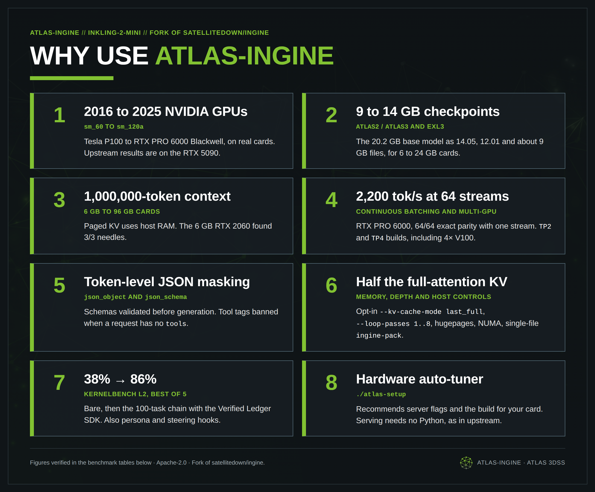

1. **Ten years of NVIDIA GPUs.** Measured on real cards from the Tesla P100 (2016) to the RTX PRO 6000 (2025), 6 GB to 96 GB. Model files of 20, 14, 12 and 9 GB, and `./atlas-setup` picks the build and flags for your card: [measured performance](#measured-performance-16k-64k--262k-context-across-6-nvidia-generations), [checkpoints](#checkpoints-direct-hugging-face-links), [setup](#option-b-hardware-aware-auto-tuner--interactive-installer)
2. **A 1,000,000-token context on one card.** Held entirely on a 24 GB card (`29 tok/s` on an RTX 3090, `53 tok/s` on an RTX 4090), paged to host RAM on 6 GB cards with 3 of 3 needles found, and saved to disk and resumed bit-identical: [1M table](#1000000-token-context-6-gb-to-96-gb-silicon)
3. **Fast for one user and for many.** `220 tok/s` on an RTX 3090 on the same job where Project Maya ran `118`, `llama.cpp` with DSpark `104` and Kintsugi-12G `63`. On one Tesla V100, `100.4 tok/s` for a single request without drafting, `123.3` chat and `156.9` code with `--spec`, and `463 tok/s` across 64 requests (StrataEngine SQ-20 on the same card and prompts: `259`; with drafting for one request, `59.2` against `45.1`). `2,200 tok/s` across 64 streams and `460.6` chat, `586.1` code for one request on an RTX PRO 6000 (upstream `satellitedown/ingine` on an RTX 5090: `487` chat, ahead of ours, and `554` code): [engine comparison](#measured-performance-16k-64k--262k-context-across-6-nvidia-generations), [Tesla V100](#tesla-v100-sm_70-matched-test-load-multi-gpu-and-other-engines-published-figures)
4. **Built for agents that have to be right (Verified Ledger + Neuron Lens).** Token-level JSON Schema output, native vision input, live `/v1/probe/*` Neuron Lens MoE routing telemetry, and the Host-Enforced Verified Ledger SDK — which raised KernelBench Level 2 from `38%` to `86%`, raised browser-verified web tasks from `68` to `117` of 128 with unchanged weights, and held **`0/40` (`0.0%`)** committed breaches under live Pliny-style adversarial red-teaming where a system-prompt constitution alone breached `22/40` (`55.0%`, `10/10` benign utility): [API](#openai-compatible-api), [evaluations](#kernelbench-level-2-benchmarks-100-tasks-continual-learning--verified-ledger), [ledger](#building-your-own-verified-ledger), [live Pliny + Neuron Lens proof](modules/zero_gradient_omni_modal_grafting/HOST_ENFORCED_ALIGNMENT.md)
5. **Omni by Atlas — Zero-Gradient Omni-Modal Grafting (not just native vision).** Closed-form FP64-fitted Plato's Keys (`22.5–271 MiB` FP16 safetensors, `0` gradient steps, `0` trunk weight edits) graft **image diffusion** (`MiniMax-H3`, `FLUX.2-dev` `99.65%` replacing `44.7 GiB` Mistral-24B, `Z-Image` `98.88%/101.19%`, `FLUX.2-klein-4B/9B`, `Qwen-Image-2.1`, `p_image_oss`, `moss_image`), **native video+audio** (`MiniMax-H3 FL2VA/Ref2VA`, `0` extra bytes, measured on `30` distinct GPUs across 6 CUDA generations and `16` distinct real AV GPUs down to `12 GB` `RTX 5070` @ `9.33 GiB` peak and `5.72 s` img / `93.34 s` AV on `RTX 5090`), **symbolic music** (`YuE2-3B`, `36 MiB`, Flagship `88.75 s` Anthem v5 `K:Bb 3/4` Verified Ledger Music Gate PASS), and **prosodic voice** (`Qwen3-TTS`) onto frozen local trunks: [Paper v0.9 (Markdown)](modules/zero_gradient_omni_modal_grafting/PAPER.md) / [**LaTeX PDF**](modules/zero_gradient_omni_modal_grafting/PAPER.pdf) ([`.tex`](modules/zero_gradient_omni_modal_grafting/PAPER.tex)), [Shot-by-Shot Walkthrough](modules/zero_gradient_omni_modal_grafting/TUTORIAL.md), [22 Side-by-Side Comparisons](modules/zero_gradient_omni_modal_grafting/COMPARISONS.md), [Omni by Atlas on Hugging Face](https://huggingface.co/collections/Atlas3D/omni-by-atlas-6b09daccd0f65e23233163b3)
6. **Zero-Chrome Agentic UX (`Alpha` Suite — Blender, Godot, DragonFruit, Neuron Lens).** Full-bleed viewport + single floating Omni prompt/voice bar at rest (`0` out-of-mask chrome diff pixels in automated `zero_chrome_test`), instant reversible `Ctrl+F10` Power User toggle, host-enforced Verified Ledger checkpoints, and SHA-256 cross-app asset bridges across **Blender by Atlas (`Alpha`)**, **Godot by Atlas (`Alpha`)**, **DragonFruit by Atlas (`Alpha`)**, and **Neuron Lens × Verified Ledger (`Alpha`)**: [Zero-Chrome Agentic UX section](#zero-chrome-agentic-ux-alpha-suite), [Full Alpha UX Guide](docs/ZERO_CHROME_AGENTIC_UX.md)

## Checkpoints (Direct Hugging Face Links)

Browse checkpoints and Plato's Key packs by collection on Hugging Face:
- **Omni by Atlas Collection (Plato's Keys + Elastic Checkpoints):** [Atlas3D/omni-by-atlas](https://huggingface.co/collections/Atlas3D/omni-by-atlas-6b09daccd0f65e23233163b3)
- **Inkling-2-Mini Collection (6 GB to 96 GB):** [Atlas3D/inkling-2-mini-atlas-3d-6-gb-to-96-gb](https://huggingface.co/collections/Atlas3D/inkling-2-mini-atlas-3d-6-gb-to-96-gb-6b054702b9c8001bb2b06675)
- **Qwen3.8-27B Collection (12 GB to 24 GB, Apache-2.0):** [Atlas3D/qwen38-27b-atlas-3d-12-gb-to-24-gb](https://huggingface.co/collections/Atlas3D/qwen38-27b-atlas-3d-12-gb-to-24-gb-6b08ed57e702a2206df7dac7)
- **Qwen3.8-Flash-Next (177B) Collection (Qwen Community License 1.0):** [Atlas3D/qwen38-flash-next-177b-atlas-3d](https://huggingface.co/collections/Atlas3D/qwen38-flash-next-177b-atlas-3d-6b08ed57d62742b964d01f70)

### Inkling-2-Mini

| Checkpoint | Format | Target VRAM / Use | Direct Link |
|---|---|---|---|
| **Native `NVFP4+MXFP8`** | Base safetensors (`20.2 GB`) | `24 GB+` cards (`64K–262K`), `32–96 GB` (`1M` ctx) | [thinkingmachines/Inkling-2-Mini](https://huggingface.co/thinkingmachines/Inkling-2-Mini) |
| **Elastic `atlas-12g`** | Native `ATLAS2`/`ATLAS3` (`14.05 GB`) | `16 GB–24 GB` cards (`64K–128K` ctx) | [Atlas3D/Inkling-2-Mini-atlas-12g-ingine](https://huggingface.co/Atlas3D/Inkling-2-Mini-atlas-12g-ingine) |
| **Elastic `atlas-10g`** | Native `ATLAS2`/`ATLAS3` (`12.01 GB`) | `12 GB–16 GB` cards (`P100`/`T4`/`3090`) | [Atlas3D/Inkling-2-Mini-atlas-10g-ingine](https://huggingface.co/Atlas3D/Inkling-2-Mini-atlas-10g-ingine) |
| **EXL3 9 GB (FP8-prebaked)** | Native EXL3 + FP8 (`~9 GB`) | **`6 GB–24 GB` 1M-context** (`--kv-q4`, `0.000000` KL vs `--dense-fp8`) | [Atlas3D/Inkling-2-Mini-atlas-exl3-9g-fp8-ingine](https://huggingface.co/Atlas3D/Inkling-2-Mini-atlas-exl3-9g-fp8-ingine) |
| **EXL3 9 GB (BF16 dense)** | Native EXL3 + BF16 (`~9 GB`) | `6 GB–24 GB` cards (unquantized dense projections) | [Atlas3D/Inkling-2-Mini-atlas-exl3-9g-ingine](https://huggingface.co/Atlas3D/Inkling-2-Mini-atlas-exl3-9g-ingine) |
| **Atlas Elastic GGUF** | GGUF (`llama.cpp` / `atlas-engine`) | `llama.cpp` / [Atlas3DSS/atlas-engine](https://github.com/Atlas3DSS/atlas-engine) serving | [Atlas3D/Inkling-2-Mini-Atlas-Elastic-GGUF](https://huggingface.co/Atlas3D/Inkling-2-Mini-Atlas-Elastic-GGUF) |

### Qwen3.8-27B (Text-Only Elastic Packs, Apache-2.0)

Collection: [**Qwen3.8-27B - Atlas 3D (12 GB to 24 GB)**](https://huggingface.co/collections/Atlas3D/qwen38-27b-atlas-3d-12-gb-to-24-gb-6b08ed57e702a2206df7dac7). All three Elastic packs carry compiled-in SHA-256 pins (`PinnedVerified` in `native/src/backends/qwen38/qwen38_manifest.cpp`).

| Checkpoint | Format / Size | Peak VRAM @ 4K & Parity vs `NVFP4` Base | Direct Link |
|---|---|---|---|
| **Baseline `NVFP4`** | Mixed `FP8`/`NVFP4` (`18.77 GiB` weights) | `19.42 GiB` peak VRAM (`24 GB+` cards) | [nvidia/Qwen3.8-27B-NVFP4](https://huggingface.co/nvidia/Qwen3.8-27B-NVFP4) |
| **Elastic `atlas-17g` (v2)** | `NVFP4`/`ATLAS3` MLP, `FP8` Attn (`16.45 GB` / `15.33 GiB`, 4 sh) | `15.97 GiB` (`-3.45 GiB`), V100 SM70 KLD `0.1640`, cos `0.9731`, top-1 `0.750` | [Atlas3D/Qwen3.8-27B-atlas-17g-ingine](https://huggingface.co/Atlas3D/Qwen3.8-27B-atlas-17g-ingine) |
| **Elastic `atlas-14g`** | `NVFP4`/`ATLAS3` MLP, `FP8`/`NVFP4` Attn (`13.69 GB` / `12.75 GiB`, 4 sh) | `12.64 GiB` (`-6.02 GiB` weights), PRO 6000 SM120a KLD `0.1323`, cos `0.9724`, top-1 `0.8125` | [Atlas3D/Qwen3.8-27B-atlas-14g-ingine](https://huggingface.co/Atlas3D/Qwen3.8-27B-atlas-14g-ingine) |
| **Elastic `atlas-11g` (v3)** | Pure `ATLAS3`+`NVFP4` (zero `ATLAS2`, `12.18 GB` / `11.35 GiB`, 3 sh) | `12.00 GiB` (`-7.42 GiB`), V100 SM70 KLD `0.1415`, cos `0.9553`, top-1 `0.781` | [Atlas3D/Qwen3.8-27B-atlas-11g-ingine](https://huggingface.co/Atlas3D/Qwen3.8-27B-atlas-11g-ingine) |

### Qwen3.8-Flash-Next 177B (`qwen4exp`, Qwen Community License 1.0)

Collection: [**Qwen3.8-Flash-Next (177B) - Atlas 3D**](https://huggingface.co/collections/Atlas3D/qwen38-flash-next-177b-atlas-3d-6b08ed57d62742b964d01f70). Derived from `unsloth/Qwen3.8-Flash-Next-GGUF` `UD-Q6_K_XL` (text-only, single-GPU `INGINE_TP_SIZE=1`); host-only Per-Layer Embeddings (`320,001,536 x 160` in `NVFP4`, `28.80 GB`, 81 shards) remain in host RAM/mmap (`0 GB VRAM`).

| Checkpoint | Format / Footprint | Verified V100 SM70 `TieredExpertCache` (`25.28 GiB` cache) vs FP32 `Q6_K_XL` Oracle | Direct Link |
|---|---|---|---|
| **Elastic `atlas-70g`** | All-`NVFP4` MoE, `FP8` Dense (`73.06 GB` GPU / 49 sh + `28.80 GB` PLE / 81 sh) | `cos=0.9757`, `top1=true`, warm 8-tok greedy `6.29 tok/s`; sized for `AllResident` on 96 GB GPUs | [Atlas3D/Qwen3.8-Flash-Next-atlas-70g-ingine](https://huggingface.co/Atlas3D/Qwen3.8-Flash-Next-atlas-70g-ingine) |
| **Elastic `atlas-56g`** | Boundary `NVFP4` + Core `ATLAS3` MoE, `FP8` Dense (`59.22 GB` GPU / 49 sh + `28.80 GB` PLE / 81 sh) | `cos=0.9722`, `top1=true`, warm 8-tok greedy `6.12 tok/s`, live `ingine-serve` HTTP smoke PASS; sized for `AllResident` on 80–96 GB GPUs | [Atlas3D/Qwen3.8-Flash-Next-atlas-56g-ingine](https://huggingface.co/Atlas3D/Qwen3.8-Flash-Next-atlas-56g-ingine) |

**Scope & disclosure (177B):** Real 177B SM120a `AllResident` speed is unmeasured in this release (all real-177B GPU evaluations ran on Tesla V100 SM70 `TieredExpertCache`; SM120a coverage on `qwen4exp` is synthetic `qwen4exp_cuda_ops` and `qwen4exp_gpu_e2e` across `AllResident` and `TieredExpertCache`). `atlas-42g` is held back from publication pending `ffn_down_exps=atlas3` or Hessian/DFly-SFT calibration.

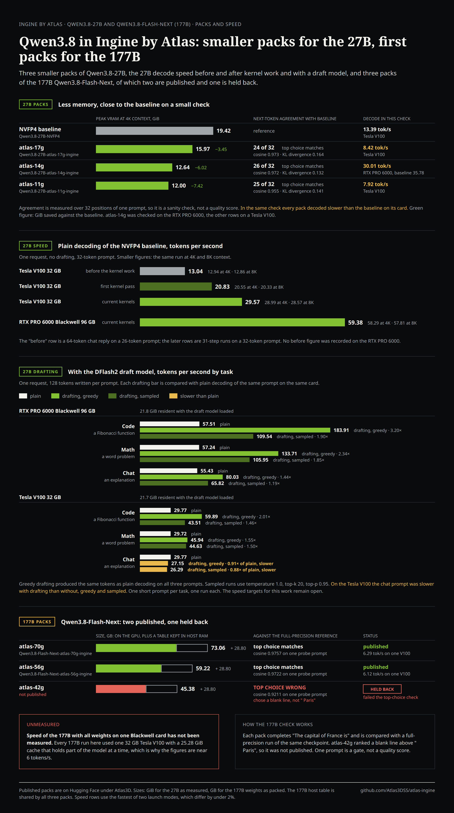

In the 32-position agreement check, all three Qwen3.8-27B Elastic packs decoded slower than the `NVFP4` baseline on the same card. The plain-decode and DFlash2 drafting speeds in the figure were measured on development branches that are not yet merged into `main`. With drafting, the chat prompt on the Tesla V100 ran slower than plain decoding (`0.91x` greedy, `0.88x` sampled).

## Measured performance (16K, 64K & 262K context across 6 NVIDIA generations)

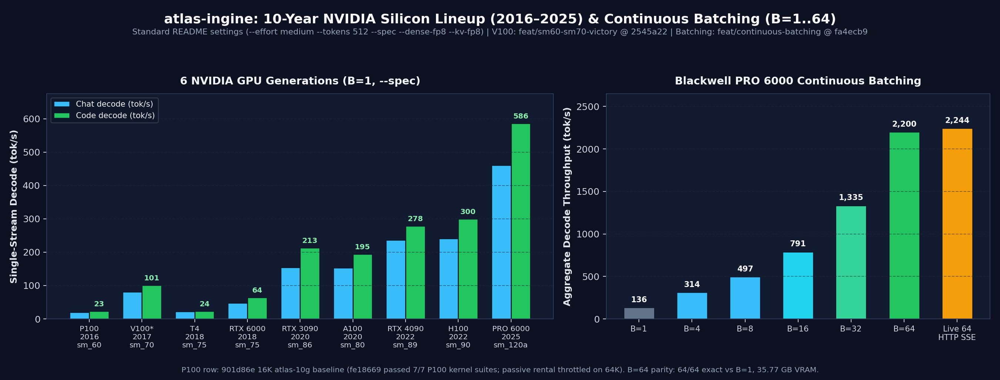

Inkling-2-Mini has been benchmarked on real cards across **six NVIDIA GPU generations (2016 Pascal through 2025 Blackwell)**: **Tesla P100 (`sm_60`), Tesla V100 (`sm_70`), Tesla T4 & Quadro RTX 6000 (`sm_75`), RTX 3090 & A100 (`sm_86`/`sm_80`), RTX 4090 & H100 (`sm_89`/`sm_90`), and RTX PRO 6000 Blackwell (`sm_120a`)**, with upstream results on the RTX 5090.

On the RTX 3090, all 24 BF16 dense output hashes matched between the pre-port build and the FP16 port. Blackwell and V100 runs passed `kernels_bitlock` (`48/48` on Blackwell) and full-model parity; P100 (`sm_60`) and Turing (`sm_75`) passed kernel tests and real-card speed benchmarks (full-model parity ctest was not run on the cloud P100/T4/RTX 6000/A100/H100 instances).

Unless noted, 64K rows use `ingine-bench --max-ctx 65536 --dense-fp8 --kv-fp8 --spec --spec-threshold 0.8 --effort medium --tokens 512 --runs 2 --long-prompt 64000` on commit `901d86e` (runtime opt-in SMEM dispatch for `<=64 KiB` Turing and `<=48 KiB` Pascal). 16K rows use `--max-ctx 16384 --long-prompt 16000`. The V100 262K row uses `--effort low --tokens 64 --runs 1` with no long prompt; A100 and H100 262K rows use `--max-ctx 262144 --tokens 512 --runs 2`. The two V100 `main` rows after the Volta decode change (`66ef369` / `56493c3`) are `ingine-bench` on its short built-in prompts with one slot and three runs, not the 64K-prompt setting, so they are not comparable with the other rows.

| GPU | Arch | Year | Checkpoint / Mode | VRAM | Chat decode | Code decode | Prefill |
|---|---|---:|---|---:|---:|---:|---:|
| Tesla P100-PCIE 16 GB | `sm_60` (FP16) | 2016 | [Elastic `atlas-10g`](https://huggingface.co/Atlas3D/Inkling-2-Mini-atlas-10g-ingine) (16K, `--spec`) | `13.33 GB` | `20.2 tok/s` | `22.9 tok/s` | `282 tok/s` (16K) |
| Tesla P100-PCIE 16 GB | `sm_60` (FP16) | 2016 | [Elastic `atlas-10g`](https://huggingface.co/Atlas3D/Inkling-2-Mini-atlas-10g-ingine) (64K, `--spec`) | `14.34 GB` | `11.9 tok/s` | `10.2 tok/s` | `72.8 tok/s` (64K) |
| Tesla P100-PCIE 16 GB | `sm_60` (FP16) | 2016 | [Elastic `atlas-10g`](https://huggingface.co/Atlas3D/Inkling-2-Mini-atlas-10g-ingine) (64K, no-spec) | `13.17 GB` | `7.9 tok/s` | `7.5 tok/s` | `70.1 tok/s` (64K) |
| Tesla V100-PCIE 32 GB | `sm_70` (FP16) | 2017 | [Native `NVFP4+MXFP8`](https://huggingface.co/thinkingmachines/Inkling-2-Mini) (64K, `901d86e`) | `21.82 GB` | `59.8 tok/s` | `72.2 tok/s` | `717.7 tok/s` (64K) |
| Tesla V100-PCIE 32 GB | `sm_70` (FP16) | 2017 | [Native `NVFP4+MXFP8`](https://huggingface.co/thinkingmachines/Inkling-2-Mini) (64K, `feat/sm60-sm70-victory @ 2545a22`) | `21.82 GB` | **`81.0 tok/s`** | **`100.7 tok/s`** | **`2,052 tok/s`** (64K) |
| Tesla V100-PCIE 32 GB | `sm_70` (FP16) | 2017 | [Native `NVFP4+MXFP8`](https://huggingface.co/thinkingmachines/Inkling-2-Mini) (short prompts, `--spec`, `main @ 56493c3`) | `21.57 GB` | `123.3 tok/s` | `156.9 tok/s` | — |
| Tesla V100-PCIE 32 GB | `sm_70` (FP16) | 2017 | [Native `NVFP4+MXFP8`](https://huggingface.co/thinkingmachines/Inkling-2-Mini) (short prompts, no-spec, `66ef369`) | `20.41 GB` | `100.4 tok/s` | `100.4 tok/s` | — |
| Tesla V100-PCIE 32 GB | `sm_70` (FP16) | 2017 | [Native `NVFP4+MXFP8`](https://huggingface.co/thinkingmachines/Inkling-2-Mini) (262K) | `25.04 GB` | `46.0 tok/s` | `54.9 tok/s` | — |
| Tesla T4 16 GB | `sm_75` (FP16) | 2018 | [Elastic `atlas-10g`](https://huggingface.co/Atlas3D/Inkling-2-Mini-atlas-10g-ingine) (16K, `--spec`) | `13.33 GB` | `23.5 tok/s` | `25.2 tok/s` | `303 tok/s` (16K) |
| Tesla T4 16 GB | `sm_75` (FP16) | 2018 | [Elastic `atlas-10g`](https://huggingface.co/Atlas3D/Inkling-2-Mini-atlas-10g-ingine) (64K, `--spec`) | `14.34 GB` | `22.1 tok/s` | `23.9 tok/s` | `237 tok/s` (64K) |
| Quadro RTX 6000 24 GB | `sm_75` (FP16) | 2018 | [Native `NVFP4+MXFP8`](https://huggingface.co/thinkingmachines/Inkling-2-Mini) (64K) | `21.83 GB` | `47.9 tok/s` | `64.0 tok/s` | `431 tok/s` (64K) |
| RTX 3090 24 GB | `sm_86` (BF16) | 2020 | [Native `NVFP4+MXFP8`](https://huggingface.co/thinkingmachines/Inkling-2-Mini) (64K) | `21.82 GB` | `154.9 tok/s` | `213.2 tok/s` | `2,980 tok/s` (64K) |
| RTX 3090 24 GB | `sm_86` (BF16) | 2020 | [Elastic `atlas-12g`](https://huggingface.co/Atlas3D/Inkling-2-Mini-atlas-12g-ingine) (64K) | `16.37 GB` | `132.4 tok/s` | `161.2 tok/s` | `2,970 tok/s` (64K) |
| RTX 3090 24 GB | `sm_86` (BF16) | 2020 | [Elastic `atlas-10g`](https://huggingface.co/Atlas3D/Inkling-2-Mini-atlas-10g-ingine) (64K) | `14.33 GB` | `145.6 tok/s` | `196.1 tok/s` | `3,012 tok/s` (64K) |
| A100 80 GB | `sm_80` (BF16) | 2020 | [Native `NVFP4+MXFP8`](https://huggingface.co/thinkingmachines/Inkling-2-Mini) (64K) | `21.82 GB` | `153.0 tok/s` | `194.6 tok/s` | `5,164 tok/s` (64K) |
| A100 80 GB | `sm_80` (BF16) | 2020 | [Native `NVFP4+MXFP8`](https://huggingface.co/thinkingmachines/Inkling-2-Mini) (262K) | `25.04 GB` | `152.8 tok/s` | `194.2 tok/s` | — |
| RTX 4090 24 GB | `sm_89` (BF16) | 2022 | [Elastic `atlas-12g`](https://huggingface.co/Atlas3D/Inkling-2-Mini-atlas-12g-ingine) (64K) | `16.36 GB` | `236.7 tok/s` | `278.3 tok/s` | `7,031 tok/s` (64K) |
| H100 80 GB | `sm_90` (BF16) | 2022 | [Native `NVFP4+MXFP8`](https://huggingface.co/thinkingmachines/Inkling-2-Mini) (64K) | `21.79 GB` | `240.8 tok/s` | `300.3 tok/s` | `7,004 tok/s` (64K) |
| H100 80 GB | `sm_90` (BF16) | 2022 | [Native `NVFP4+MXFP8`](https://huggingface.co/thinkingmachines/Inkling-2-Mini) (262K) | `25.01 GB` | `241.8 tok/s` | `300.8 tok/s` | — |
| RTX PRO 6000 96 GB | `sm_120a` (BF16) | 2025 | [Native `NVFP4+MXFP8`](https://huggingface.co/thinkingmachines/Inkling-2-Mini) (B=1, `feat/continuous-batching @ fa4ecb9`) | `20.53 GB` | **`460.6 tok/s`** | **`586.1 tok/s`** | — |
| RTX PRO 6000 96 GB | `sm_120a` (BF16) | 2025 | [Elastic `atlas-12g`](https://huggingface.co/Atlas3D/Inkling-2-Mini-atlas-12g-ingine) (64K) | `16.26 GB` | `411.0 tok/s` | `519.9 tok/s` | `11,728 tok/s` (64K) |
| RTX PRO 6000 96 GB | `sm_120a` (BF16) | 2025 | [Elastic `atlas-10g`](https://huggingface.co/Atlas3D/Inkling-2-Mini-atlas-10g-ingine) (64K) | `14.18 GB` | `410.7 tok/s` | `554.3 tok/s` | `11,806 tok/s` (64K) |

External baseline reference points (different hardware, quants, or settings — reported individually):


- **Kern, SGLang, and vLLM** (`@SuJinYan123`, Nov 22, 2026, single RTX PRO 5000 72 GB `SM120`, ~`1,344 GB/s` vs PRO 6000 `1,792 GB/s` [`1.33×` BW], DSpark `k=7`, `max_seqs=8`): `c=1` HumanEval `256` / `~220` / `~152 tok/s`; `c=8` 512-OSL `693` / `~550` / `~478 tok/s` (`742` SpecBench `c=8`); cold prefill `15.3k` (4K) / `15.0k` (32K) / `10.5k` (128K).
- **Upstream `satellitedown/ingine`** (RTX 5090 32 GB, native `NVFP4+MXFP8`, 262K ctx, `--spec`, default temp 1): `487 tok/s` chat, `554 tok/s` code, `9,600 tok/s` 64K prefill (`24.4 GiB` VRAM; full table below).
- **Kintsugi (`ExLlamaV3` / 12 GB community serving)** (reported reference on Blackwell): `4,895 tok/s` 64K prefill.
- **StrataEngine** (Tesla P100 16 GB, thinking off, prompt length unstated): `35.0 tok/s` (not directly comparable to `--effort medium` thinking-on rows).
- **Project Maya** (AMD ROCm/HIP & multi-GPU Inkling-2-Mini serving) and **`llama.cpp` / `Atlas3DSS/atlas-engine`** (GGUF serving; see [Atlas3DSS/atlas-engine](https://github.com/Atlas3DSS/atlas-engine)).
- **Like-for-like 6-engine RTX 3090 24 GB bare multi-turn Blender authoring showdown** (identical prompts, 6 sequences / 24 shots, no Verified Ledger, Blender 4.5.14 LTS verifier): `atlas-ingine` Native **`220.15 tok/s`** (`21.23 GiB`, `25.0%` bare pass / `43.93%` compliance — **`1.86×`** Project Maya `118.26 tok/s`, **`2.11×`** `llama.cpp v7+DSpark` `104.16 tok/s`, **`3.48×`** `Kintsugi-12G` `63.22 tok/s`), while `atlas-12g` ran **`163.73 tok/s`** (**`2.59×`** `Kintsugi-12G` with vision included; upstream `satellitedown/ingine` fails startup on `sm_86`). Adding Verified Ledger lifts `atlas-ingine` Native from `25%` bare to `100%` (`28/28` shots).

### Tesla V100 (`sm_70`): matched test, load, multi-GPU, and other engines' published figures

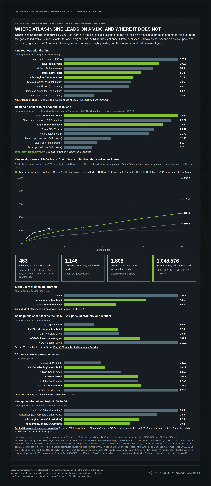

Measured 2026-11-25 on Tesla V100-PCIE-32GB cards with [knapcio/speedbench](https://github.com/knapcio/speedbench) at `e95a638` (native `NVFP4+MXFP8`, `--dense-fp8 --kv-fp8`, built-in DSpark for single-stream speedbench and cold prefill, no drafting for the concurrent prose runs). These runs used a pre-merge build of the Volta prefill/batch kernels and have not been repeated on current `main`.

**Matched test against StrataEngine** (2026-11-26; the same Tesla V100-PCIE-32GB, speedbench-v1 prose prompts over HTTP, 256 output tokens, thinking off, two rounds, 0 failed requests in every arm). StrataEngine is release `v0.2.22` (engine `0.1.69`) with its SQ-20 pack from the [card at `04996a1e`](https://huggingface.co/strata-engine/Inkling-2-Mini-Strata/blob/04996a1e2c45009b6a04f2af126cb6bdb2ba3587/README.md), `--parallel 64 --kv fp8`. atlas-ingine is the same pre-merge build as above (native `NVFP4+MXFP8`), not `main` after the Volta decode change.

| Arm | `c=1` | `c=8` | `c=16` | `c=64` | First token at `c=64`, median / p95 | Cold 10,131-token prompt |
|---|---:|---:|---:|---:|---:|---:|
| atlas-ingine, no drafting, `--max-batch 64` | `44.65` | `142.36` | `204.18` | `463.37` | `6.73 s` / `6.77 s` | — |
| atlas-ingine, `--spec`, one slot | `59.17` | — | — | — | — | `2,648 tok/s` (`3.83 s`) |
| StrataEngine SQ-20, `--draft off` | `55.62` | `138.14` | `170.34` | `258.18` | `1.30 s` / `16.85 s` | `1,259 tok/s` (`8.05 s`) |
| StrataEngine SQ-20, drafting on | `45.09` | `138.93` | `169.34` | `258.59` | `1.16 s` / `16.72 s` | `651 tok/s` (`15.57 s`) |

Throughput is aggregate `tok/s`. atlas-ingine is ahead at 16 and 64 requests (`1.20×` and `1.79×`) and on the cold prompt (`2.1×` with Strata's drafting off); the two are level at 8. StrataEngine is ahead for one request without drafting (`55.62` against `44.65`) and starts most replies sooner at 64 (median first token `1.2–1.3 s` against `6.7 s`), while its slowest requests wait longer (p95 `16.7 s` against `6.8 s`). The cold-prompt figure is one request per arm, timed end to end including 32 output tokens. StrataEngine's SQ-10 pack with drafting failed 3 of 3 starts on this card (`CUDA error 9`), so it has no row.

| Setup | speedbench full, `c=1` (geomean) | Prose, 16 concurrent | Highest load measured (prose, 0 failed) | Cold prefill, 8K |
|---|---:|---:|---:|---:|
| 1× V100 (`--max-batch 64` for concurrent prose) | `72.8 tok/s` | `204.2 tok/s` | `463.4 tok/s` at `c=64` | `2,900 tok/s` |
| 4× V100, `TP4+EP4` (`--max-batch 128` for concurrent prose) | `102.2 tok/s` | `369.9 tok/s` | `1,146.2 tok/s` at `c=128` | `3,854 tok/s` |
| 4× V100, four independent replicas | — | `387.9 tok/s` | `1,808.1 tok/s` at `c=256` | — |

On one card, 64 concurrent high-effort requests of 4,096 tokens exceeded the KV pool: 49 of 64 failed. The `c=128` and `c=256` rows are four-card capacity figures on this prose workload, not comparisons with another engine.

Published V100 and P100 figures from other projects, on their hardware, quants, and prompts (not re-measured here):

- **[ashalliants/ninfer-3090](https://github.com/ashalliants/ninfer-3090)** ([`docs/tesla-v100.md` at `8ea67ce`](https://github.com/ashalliants/ninfer-3090/blob/8ea67ce616c481592d3016291043ed5143c9065b/docs/tesla-v100.md); Tesla V100 32 GB at 200 W, byte-exact repack of Unsloth `UD-Q8_K_XL`, INT8 KV): `78.0 tok/s` plain and `94.3 tok/s` with DSpark (12-chat average, 262,144 max context with vision), `198.2 tok/s` aggregate at 8 concurrent (the highest it publishes), prefill `2,727 tok/s` at 8K with `--prefill-chunk 8192` at 131,072 max context (`2,170` at its default chunk). **NInfer's published figures are higher at 8 users:** ours is `142.2 tok/s` at `c=8` on the pre-merge build. For one request, `main` after the Volta decode change measures `100.4 tok/s` plain and `123.3 tok/s` chat with `--spec` on `ingine-bench`'s short prompts (the earlier build: `81.0` chat at 64K, `44.7` plain over HTTP); prompts and context differ from NInfer's, so this is not a matched result. atlas-ingine's 8K prefill is `2,900 tok/s` against `2,727`; NInfer publishes no four-card or 1,048,576-token figures.
- **[StrataEngine Hugging Face card at `04996a1e`](https://huggingface.co/strata-engine/Inkling-2-Mini-Strata/blob/04996a1e2c45009b6a04f2af126cb6bdb2ba3587/README.md)** (Tesla V100 32 GB, its SQ-20 and SQ-10 packs, thinking off, draft decoding on for single requests; prompts, output length, and context not stated): `70.5 tok/s` for one request, `2,287 tok/s` prefill on SQ-20, and **`990.1 tok/s` (SQ-20) and `676.0 tok/s` (SQ-10) across 64 simultaneous requests**. Our `463.4 tok/s` at `c=64` is on a different workload (speedbench prose, native `NVFP4`, no drafting). On that workload the same SQ-20 pack measured `258.6 tok/s` at `c=64` in the matched test above; we did not reproduce its published workload.
- **[Lapilli Inkling port](https://github.com/chris83-dev/lapilli-v100/blob/f9b7dd093a9ff018bc68f177f81a1d27d3ffec91/docs/community/inkling2-mini.md)** (`f9b7dd0`; V100 PCIe 32 GB, official NVFP4 experts, no drafting): `69 tok/s` decode, `850 tok/s` on a short prompt.
- **[`llama.cpp`, realugbun `inkling2-speed` fork README](https://github.com/realugbun/llama.cpp/blob/2eb2530ec4da/README.md)** (`2eb2530`; V100 32 GB, Unsloth `UD-Q4_K_XL`): `50.7 tok/s` and `1,185 tok/s` (`pp512`) on the fork, `32.0` and `725` on mainline as measured there.
- **[knapcio DGX Spark recipe](https://github.com/knapcio/Inkling-2-Mini-4x-DGX-Spark-TP4)** (`c0f5f1c`; GB10 `sm_121`, SGLang, DFlash2 draft model, BF16 KV; same speedbench): speedbench full `40.6` (1 Spark, stock), `73.34` (1 Spark, tuned), `152.97` (4 Sparks, tuned); prose at 16 concurrent `186.2` / `288.3` / `572.6 tok/s`. One V100 matches a tuned Spark at `c=1`; four tuned Sparks are ahead of four V100s at equal load.
- **[iammrduncan/tensorless](https://github.com/iammrduncan/tensorless)** (`11df9a5`; Tesla P100 16 GB, 12.8 GB quant on a `llama.cpp`-based engine, draft recipe): `28.5 tok/s` decode, `240 tok/s` prefill at about 4K, against the P100 `atlas-10g` 16K row above (`20.2` / `22.9 tok/s`, `282 tok/s`). The [StrataEngine card](https://huggingface.co/strata-engine/Inkling-2-Mini-Strata/blob/04996a1e2c45009b6a04f2af126cb6bdb2ba3587/README.md) lists a Tesla P100 16 GB on its SQ-10 pack at `35.0 tok/s` decode, `223 tok/s` prefill, and `136.9 tok/s` across 32 requests (thinking off).
- No V100 figures were found for Project Maya or upstream `satellitedown/ingine`.

## Physical GPU measurements with the 9 GB checkpoint

The additional sweep measured 25 physical GPU models using the [EXL3 9 GB FP8 pack](https://huggingface.co/Atlas3D/Inkling-2-Mini-atlas-exl3-9g-fp8-ingine/tree/6a118e83ac566f4b908f777e27a4bb9afc35a12e).
All 25 produced decode measurements at 16K KV allocation; 23 did so at 64K allocation.
These are `ingine-bench` built-in short-prompt decode rates, in tokens/s, with separate synthetic prefill measurements.
The allocation is 16,384 or 65,536 tokens; the synthetic prefill is 16,000 or 64,000 tokens.
GPU names and VRAM below come from physical `nvidia-smi`, not provider offer descriptions.
The 6 GB cards use `--atlas-6g` with `--spec` omitted; every row identifies its 16K drafting mode.

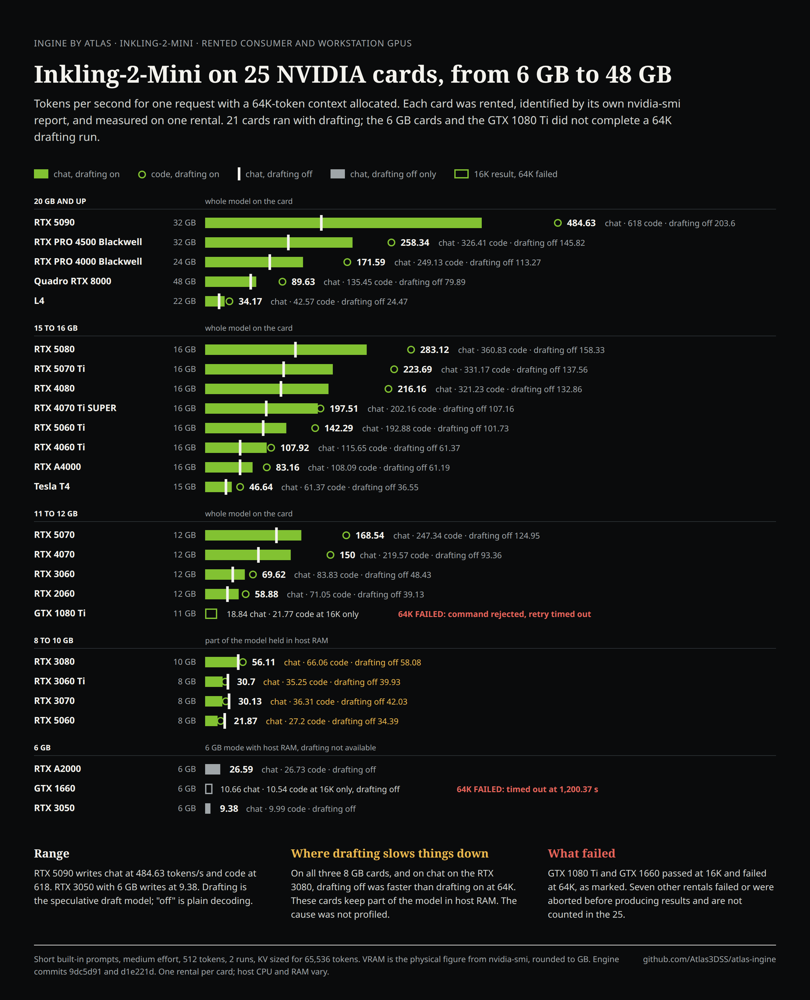

| Physical GPU | nvidia-smi VRAM (MiB) | 16K allocation: chat / code | 64K allocation: chat / code, --spec | 64K allocation: chat / code, drafting off |
| --- | --- | --- | --- | --- |
| NVIDIA GeForce RTX 5090 | 32,607 | 484.48 / 617.78 (`--spec`) | 484.63 / 618.00 | 203.60 / 203.60 |
| NVIDIA GeForce RTX 5080 | 16,303 | 283.54 / 361.68 (`--spec`) | 283.12 / 360.83 | 158.33 / 158.34 |
| NVIDIA RTX PRO 4500 Blackwell | 32,623 | 259.44 / 327.70 (`--spec`) | 258.34 / 326.41 | 145.82 / 145.40 |
| NVIDIA GeForce RTX 5070 Ti | 16,303 | 226.02 / 331.63 (`--spec`) | 223.69 / 331.17 | 137.56 / 138.47 |
| NVIDIA GeForce RTX 4080 | 16,376 | 216.22 / 321.43 (`--spec`) | 216.16 / 321.23 | 132.86 / 132.97 |
| NVIDIA GeForce RTX 4070 Ti SUPER | 16,376 | 197.61 / 202.26 (`--spec`) | 197.51 / 202.16 | 107.16 / 107.19 |
| NVIDIA RTX PRO 4000 Blackwell | 24,467 | 173.02 / 246.27 (`--spec`) | 171.59 / 249.13 | 113.27 / 112.31 |
| NVIDIA GeForce RTX 5070 | 12,227 | 168.72 / 247.84 (`--spec`) | 168.54 / 247.34 | 124.95 / 124.95 |
| NVIDIA GeForce RTX 4070 | 12,282 | 150.51 / 220.24 (`--spec`) | 150.00 / 219.57 | 93.36 / 93.48 |
| NVIDIA GeForce RTX 5060 Ti | 16,311 | 142.42 / 192.83 (`--spec`) | 142.29 / 192.88 | 101.73 / 101.71 |
| NVIDIA GeForce RTX 4060 Ti | 16,380 | 108.00 / 115.77 (`--spec`) | 107.92 / 115.65 | 61.37 / 61.38 |
| Quadro RTX 8000 | 49,152 | 89.51 / 135.36 (`--spec`) | 89.63 / 135.45 | 79.89 / 79.88 |
| NVIDIA RTX A4000 | 16,376 | 84.01 / 109.51 (`--spec`) | 83.16 / 108.09 | 61.19 / 60.46 |
| NVIDIA GeForce RTX 3060 | 12,288 | 69.69 / 83.83 (`--spec`) | 69.62 / 83.83 | 48.43 / 48.23 |
| NVIDIA GeForce RTX 2060 | 12,288 | 59.23 / 71.34 (`--spec`) | 58.88 / 71.05 | 39.13 / 39.04 |
| NVIDIA GeForce RTX 3080 | 10,240 | 49.80 / 51.87 (`--spec`) | 56.11 / 66.06 | 58.08 / 57.93 |
| Tesla T4 | 15,360 | 47.38 / 62.22 (`--spec`) | 46.64 / 61.37 | 36.55 / 36.43 |
| NVIDIA GeForce RTX 3060 Ti | 8,192 | 36.75 / 41.84 (`--spec`) | 30.70 / 35.25 | 39.93 / 40.48 |
| NVIDIA GeForce RTX 3070 | 8,192 | 36.52 / 43.38 (`--spec`) | 30.13 / 36.31 | 42.03 / 42.43 |
| NVIDIA L4 | 23,034 | 35.29 / 43.60 (`--spec`) | 34.17 / 42.57 | 24.47 / 24.04 |
| NVIDIA GeForce RTX 5060 | 8,151 | 27.63 / 33.87 (`--spec`) | 21.87 / 27.20 | 34.39 / 34.84 |
| NVIDIA RTX A2000 | 6,138 | 28.40 / 28.14 (drafting off) | Drafting unsupported | 26.59 / 26.73 |
| NVIDIA GeForce GTX 1080 Ti | 11,264 | 18.84 / 21.77 (`--spec`) | Unavailable (command rejected) | Unavailable (command rejected) |
| NVIDIA GeForce GTX 1660 | 6,144 | 10.66 / 10.54 (drafting off) | Drafting unsupported | Timeout |
| NVIDIA GeForce RTX 3050 | 6,144 | 10.75 / 10.85 (drafting off) | Drafting unsupported | 9.38 / 9.99 |

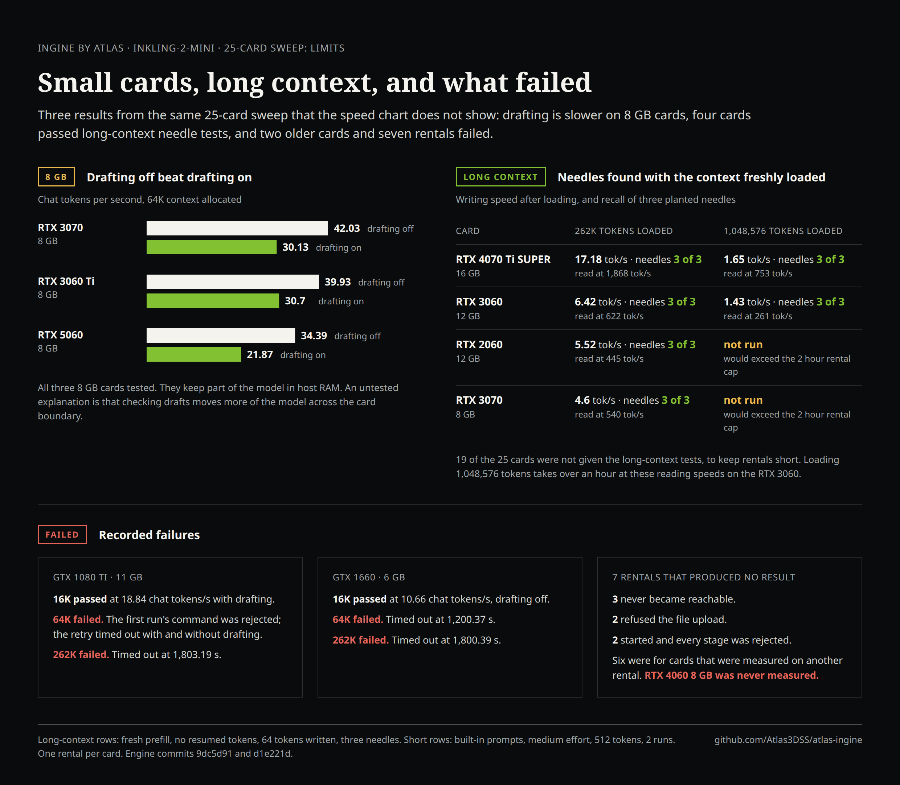

At 64K allocation, plain decoding beat drafting on all three measured 8 GB cards:
RTX 3070 (42.03 vs 30.13 chat tokens/s), RTX 3060 Ti (39.93 vs 30.70), and RTX 5060 (34.39 vs 21.87).
Additional expert transfers across the VRAM/PCIe boundary are an unmeasured explanation, not a profiled result.

The RTX 4070 Ti SUPER and RTX 3060 each passed a 1,048,576-token target with 1,048,480 fresh document tokens and 3/3 needles.
The RTX 2060 and RTX 3070 passed a 262,144-token target in a 1M allocation; their larger runs were deferred by the time cap.
Other policy-skipped runs are explicitly `one_m_skipped_by_policy`.
GTX 1080 Ti primary 64K commands were rejected, and sidecar retries timed out; GTX 1660's 64K plain run timed out.

See [full methodology, separate prefill rates, revisions, long-context outcomes, and failed bookings](docs/consumer_gpu_911_benchmarks.md).

## 1,000,000-Token Context (6 GB to 96 GB Silicon)


Using Q4_0 full-attention KV caching (`--kv-q4`), 3-tier paged KV (`VRAM -> pinned host RAM -> NVMe`), bulk-DMA prefetching, and our EXL3 9 GB checkpoint ([`Atlas3D/Inkling-2-Mini-atlas-exl3-9g-fp8-ingine`](https://huggingface.co/Atlas3D/Inkling-2-Mini-atlas-exl3-9g-fp8-ingine), `0.000000` KL bit-identical to runtime `--dense-fp8`), `atlas-ingine` serves **1,048,576-token (1M)** contexts from **physical 6 GB cards** up to **96 GB workstations** with **100% zero-shot Needle-in-a-Haystack recall** (10%, 50%, 90% depth, scored strictly on exact final answer tokens):

| GPU & Configuration | Branch / Commit | Peak VRAM | 1M Prefill | Decode @ 1M | Needle Recall | Notes |
|---|---|---:|---:|---:|---:|---|
| **RTX 2060 6 GB** (Physical 6 GB, 2019 Turing `sm_75`) | `feat/kvq4-elastic-9g @ 8b92ef5` | **`5,346 / 6,144 MiB`** (`0.402 GiB` free) | `40.5 tok/s` (`6.87 h`) | `0.20 tok/s` | **`3/3` (100%)** | `INGINE_ACT_FP16=ON`, `15.5 GB` host RSS, `SWAP=0`, PCIe Gen3 x8 (works, slow at 1M) |
| **RTX A2000 6 GB** (Physical 6 GB, 2021 Ampere `sm_86`) | `feat/kvq4-elastic-9g @ 8b92ef5` | **`5,334 / 6,138 MiB`** (`0.445 GiB` free) | **`240.5 tok/s`** (`69.3 min`) | **`1.71 tok/s`** | **`3/3` (100%)** | 6g oracle `17/17` PASS; `15.46 GB` host RSS, `SWAP=0`, PCIe Gen4 x16 |
| **RTX 3090 (`<=6 GB` mode, `sm_86`)** | `feat/kvq4-elastic-9g @ 8b92ef5` | **`5,492 MiB`** | **`245.1 tok/s`** | `0.60 tok/s` | **`3/3` (100%)** | Devbox PCIe Gen4 x4 slot; `SWAP=0` |
| **RTX 3090 (`<=12 GB` paged, `sm_86`)** | `feat/kvq4-elastic-9g @ f9c8da5` | **`10.79 GiB`** | **`566.6 tok/s`** | `0.52 tok/s` | **`6/6` (100%)** | `262K` (`1,614.4` / `2.93 tok/s`) + `1M`; PCIe Gen4 x4; `SWAP=0` |
| **RTX 4090 (`<=12 GB` paged, `sm_89`)** | `feat/kvq4-elastic-9g @ a3513b6` | **`10.63 GiB`** | **`1,338.1 tok/s`** | `1.25 tok/s` | **`9/9` (100%)** | `262K` (`3,174`) + `524K` (`2,092`) + `1M` (`1,338.1 tok/s`) |
| **RTX 3090 24 GB (Resident Q4 KV)** | `feat/kvq4-elastic-9g` | **`17.70 GiB`** (`18.62 GiB` w/ prefiller) | **`673.2 tok/s`** | **`29.23 tok/s`** | **`9/9` (100%)** | `4.67 GiB` free VRAM; `9.00 GiB` Q4_0 KV; `262K` + `512K` + `1M` |
| **RTX 4090 24 GB (Resident Q4 KV)** | `main` (`2050ba4`) | **`17.94 GiB`** (`18.86 GiB` w/ prefiller) | **`1,206.5 tok/s`** | **`52.92 tok/s`** | **`3/3` (100%)** | Full 1M resident on single 24 GB consumer card |
| **Tesla V100-PCIE 32 GB (2017 Volta `sm_70`, Native Resident)** | `main` (`2050ba4` / `8b92ef5`) | **`27,846 MiB`** (`26.885 GiB` w/ prefiller, `4.543 GiB` free) | **`119.4 tok/s`** (`2.33 h`) | **`17.13 tok/s`** | **`3/3` (100%)** | **Full native `NVFP4+MXFP8` + 9 GiB Q4_0 KV 100% resident in HBM2** (`INGINE_ACT_FP16=ON`, `615.6 MB` host RAM, `SWAP=0`, `47°C` max) |
| **RTX PRO 6000 96 GB (Live Server)** | `main` (`--max-ctx 1048576 --kv-fp8`) | **`39.8 / 97.9 GiB`** (`57.5 GiB` free) | Live continuous | **`629–719 tok/s`** | Live vision climb | Native `NVFP4+MXFP8`, vision + `--spec` enabled (see video below) |

- **1M Atomic Disk KV Checkpoint & Resume (`main @ 2050ba4`):** Streaming `O(1)` (~4.5 MiB buffer) atomic (`tmp -> fsync -> rename`) disk checkpoint/resume verified bit-identical (**`0.000000` KL, `0.000000` max logit diff, `17/17` top-1**) across resident Q4, 3-tier paged Q4, and cross-mode (`save resident -> load paged`), with loud SHA-256 prompt-prefix mismatch rejection and real multi-process `SIGTERM` stop -> `0.93s` resume (`--kv-ckpt-path`, `--kv-ckpt-every`, `--kv-ckpt-resume`).

### NO-GO: long-document soft-token compression

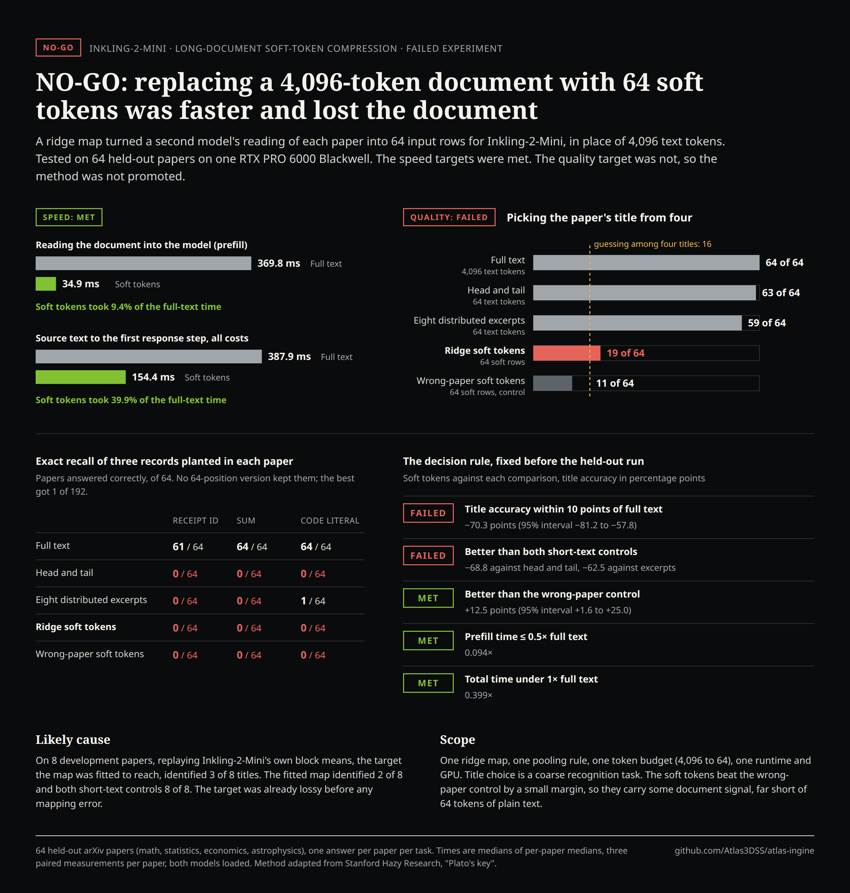

This experiment failed and the method was not promoted. A ridge map replaced a 4,096-token document with 64 soft input rows for Inkling-2-Mini, tested on 64 held-out papers on one RTX PRO 6000. Both speed targets were met: prefill took `0.094x` and total time `0.399x` of the full-text run. The quality target was not: the soft tokens picked the correct title for `19/64` papers, against `64/64` for full text, `63/64` for 64 tokens of head-and-tail text, and `11/64` for a wrong-paper control. They recalled `0/192` planted records. The method is adapted from Stanford Hazy Research, "Plato's key".

## KernelBench Level-2 Benchmarks (100 Tasks, Continual Learning & Verified Ledger)

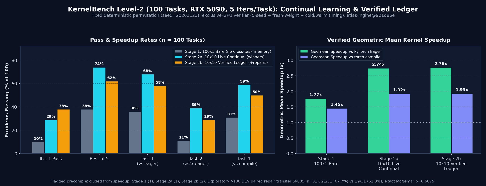

All 100 Stanford KernelBench Level-2 tasks (`423217d9`, fixed deterministic permutation `seed=20261123`), 5 iterations/task, `--effort medium`, `--max-tokens 16384`, running `atlas-ingine@901d86e` on RTX 5090 with an isolated exclusive-GPU verifier checking 5 random input seeds, a second fresh weight-state reload (anti-caching), cold & warm timings against both PyTorch eager and `torch.compile`, and automatic precomputation flagging:

| Stage & Memory Layout | Tasks | `iter1` Pass | `best5` Pass | `fast_1` (vs eager) | `fast_2` (>2× eager) | `fast_1` (vs compile) | Geomean Speedup (eager / compile) | Flagged |
|---|---:|---:|---:|---:|---:|---:|---:|---:|
| **Stage 1: `100×1` Bare** (no cross-task memory) | 100 | `10%` (`0.10`) | `38%` (`0.38`) | `36%` (`0.36`) | `11%` (`0.11`) | `31%` (`0.31`) | `1.77×` / `1.45×` | 1 |
| **Stage 2a: `10×10` Live Continual** (verified winners) | 100 | `29%` (`0.29`) | `74%` (`0.74`) | `68%` (`0.68`) | `39%` (`0.39`) | `59%` (`0.59`) | `2.74×` / `1.92×` | 1 |
| **Stage 2b: `10×10` Verified Ledger** (+ verified repairs) | 100 | `38%` (`0.38`, 3.8× bare) | `62%` (`0.62`) | `58%` (`0.58`) | `29%` (`0.29`) | `50%` (`0.50`) | `2.76×` / `1.93×` | 2 |
| **Stage 3a: `1×100` Live Continual** (full 100-task chain) | 100 | **`49%`** (`0.49`, **4.9× bare**) | `80%` (`0.80`) | `76%` (`0.76`) | `40%` (`0.40`) | **`72%`** (`0.72`) | **`3.09×` / `2.12×`** | 3 |
| **Stage 3b: `1×100` Verified Ledger** (full 100-task chain) | 100 | `44%` (`0.44`, 4.4× bare) | **`86%`** (`0.86`, **+48 pp**) | **`80%`** (`0.80`) | **`50%`** (`0.50`, **4.5× bare**) | **`72%`** (`0.72`) | `3.04×` / `2.06×` | 2 |

- **300-Agent Parallel Swarm over Shared Verified Ledger (`4× RTX 5090`, `feat/continuous-batching @ fa4ecb9`, 3 archetypes × 100 tasks):** Running 300 concurrent agents (`minimal_launch`, `warp_vectorized`, `tile_fusion`) over a single shared SQLite Verified Ledger across 4 batched `ingine-serve` workers (`568` committed turns = `300` R1 + `268` R2 before the 3.5 h cap, `1.39M` completion tokens) solved **`45/100`** (`44%` `fast_1`, `2.24×` eager / `1.66×` compile) in Round 1 alone and **`55/100`** (`54%` `fast_1`, `25%` `fast_2`, `47%` `fast_1_compile`, **`2.36×` eager / `1.65×` compile geomean**, peak `14.28×`, **`0 / 159` precomputation flags**) cumulatively through Round 2 — producing **`159` verified winners**, **`62` verified failure-to-winner repairs** (`34` cross-agent + `28` same-agent), and speeding up `20` Round-1 winners in Round 2.
- **Exploratory A100 DEV Paired Repair-Transfer (`#805`, NVIDIA A100-SXM4-40GB, `TORCH_CUDA_ARCH_LIST=8.0`, 0 infra errors):** Across 89 disjoint Level-2 targets (`58` Attempt-1 passes, `31` eligible failures forked symmetrically under `grade1` + independent `regrade`), Treatment recovered **`21 / 31`** (`67.74%`, Wilson 95% CI `[50.14%, 81.43%]`) vs Control **`19 / 31`** (`61.29%`, `[43.82%, 76.27%]`), with `4` Treatment-only wins vs `2` Control-only wins (exact two-sided McNemar `p = 0.6875`, exploratory; `14/17` vs `12/17` on retrieval hits; all `14` no-hit pairs produced identical code including `4` empty pairs).

Other Verified Ledger evaluations with unchanged weights:

- **Loktar web tasks** (128 canvas and front-end tasks, deterministic browser verifier; [showcase](https://monkeyalignment.com/inkling/self-repair/#loktar-testing)): `68/128` passed on the first attempt (mean score `56.91`) and `117/128` after verifier-guided repair with the Verified Ledger (mean `84.68`, 370 iterations in total). The first-attempt arm has no retries, so the difference includes the retries as well as the ledger.
- **BenchFlow Robo Use** (local fleet, in progress; rollup of 2026-11-26 10:46 UTC): over 69 matched task/seed/host pairs, stock passed `32` (`46.4%`) and Verified Ledger `37` (`53.6%`); 11 ledger-only wins, 6 stock-only wins, 52 ties. The difference is not statistically significant at this size.
- **BFCL v3 multi-turn** (unmodified `gorilla@6ea57973`, 800 of 800 entries, `--spec`, 2× Tesla V100): stock Inkling-2-Mini scores `42.75%` (`342/800`; base `53.5%`, missing function `30.5%`, missing parameter `43.0%`, long context `44.0%`). The Verified Ledger arm has not finished.
- **Graph-query benchmarks** (CypherBench, 2,348 questions, and Neo4j Text2Cypher, 943 questions; exact-result check on a live Neo4j database; one Tesla V100, one seed): on CypherBench, repair from database errors plus four parallel attempts raised accuracy from `50.60%` to `65.12%`. Adding Verified Ledger lessons to repair made no detectable difference on either benchmark (`-0.34` and `-0.26` points on CypherBench, `+0.32` and `-0.21` on Text2Cypher; none significant).

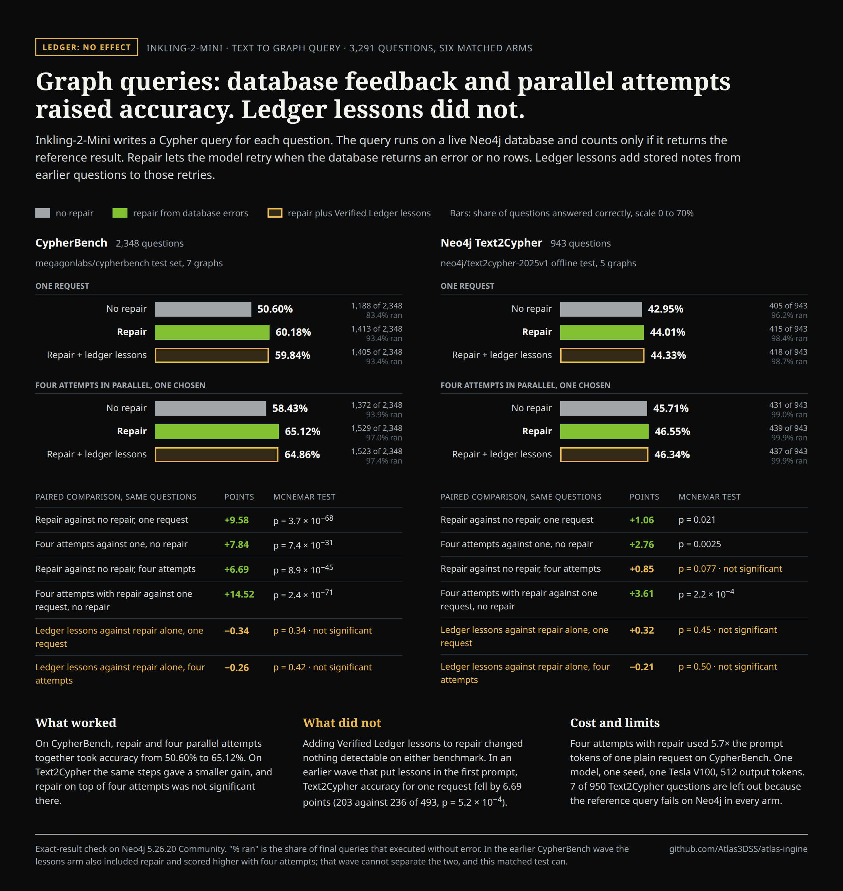

## Autonomous Multimodal Video Examples

All three showcase videos below were authored, rendered, visually critiqued through Inkling-2-Mini's native GPU vision tower, and verified autonomously using `atlas-ingine` + **Verified Ledger** on a single RTX PRO 6000 Blackwell:

| 10-Year NVIDIA Celebration Film v2 (Blender 4.5 Cycles CUDA) | Whiteout Circuit 3D Snow Podracer (350K Vision Hillclimb) | Whiteout Circuit Live 1M-Context Climb (`--max-ctx 1,048,576`) |
|---|---|---|
| 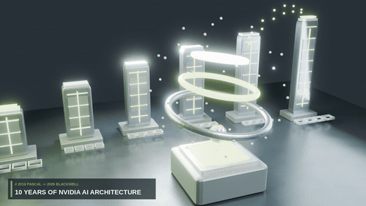 |  | 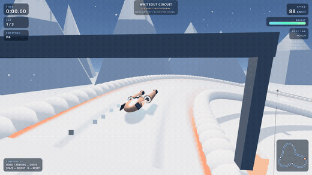 |
| 16-iteration Blender 4.5 LTS hillclimb (**`84.0/100`**, `+13 pts` over v1, 240 Cycles 64-spp OIDN frames, Verified Ledger: 26 ADD / 13 RETRACT / 6 REJECT).<br>[**Watch full 1080p MP4 (4.0 MB)**](https://github.com/Atlas3DSS/atlas-ingine/releases/download/media-v1/celebration_10yr_nvidia_inkling_1080p.mp4) | Single-file 60 FPS Three.js WebGL2 snow podracer built & visually self-critiqued via Playwright screenshots + Verified Ledger (**`82.5/100`**).<br>[**Watch full 720p MP4 (6.8 MB)**](https://github.com/Atlas3DSS/atlas-ingine/releases/download/media-v1/whiteout_circuit_720p.mp4) | Single continuous multi-turn conversation inside `--max-ctx 1,048,576` (`39.8 GiB` VRAM, `629–719 tok/s`, `1.05M` cum. tokens in 5.5 min, `obj 97.8`).<br>[**Watch full 720p MP4 (3.8 MB)**](https://github.com/Atlas3DSS/atlas-ingine/releases/download/media-v1/whiteout_circuit_1m_720p.mp4) |

## Zero-Chrome Agentic UX (Alpha Suite)

> **Alpha preview notice:** **Blender by Atlas (`Alpha`)**, **Godot by Atlas (`Alpha`)**, **DragonFruit by Atlas (`Alpha`)**, and the **Neuron Lens × Verified Ledger UX (`Alpha`)** are active pre-release Alpha builds running against local `atlas-ingine` + Verified Ledger backends over authenticated loopback IPC. See [`docs/ZERO_CHROME_AGENTIC_UX.md`](docs/ZERO_CHROME_AGENTIC_UX.md) for the full design contract, `zero_chrome_test` pixel-diff metrics, 18-brush Omni-Brush matrix, and license/IP isolation boundaries.

Every application in the Alpha suite opens in **Creative Mode** — a 100% full-bleed viewport with a single floating Omni bar (`say it, type it, sketch it, or drop a reference`) and **`0` differing pixels** outside the Omni mask in automated 3-state pixel-diff tests (`at_rest`, `after_reveal`, `after_roundtrip`). Pressing **`Ctrl+F10`** toggles the full native **Power User Mode** without reloading or mutating scene state. Below, the exact same watertight **`Atlas Orrery` (`10,832` triangles)** moves end-to-end across all three Alpha apps:

| Alpha Application & License | Creative Mode (Zero-Chrome Default) | Power User Mode (`Ctrl+F10` Instant Toggle) |
|---|---|---|
| **Blender by Atlas (`Alpha`)**<br>Blender `5.2.5 LTS` fork (`GPL-3.0`)<br>`0` out-of-mask diff px; `18/18` watertight Omni-Brushes (`88/88` ledger checkpoints); out-of-process MIT TRELLIS.2-4B worker | 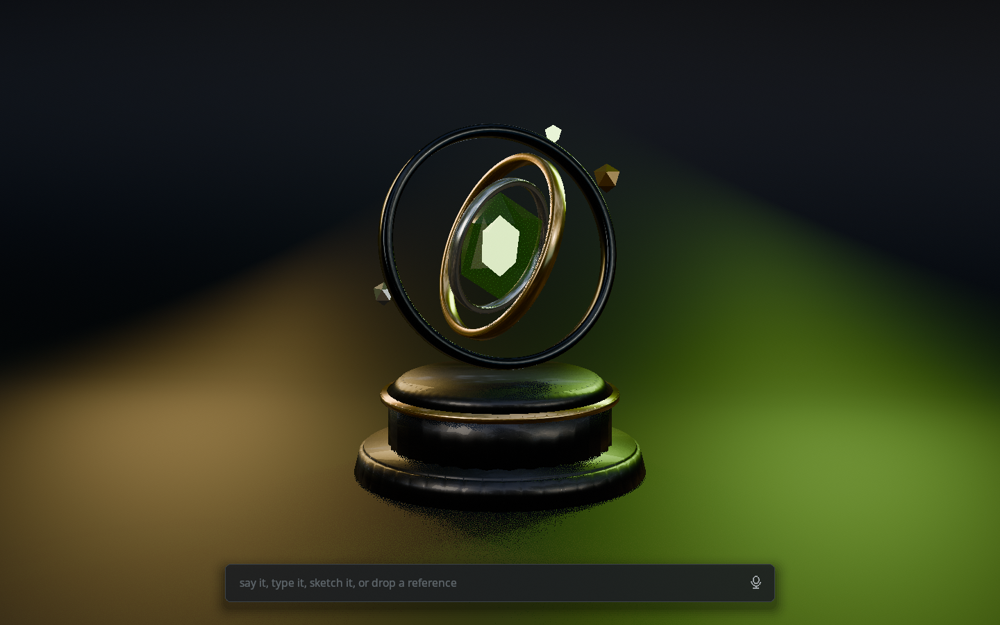 |  |
| **Godot by Atlas (`Alpha`)**<br>Godot `4.7.2` fork (`MIT`, private preview `Atlas3DSS/godot-by-atlas`)<br>`0` out-of-mask diff px; live SHA-256 `.glb` bridge (`10,832/10,832` tris, `12` meshes, `6` PBR materials + 31-bone rigged `.glb` parity) | 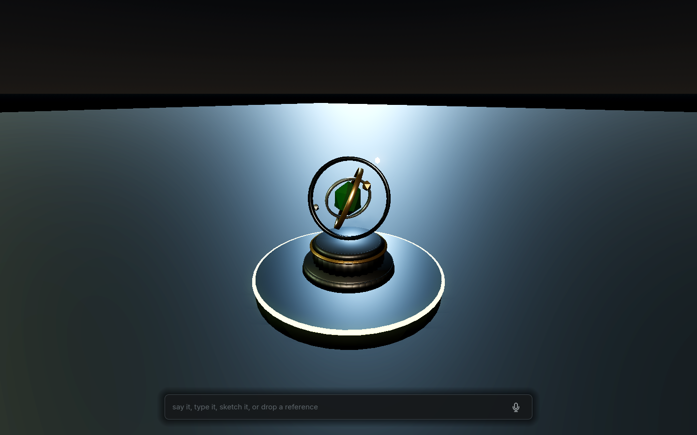 |  |
| **DragonFruit by Atlas (`Alpha`)**<br>Open-Resin-Alliance/DragonFruit fork (`AGPL-3.0`)<br>`0/1,190,160` out-of-mask diff px; live `.stl` + `3,372`-face hero-mask bridge; **out-of-process localhost IPC only** to the separate closed-source commercial `Atlas Support Engine` | 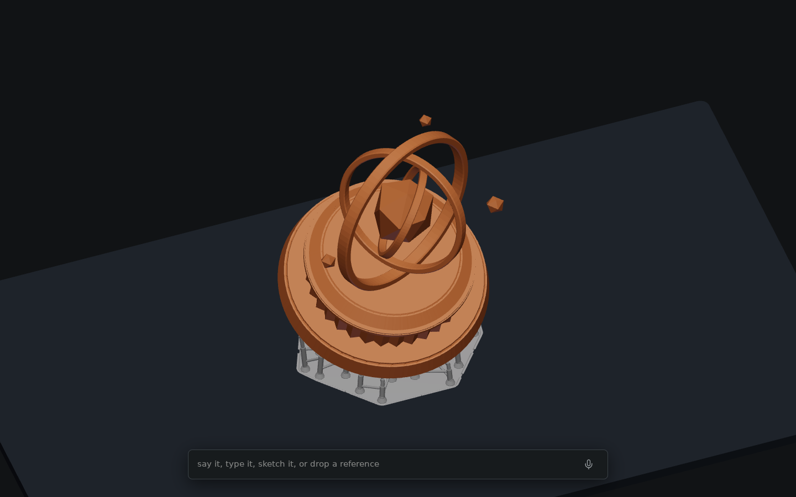 |  |

- **Full Alpha UX breakdown & 18-brush Omni-Brush matrix:** [`docs/ZERO_CHROME_AGENTIC_UX.md`](docs/ZERO_CHROME_AGENTIC_UX.md) (all 7 verified PNGs SHA-256 pinned in [`docs/media/zero_chrome_ux/MANIFEST.sha256.json`](docs/media/zero_chrome_ux/MANIFEST.sha256.json)).
- **Neuron Lens × Verified Ledger Zero-Chrome UX (`Alpha`):** [`zero_chrome_neuron_lens_ux.html`](modules/zero_gradient_omni_modal_grafting/adversarial_ledger_proof/zero_chrome_neuron_lens_ux.html) — live `/v1/probe/chat` MoE routing inspector paired with host-enforced Verified Ledger receipts (`0/40` committed breaches vs `22/40` prompt-only; [`HOST_ENFORCED_ALIGNMENT.md`](modules/zero_gradient_omni_modal_grafting/HOST_ENFORCED_ALIGNMENT.md)).

## Quick Visual Guides: How to Use All the Extra Goodies

### 1. Pick Your GPU & Turn On 1,000,000-Token Memory


<details>
<summary><b>Copy-paste commands: 1M context on 6 GB, 12 GB, 24 GB, and 96 GB + 0.93s crash-proof KV checkpoints</b></summary>

First, download the EXL3 9 GB checkpoint for 6 GB–24 GB 1M runs (skip this if using the native 20.2 GB checkpoint on 96 GB cards):
```bash
hf download Atlas3D/Inkling-2-Mini-atlas-exl3-9g-fp8-ingine --local-dir ./Inkling-2-Mini-exl3-9g
```

- **6 GB – 12 GB GPU (`feat/kvq4-elastic-9g` branch) — 1M tokens in ~5.3–10.8 GB VRAM (3-tier paged KV, `SWAP=0`):**
  ```bash
  git checkout feat/kvq4-elastic-9g
  ./native/build-multiarch/apps/serve/ingine-serve --engine \
    --model-dir ./Inkling-2-Mini-exl3-9g --max-ctx 1048576 \
    --atlas-6g --kv-q4 --kv-paged --kv-vram-mb 512 --kv-ram-mb 12288 \
    --prefill-chunk 512 --no-vision --host 127.0.0.1 --port 8003
  # For 12 GB cards, replace --atlas-6g --kv-vram-mb 512 with --dense-fp8 --kv-vram-mb 2048
  # Optional Tier-2 NVMe spill for low-RAM machines: add --kv-swap-dir /fast/nvme/kvswap
  ```
- **24 GB GPU (`feat/kvq4-elastic-9g` branch) — Full 1M resident on-card (`29–53 tok/s`, ~17.8 GiB VRAM):**
  ```bash
  git checkout feat/kvq4-elastic-9g
  ./native/build-multiarch/apps/serve/ingine-serve --engine \
    --model-dir ./Inkling-2-Mini-exl3-9g --max-ctx 1048576 \
    --dense-fp8 --kv-q4 --prefill-chunk 2048 --no-vision --host 127.0.0.1 --port 8003
  ```
- **96 GB Workstation (`main`) — Live 1M context with vision + DSpark speculative decoding (`39.8 GiB` VRAM, `629–719 tok/s`):**
  ```bash
  ./native/build-multiarch/apps/serve/ingine-serve --engine \
    --model-dir /path/to/Inkling-2-Mini --max-ctx 1048576 \
    --dense-fp8 --kv-fp8 --spec --spec-threshold 0.8 --park-mb 0 --host 127.0.0.1 --port 8003
  ```
- **Crash-proof 1M Atomic Disk KV Checkpoints (`feat/kv-checkpoint-resume` branch) — save mid-prefill, resume in `0.93s` (`0.000000` KL):**
  ```bash
  git checkout feat/kv-checkpoint-resume
  # Save an atomic checkpoint every 131,072 prefilled tokens (safe on Ctrl-C / SIGTERM):
  ./native/build-multiarch/apps/serve/ingine-serve --engine \
    --model-dir ./Inkling-2-Mini-exl3-9g --max-ctx 1048576 --dense-fp8 --kv-q4 \
    --kv-ckpt-path /tmp/session.kvckpt --kv-ckpt-every 131072 --no-vision

  # Resume bit-identically later (even switching resident <-> paged; fails loudly on prompt mismatch):
  ./native/build-multiarch/apps/serve/ingine-serve --engine \
    --model-dir ./Inkling-2-Mini-exl3-9g --max-ctx 1048576 --dense-fp8 --kv-q4 \
    --kv-ckpt-resume /tmp/session.kvckpt --no-vision
  ```

</details>

### 2. Visual Map of All Extra Goodies

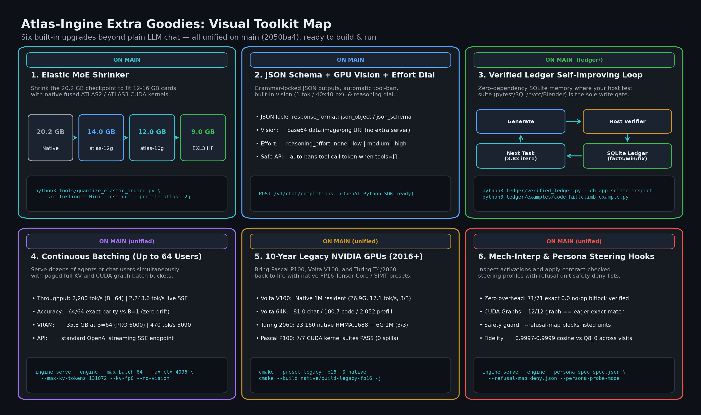

<details>
<summary><b>Copy-paste recipes: Elastic Shrinker, JSON Schema &amp; GPU Vision, Verified Ledger, Continuous Batching, Legacy GPUs, Mech-Interp</b></summary>

1. **Shrink the Model for 12–16 GB Cards (`main`):**
   ```bash
   python3 tools/quantize_elastic_ingine.py \
     --src /path/to/Inkling-2-Mini --dst /path/to/Inkling-2-Mini-atlas-12g --profile atlas-12g
   # Use --profile atlas-10g for 12.01 GB on disk; add --no-vision or --text-only to trim further.
   ```

2. **Constrained JSON Schema, Built-In GPU Vision, & Reasoning Dial (`main`):**
   ```python
   import base64
   from openai import OpenAI

   client = OpenAI(base_url="http://127.0.0.1:8003/v1", api_key="none")
   img_b64 = base64.b64encode(open("screenshot.png", "rb").read()).decode()

   resp = client.chat.completions.create(
       model="inkling-2-mini",
       messages=[{
           "role": "user",
           "content": [
               {"type": "text", "text": "Rate this render and list the top 2 visual fixes as JSON."},
               {"type": "image_url", "image_url": {"url": f"data:image/png;base64,{img_b64}"}},
           ],
       }],
       response_format={
           "type": "json_schema",
           "json_schema": {
               "name": "render_audit",
               "schema": {
                   "type": "object",
                   "properties": {
                       "score": {"type": "number"},
                       "fixes": {"type": "array", "items": {"type": "string"}},
                   },
                   "required": ["score", "fixes"],
               },
           },
       },
       extra_body={"reasoning_effort": "medium"},  # none | minimal | low | medium | high | max
   )
   print(resp.choices[0].message.content)
   ```

3. **Turn Inkling Into a Self-Improving Agent with Verified Ledger (`main`, [`ledger/`](ledger/README.md)):**
   ```bash
   # Try the zero-dependency SQLite Verified Ledger example right away:
   python3 ledger/examples/code_hillclimb_example.py --base-url http://127.0.0.1:8003/v1 --model inkling-2-mini
   # Inspect what your host verifier admitted (facts, winners, repairs, drift):
   python3 ledger/verified_ledger.py --db code_hillclimb.sqlite inspect
   ```
   See [`ledger/README.md`](ledger/README.md) for the 15-line Python loop (`VerifiedLedger` + `run_verified_loop`).

4. **Serve Up to 64 Concurrent Users / Agents (`feat/continuous-batching`):**
   ```bash
   ./native/build-multiarch/apps/serve/ingine-serve --engine \
     --model-dir /path/to/Inkling-2-Mini --max-batch 64 --max-ctx 4096 \
     --max-kv-tokens 131072 --max-queue 256 --kv-fp8 --no-vision --host 127.0.0.1 --port 8003
   ```

5. **Run on 2016–2018 Pascal / Volta / Turing GPUs (`main` & `feat/sm60-sm70-victory`):**
   ```bash
   cmake --preset sm70 -S native && cmake --build native/build-sm70 -j          # Tesla V100 32 GB
   cmake --preset legacy-fp16 -S native && cmake --build native/build-legacy-fp16 -j  # P100 + V100 + T4/2060
   ```

6. **Mechanistic Interpretability & Persona Steering Hooks (`feat/mech-interp-persona`):**
   ```bash
   ./native/build-multiarch/apps/serve/ingine-serve --engine \
     --model-dir /path/to/Inkling-2-Mini --persona-spec persona_spec.json \
     --refusal-map refusal_deny.json --persona-probe-mode --host 127.0.0.1 --port 8003
   ```

</details>

Additional verified architecture, branch, and live-serving details:
- **Pascal (`sm_60`/`sm_61`, 2016) & Turing (`sm_75`, 2018):** Runtime opt-in SMEM dispatch in `901d86e` enables both speculative (`--spec`) and non-speculative decoding on `<=48 KiB` Pascal (`Tesla P100-PCIE-16GB`) and `<=64 KiB` Turing (`Tesla T4 16 GB`, `Quadro RTX 6000 24 GB`). On `feat/sm60-sm70-victory @ fe18669`, all **7/7 kernel suites passed on real 2016 Tesla P100 (`sm_60`) silicon** (`kernels_bitlock`, `kernels_dense`, `kernels_moe`, `kernels_attn`, `prefill_moe`, `prefill_attention`, `spec_draft_kernels`); P100 speed rows above remain on the `901d86e` baseline pending a cooled, clock-controlled host comparison (passive cloud P100 rentals thermally throttled from `1328 MHz` to `405 MHz` at `79–80°C`).
- **Volta (`sm_70`, Tesla V100 32 GB, 2017):** On `feat/sm60-sm70-victory @ 2545a22`, README `--effort medium` decode reached **`81.0 tok/s` chat (+35.0%) / `100.7 tok/s` code (+39.9%)** and **`2,052 tok/s` 64K prefill (2.86×)** in `21.82 GB` VRAM. With `INGINE_ACT_FP16=ON`, 39 distinct CTest cases passed across qualification runs.
- **RTX 3090 (`sm_86`, 24 GB):** `atlas-10g` at 16K ctx with `--no-vision --dense-fp8 --kv-fp8 --spec --park-mb 0` uses **`12,984 MiB`** (`<12 GiB` without `--spec`).
- **RTX 4090 (`sm_89`, 24 GB):** `atlas-12g` at 128K ctx with `--no-vision` uses **`17,776 MiB`**; live long-output serving with vision enabled at 64K ctx runs at **~257 tok/s**.
- **Upstream RTX 5090 (`sm_120a`, 32 GB):** native `NVFP4+MXFP8` serves up to **262,144 tokens** of context in `24.4 GiB` (`490–560 tok/s` decode, `6,200–10,900 tok/s` prefill; see [Upstream RTX 5090 results](#upstream-rtx-5090-and-abliteration-results)).
- **All 5 feature tracks are unified directly on `main` (`2050ba4`)** (and preserved as individual history branches on GitHub):
  - `feat/kvq4-elastic-9g` (`8b92ef5`): EXL3 sub-3-bit MoE (`Atlas3D/Inkling-2-Mini-atlas-exl3-9g-fp8-ingine`) + `--kv-q4` + 3-tier paged KV + bulk-DMA prefetching (`1,048,576` tokens proven on physical 6 GB `RTX 2060` & `RTX A2000`, 2017 `Tesla V100 32 GB`, `RTX 3090`, and `RTX 4090`; `48/48` `kernels_bitlock` PASS).
  - `feat/kv-checkpoint-resume` (`efefeb3`): `O(1)` streaming atomic disk KV checkpoint/resume (`0.000000` KL bit-identical resume across resident, 3-tier paged, and cross-mode, `0.93s` multi-process resume).
  - `feat/sm60-sm70-victory` (`fe18669`): Volta V100 `81.0` chat / `100.7` code / `2,052` 64K prefill + **native 1M resident (`119.4` prefill / `17.13 tok/s` decode, `3/3` needles)** + real 2016 Pascal P100 `7/7` kernel suites PASS (0 register spills).
  - `feat/continuous-batching` (`fa4ecb9`): Continuous batching `B=1..64` with paged full KV and CUDA-graph buckets — **`2,200.1 tok/s` at `B=64`** (`34.4 tok/s/req`, `7.45×` plain `B=1`, `35.77 GB` VRAM), **`2,243.6 tok/s` live 64-client OpenAI HTTP SSE (`64/64 OK`)**, and `64/64` exact parity vs `B=1` on Blackwell PRO 6000.
  - `feat/mech-interp-persona` (`dd0f776`): Full 5-gate mechanistic interpretability hook & HTTP control-plane suite on Blackwell SM120a (`71/71` exact-0.0 no-ops, `12/12` CUDA graph == eager bitlock, `0.999745–0.999957` cosine vs Q8_0 across 6 visits).
  - `feat/pascal-turing-lowvram-neon` (`6b2e496`) & `feat/atlas-6g-homology` (`7c7639c`): `23,160` native Turing `sm_75` `HMMA.1688` ops (`0` `sm_61` FP16x2 ALU), `+81.6%` 6G 16K prefill (`433.9` vs `238.9 tok/s` at `5.92 GB`), `--atlas-6g --spec` M=2..8 at `5.87 GB`, and homology-guided `--atlas-6g` MoE offloading (`5.90 GB` VRAM, `87.4%` hit rate, `100%` token-exact vs UVA).

## What this fork adds over upstream `satellitedown/ingine`

1. **10-year NVIDIA multi-architecture support (`sm_60`/`61`, `sm_70`, `sm_75`, `sm_80`/`86`, `sm_89`, `sm_90`, `sm_120a`):**
   - Volta (`sm_70`) single-request decode kernels (NVFP4 `dp4a` MoE, zero-SMEM FP8 GEMV, fused epilogues) and, in the batch engine, speculative drafting for more than one request at a time.
   - Native **Ampere (`sm_80`/`86`)**, **Ada (`sm_89`)**, **Hopper (`sm_90`)**, and **Blackwell (`sm_120a`)** BF16 codepaths on CUDA 12.8+ / CUDA 13.x.
   - Compile-time **FP16 activation mode (`-DINGINE_ACT_FP16=ON`)** for **Volta (`sm_70`)**, **Turing (`sm_75`)**, and **Pascal (`sm_60`/`61`)** on CUDA 12.9 uses FP16 Tensor Core instructions for `sm_70`/`75` and FP32 SIMT for `sm_60`/`61`.
   - Software fallbacks for Hopper/Blackwell-only primitives (PDL, DSMEM/cluster reductions, hardware FP4/FP8 conversions), branchless FP8/E2M1/ATLAS2/ATLAS3 unpackers, and a CTA-wide synchronization fix in `native/src/kernels/head/head.cu` (`finish_part`) preventing multi-block top-p publication races under independent thread scheduling.
2. **Native Elastic sub-4-bit MoE weights (`ATLAS2` 2.50 b/w, `ATLAS3` 3.50 b/w):**
   - Mixed-precision MoE tier converter ([`tools/quantize_elastic_ingine.py`](tools/quantize_elastic_ingine.py)) that compresses the 20.2 GB base checkpoint to **`atlas-12g` (`14.05 GB` on disk incl. vision + `mtp.safetensors`)** or **`atlas-10g` (`12.01 GB` on disk incl. vision + `mtp.safetensors`)**.
   - Native fused decode (`native/src/kernels/moe/moe.cu`) and prefill (`native/src/kernels/prefill/wgemm.cu`) kernels verified against FP64 oracles (`kernels_moe`, `prefill_moe`).
3. **Structured outputs, tool-ban, and standalone Verified Ledger SDK:**
   - OpenAI `response_format` (`text`, `json_object`, `json_schema`) in `ingine-serve`. `json_object` and `json_schema` apply token-level logit masking; `text` is unconstrained. `json_schema` supports `oneOf`, objects with more than 64 properties, UTF-8 keys, and numeric, length, and item bounds. Schema numbers are compared as written on the wire, without rounding through binary64. Output can still be cut short by `max_tokens` / `max_completion_tokens`, the context limit, or a `stop` string, so check `finish_reason` and validate the returned content. Unsupported schemas and contradictions the validator detects return HTTP 400 before generation; not every unsatisfiable schema is detected.
   - Automatic `<|content_invoke_tool_json|>` token banning when `tools` is absent from the request.
   - Zero-dependency SQLite Verified Ledger SDK in [`ledger/`](ledger/README.md).
4. **Opt-in shared full-attention KV (`--kv-cache-mode last_full`):**
   - Layers 11 and 17 share one KV slot across the three loop passes, so full-attention KV drops from 8 slots to 4 (`9.00 GiB` to `4.50 GiB` at 1,048,576 tokens with `--kv-q4`). The default remains `per_pass`. `last_full` requires `--max-batch 1`, no `--spec`, a single GPU, and the default 3 loop passes.
   - On a Tesla V100 with native weights, `last_full` raised NLL by 5.9–7.2% over 1,280 scored tokens (top-1 agreement 97.7–97.8%) at unchanged decode speed. KV checkpoints are rejected across modes.
   - [`tools/host_cache_mode_policy.py`](tools/host_cache_mode_policy.py) reads each worker's advertised modes and applies per-worker admission; a session changes mode only through an explicitly authorized replay with the prefix cache bypassed.
5. **Runtime loop depth (`--loop-passes`) and LoopCD (`--loopcd`):**
   - `ingine-serve` and `ingine-bench` accept `--loop-passes 1..8` (default 3, 48 layer visits), for models trained for variable depth such as `TML-d24-varloop`. Inkling-2-Mini is trained for 3; on an RTX PRO 6000 it produced degenerate output at 1 pass, and on a Tesla V100 it produced degenerate output at 2 passes.
   - Values other than 3 require `--max-batch 1` and cannot be combined with `--spec`, `--ablation`, persona hooks, or `--kv-cache-mode last_full`.
   - Opt-in Loop-wise Contrastive Decoding (`--loopcd off|logits-adaptive|hidden`, default `off`, optional `--loopcd-omega` in `[0, 4]` with defaults `0.5` for `logits-adaptive` and `0.3` for `hidden`; [arXiv:2610.02185](https://arxiv.org/abs/2610.02185)) contrasts final loop pass `L` against pass `L-1` (`--loop-passes >= 2`, `--max-batch 1`, `--kv-cache-mode per_pass`, TP=1; CUDA-only, rejected on Qwen3.8). `hidden` applies Eq. (2) pre-coda directly before layers 18–23. To avoid a second pass through coda layers 18–23, `logits-adaptive` uses a **shared-coda approximation** (substituting earlier loop blocks `B2[L-1], E[L-1]` alongside the shared post-coda residual `part + y2` at `final_read`, distinct from Eq. (3)'s separate post-loop coda readout) paired with a fused single-pass dual-vector `lm_head` GEMV (`dense::head_loopcd`) that reads each `[200058, 2304]` weight row once, keeping V100 decode overhead at `~0.1–0.3%` (`100.4` vs `100.7 tok/s` at 3 passes) with zero extra VRAM at `--loopcd off`. `/health`, `/v1/models`, and `X-Ingine-LoopCD` advertise the active mode.
6. **Host memory, CPU placement, and single-file weight packs:**
   - 2 MiB hugepage host buffers, NUMA binding, and a pinned futex/spin CPU worker pool are on by default on Linux (`INGINE_DISABLE_HUGEPAGES=1`, `INGINE_DISABLE_NUMA_BIND=1`, `INGINE_CPU_PIN=0` turn each off).
   - `ingine-pack build <model_dir> <model_dir>/model.ingpack` writes the weights as one 2 MiB-aligned file; `ingine-pack inspect <file> --verify` checks it. A pack next to the safetensors files is used only when it verifies against them, otherwise the loader reads the safetensors (`INGINE_DISABLE_WEIGHT_PACK=1` ignores packs).

## Requirements

- **OS:** Linux x86_64
- **CUDA build targets** (see the hardware results above)
  - **SM80+ (BF16, CUDA 12.8+ / 13.x):** Ampere (`sm_80`/`86`), Ada (`sm_89`), Hopper (`sm_90`), Blackwell (`sm_120a`).
  - **SM60–SM75 (FP16, CUDA 12.9, `-DINGINE_ACT_FP16=ON`):** Pascal (`sm_60`/`61`), Volta (`sm_70`, e.g. Tesla V100 32 GB), Turing (`sm_75`).
  - **VRAM guide:**
    - **32 GB:** The V100 allocated `25.04 GB` for a 262,144-token context with the native checkpoint. Upstream measured `24.4 GiB` on the RTX 5090.
    - **24 GB (RTX 3090 / 4090):** native checkpoint at 64K context (`~21.8 GB` VRAM) or Elastic `atlas-12g` up to 128K context (`~17.8 GB` VRAM).
    - **16 GB / 12 GB class:** Elastic `atlas-12g` (`~16.3 GB` @ 64K) or `atlas-10g` (`12,984 MiB` @ 16K with `--spec --no-vision`, `<12 GiB` without `--spec`).
- **Driver & Toolchain:** NVIDIA driver for CUDA 12.8+ / 13.x (CUDA 12.9 toolkit for `sm_60`/`61`/`70`/`75`; CUDA 13.4 private toolkit installer for `sm_86`/`89`/`120a`), C++20 compiler (GCC 12–16), CMake >= 3.28, Ninja.
- **Runtime:** `ingine-serve` is a standalone C++/CUDA binary; it needs no Python or PyTorch to run.

## Build and run

### Option A: Build directly with CMake

**Ampere / Ada / Hopper / Blackwell (`sm_80`/`86`/`89`/`90`/`120a`, BF16, CUDA 12.8+ / 13.x):**

```bash
git clone https://github.com/Atlas3DSS/atlas-ingine
cd atlas-ingine

# Build multi-arch (sm_86 + sm_89 + sm_120a) or pick your single GPU arch (e.g. "80", "86", "89", "90", "120a")
cmake -S native -B native/build-multiarch -G Ninja \
  -DCMAKE_BUILD_TYPE=Release \
  -DCMAKE_CUDA_ARCHITECTURES="86;89;120a" \
  -DINGINE_BUILD_APPS=ON \
  -DINGINE_BUILD_TESTS=ON
cmake --build native/build-multiarch -j

# Run unit tests (optional)
ctest --test-dir native/build-multiarch --output-on-failure
```

**Volta / Turing / Pascal (`sm_70`, `sm_75`, `sm_60`/`61`, FP16 activations, CUDA 12.9):**

```bash
# Run from the root of the clone. Presets are in native/.
# Single-arch Tesla V100 (sm_70):
cmake --preset sm70 -S native
cmake --build native/build-sm70 -j

# Or multi-arch legacy FP16 (Pascal sm_60/61 + Volta sm_70 + Turing sm_75, with tests):
cmake --preset legacy-fp16 -S native
cmake --build native/build-legacy-fp16 -j
```

**Multi-GPU Tensor + Expert Parallel (`-DINGINE_TP_SIZE=2` or `4`, requires `libnccl`):**

```bash
# Example: 2x RTX 4090 (sm_89, TP2+EP2) or 4x Tesla V100 (sm_70, -DINGINE_ACT_FP16=ON -DINGINE_TP_SIZE=4)
cmake -S native -B native/build-tp2 -G Ninja \
  -DCMAKE_BUILD_TYPE=Release \
  -DCMAKE_CUDA_ARCHITECTURES="89" \
  -DINGINE_TP_SIZE=2 -DINGINE_BUILD_APPS=ON
cmake --build native/build-tp2 -j
```

At startup, `TP2`/`TP4` runs a 4 KiB byte-exact `cudaMemcpyPeer` probe across all P2P-capable GPU pairs before initializing NCCL; on Linux hosts where VT-d/AMD-Vi IOMMU translation mode causes silent P2P corruption (DMAR fault `0x05`), it fails closed by disabling peer access, setting `NCCL_P2P_DISABLE=1`, and warning the operator to boot with `iommu=pt`.

Start the server on a 24 GB card (RTX 3090 / RTX 4090, 64K context with vision + DSpark speculative decoding):

```bash
./native/build-multiarch/apps/serve/ingine-serve \
  --engine \
  --model-dir /path/to/Inkling-2-Mini \
  --host 127.0.0.1 --port 8003 \
  --max-ctx 65536 --dense-fp8 --kv-fp8 \
  --spec --spec-threshold 0.8 --park-mb 0
```

Add `--no-vision` to save ~0.6 GiB VRAM on text-only workloads, `--dflash2-dir /path/to/Inkling-2-Mini-DFlash2` to use the native Apache-2.0 DFlash2 block-diffusion drafter (`--max-batch 1`, `--loop-passes 3`, `--kv-cache-mode per_pass`), or `--ablation /path/to/inkling-2-mini-abliterated.safetensors` to apply the optional abliteration patch (omitting `--ablation` serves the original model as `inkling-2-mini`). For DGX Spark (`sm_121a`), use `cmake --preset sm121 -S native` or `./scripts/start.sh` (compile-verified on CUDA 12.9; physically unmeasured on GB10 hardware).

**Linux GeForce RTX 20/30/40 note:** When `ingine-serve --engine` starts on a Linux GeForce RTX 20/30/40 GPU without `/sys/module/gpu_unlock`, it logs a one-line notice pointing to the optional external [Zagitta/gpu-unlock](https://github.com/Zagitta/gpu-unlock) kernel module (GPL-2.0; zero code or firmware is bundled in this repository).

### Option B: Hardware-aware auto-tuner & interactive installer

Open the local setup page to select a model, inspect the recommended server flags and estimated memory use, and approve the download or launch.

```bash
curl -fsSL https://raw.githubusercontent.com/Atlas3DSS/atlas-ingine/main/get.sh | bash -s -- --auto
```

From an existing checkout, run `./atlas-setup` to open the page, `./atlas-setup --plan` to inspect the configuration, or `./atlas-setup --cli` to use the terminal. When a build is needed, the plan includes the command for the selected hardware.

The `bash setup.sh` menu also offers the private CUDA 13.4 installer. Option **1** builds the server for SM86, SM89 and SM120a and downloads the pinned 20.2 GB checkpoint. Option **5** links `~/.local/bin/ingine`, and **6** opens the setup page. On a 24 GB RTX 3090 or 4090, set `INGINE_CTX=65536` in `~/.config/ingine/env`. The default of 262144 targets cards with at least 32 GB.

```bash
mkdir -p ~/.config/ingine
cat <<'EOF' > ~/.config/ingine/env
INGINE_CTX=65536
INGINE_EXTRA_ARGS="--park-mb 0"
EOF
ingine start
```

### Creating Elastic sub-4-bit MoE checkpoints (`atlas-12g` / `atlas-10g`)

Convert a downloaded base `Inkling-2-Mini` directory into a smaller mixed-precision `ATLAS2`/`ATLAS3` checkpoint using
[`tools/quantize_elastic_ingine.py`](tools/quantize_elastic_ingine.py) (links/copies unchanged dense, vision, tokenizer,
and `mtp.safetensors` files):

```bash
python3 tools/quantize_elastic_ingine.py \
  --src /path/to/Inkling-2-Mini \
  --dst /path/to/Inkling-2-Mini-atlas-12g \
  --profile atlas-12g   # or atlas-10g; add --no-vision (-0.64 GB), --no-mtp (-0.64 GB), or --text-only (-1.27 GB)
```

Then pass `--model-dir /path/to/Inkling-2-Mini-atlas-12g` to `ingine-serve` (add `--no-vision` if exported with `--no-vision`/`--text-only`, or set `INGINE_MODEL_DIR` in `~/.config/ingine/env`).

## Service management (`ingine` CLI)

```bash
ingine start      # start the server in the background (systemd user unit inkling-ingine), wait until it is ready
ingine stop       # stop it and free the GPU
ingine status     # unit state, health, served model, GPU memory; exit code 0 ready, 1 starting, 3 stopped
ingine logs       # server log; ingine logs -f follows it
ingine serve      # run in the foreground instead; extra arguments go to the server, e.g. --max-ctx 65536
ingine update     # pull updates and rebuild incrementally
```

Environment overrides (`~/.config/ingine/env` or shell environment):

| Variable | Default | Meaning |
|---|---|---|
| `INGINE_MODEL_DIR` | `models/Inkling-2-Mini` in the install folder | model folder (native checkpoint or Elastic `atlas-12g` / `atlas-10g` directory) |
| `INGINE_ABLATION` | `$INGINE_MODEL_DIR/inkling-2-mini-abliterated.safetensors` | optional abliteration file; empty serves the original model (`inkling-2-mini`) |
| `INGINE_CTX` | 262144 | context length (`65536` recommended on 24 GB GPUs with native weights) |
| `HOST`, `PORT` | 127.0.0.1, 8003 | bind address and port |
| `INGINE_EXTRA_ARGS` | empty | further server arguments (e.g. `--no-vision`, `--park-mb 0`, `--temperature`, `--top-p`, `--top-k`, `--spec-threshold 0.8`) |
| `INGINE_START_TIMEOUT` | 300 | seconds `ingine start` waits for `/health` |

## OpenAI-compatible API

Use **`http://127.0.0.1:8003/v1`**, model **`inkling-2-mini`** (or `inkling-2-mini-abliterated` when `--ablation` is set).
No API key is required and there is no authentication; keep the server bound to loopback. `GET /health` and
`GET /v1/models` report server status, including `kv_cache_mode`, `supported_kv_cache_modes`, `loop_passes`, and
startup prefix warm-start state (`warm_start`, `warm_start_tokens`). Pass `--warm-start-prompt TEXT` or
`--warm-start-file PATH` (with `--warm-start-namespace NAME` when `--cache-namespace-header` is set) to pre-prefill a
system prompt into the prefix cache before serving. Responses carry
`X-Ingine-Kv-Cache-Mode` and `X-Ingine-Loop-Passes`; a request may send `X-Ingine-Expected-Loop-Passes: N` to get HTTP 409
instead of a generation when the server runs a different depth.

`POST /v1/chat/completions` supports:

* `reasoning_effort`: `none`, `minimal`, `low`, `medium`, `high`, `xhigh`, `max` (mapped to `0, 0.1, 0.2, 0.7, 0.9, 0.99, 0.99`) or a float in `[0, 0.99]`.
* `enable_thinking: false` (also accepted in `chat_template_kwargs`) to answer without reasoning.
* `response_format`: `{"type": "text"}`, `{"type": "json_object"}`, or `{"type": "json_schema", "json_schema": {"name": "...", "schema": {...}}}`. `text` is unconstrained plain text. `json_object` and `json_schema` restrict candidate tokens during generation. It can be truncated by `max_tokens` / `max_completion_tokens`, the context limit, or `stop`, so check `finish_reason` and validate the returned content. Unsupported schemas and contradictions the validator detects return HTTP 400 before generation.
* `tools` (function calling through the chat template). When `tools` is omitted, `<|content_invoke_tool_json|>` is automatically banned.
* `stop`, `max_tokens` / `max_completion_tokens`, `temperature`, `top_p`, `top_k`, `seed`.
* `stream: true` (SSE with `reasoning_content` and `content` deltas; `stream_options.include_usage` adds usage).
* Vision inputs as base64 `data:` URIs (`image_url`, `input_image`, or Anthropic `image` blocks; PNG, JPEG, WebP, GIF, BMP). Remote URLs are not fetched.

`ingine-serve` also exposes Anthropic-compatible `POST /v1/messages` (non-streaming JSON and SSE with thinking/text/tool_use blocks, exact `stop_sequence` reporting, and `tool_choice` `"auto"`/`"none"`; `"any"` and named `"tool"` return HTTP 400 before inference) and `POST /v1/messages/count_tokens`.

```bash
curl -s http://127.0.0.1:8003/v1/chat/completions -H 'Content-Type: application/json' -d '{
  "model": "inkling-2-mini",
  "messages": [{"role": "user", "content": "Explain how hash maps handle collisions."}],
  "reasoning_effort": "low",
  "max_tokens": 4096
}'
```

```python
from openai import OpenAI

client = OpenAI(base_url="http://127.0.0.1:8003/v1", api_key="none")
resp = client.chat.completions.create(
    model="inkling-2-mini",
    messages=[{"role": "user", "content": "Return a JSON object with keys city and country for Tokyo."}],
    response_format={"type": "json_object"},
    extra_body={"reasoning_effort": "none"},
)
print(resp.choices[0].message.content)
```

### Images

The model reads images through its built-in vision tower (part of the checkpoint, no extra download). Each image costs
**one token per 40×40 pixels**, `ceil(height / 40) * ceil(width / 40)` (432 tokens for 960×720, 1,296 for 1920×1080).
Images above 4,096 tokens are resized preserving aspect ratio (`--image-max-tokens N`, up to 10,609 for 4096×4096).
Pass `--no-vision` to serve text only and save ~0.6 GiB VRAM.

## Building your own Verified Ledger

[`ledger/`](ledger/README.md) provides a zero-dependency SQLite **Verified Ledger** ([`ledger/verified_ledger.py`](ledger/verified_ledger.py))
for pairing `atlas-ingine` with any host-verified workflow (SQL, `pytest`, CUDA/PyTorch kernels, Three.js, Blender, or
compilers). The host verifier is the sole write gate across four banks (`facts`, `winners`, `repairs`, and `drift`
invalidation on `env_version` changes), with deterministic character-budgeted retrieval and a CLI for inspecting and
updating ledgers. See [`ledger/README.md`](ledger/README.md), [`ledger/examples/code_hillclimb_example.py`](ledger/examples/code_hillclimb_example.py),
and our end-to-end multimodal GPU-vision examples in [`ledger/examples/blender_celebration_hillclimb/`](ledger/examples/blender_celebration_hillclimb/README.md)
(16-iteration Blender 4.5 LTS hillclimb on RTX PRO 6000 Blackwell with audited add/subtract Verified Ledger, 3-tier rolling
context compression, and rendered 1080p MP4 showcase) and [`ledger/examples/webgl_self_repair_showcase/`](ledger/examples/webgl_self_repair_showcase/README.md)
(side-by-side stock one-shot vs Verified Ledger + native vision self-repair across WebGL2 3D Gaussian Splatting, a 31-joint articulated 3D dragon, and a Playwright-playtested Atari arcade game on a single local V100) and [`ledger/examples/bijanbowen_4game_showcase/`](ledger/examples/bijanbowen_4game_showcase/README.md)
(4 playable pure-WebGL2 3D games — isometric 4×4 stock terrain, haunted 3D bowling, skate-to-GTA city sandbox, and 2P split-screen multiplayer racer — authored and self-repaired locally by a 3-archetype Inkling-2-Mini array across 3 Tesla V100 GPUs sharing one Verified Ledger and native vision QA).

## Related: `Atlas3DSS/atlas-engine`

`atlas-ingine` is our primary Inkling-2-Mini engine across Pascal (`sm_60`/`61`), Volta (`sm_70`), Turing (`sm_75`),
Ampere (`sm_80`/`86`), Ada (`sm_89`), Hopper (`sm_90`), and Blackwell (`sm_120a`). For GGUF serving or `llama.cpp`-based
workflows, see our MIT `llama.cpp` fork: [Atlas3DSS/atlas-engine](https://github.com/Atlas3DSS/atlas-engine).

## Upstream RTX 5090 and abliteration results

The measurements below are from upstream `satellitedown/ingine` on a single RTX 5090 (32 GB, `sm_120a`, default 262K
profile, native `NVFP4+MXFP8` weights, DSpark speculative decoding):

| RTX 5090 (upstream) | chat | code | coding agent |
|---|---:|---:|---:|
| temperature 1 (default) | 487 tok/s | 554 tok/s | 501 tok/s |
| greedy (temperature 0) | 501 tok/s | 561 tok/s | 510 tok/s |

- Prefill on RTX 5090: `10,900 tok/s` (20K), `9,600 tok/s` (64K), `8,100 tok/s` (131K), `7,000 tok/s` (200K); `24.4 GiB` VRAM (`23.8 GiB` with `--no-vision`).
- Long-context needle retrieval on RTX 5090: passes at `131,443` tokens (`16.4 s` prefill, `354 tok/s` decode) and `254,019` tokens (`40.9 s` prefill, `258 tok/s` decode).
- Optional abliteration eval data from upstream is retained in [`results/`](results).

## License and credits

This repository is licensed under **Apache-2.0**; see [LICENSE](LICENSE) and [NOTICE](NOTICE). This work stands on the
shoulders of the open-source AI and systems community:

- **Base model:** [thinkingmachines/Inkling-2-Mini](https://huggingface.co/thinkingmachines/Inkling-2-Mini) by **Thinking Machines Lab** (Apache-2.0; model weights are not stored in this Git repository).
- **Upstream engine, installer, and abliteration tooling:** [satellitedown/ingine](https://github.com/satellitedown/inkling-2-mini-abliterated-ingine) (Apache-2.0), with upstream kernel inspirations credited in [NOTICE](NOTICE) (**fngine**, **cinference**, **NInfer**).
- **Broader Inkling-2-Mini & quantization open-source ecosystem:** **ggml-org / llama.cpp**, **realugbun** (initial Inkling-2-Mini `llama.cpp` support), **turboderp / ExLlamaV3** (QTIP/trellis quantization), **professorpalmer / Kintsugi-Inkling-2-Mini** (community 12 GB GGUF/EXL3 serving work), **mw00 / Project Maya** (Peasant Smith & Project Maya contributors, Niko1221 & Strata contributors — MIT AMD ROCm/HIP & multi-GPU Inkling-2-Mini serving), **[knapcio/Inkling-2-Mini-4x-DGX-Spark-TP4](https://github.com/knapcio/Inkling-2-Mini-4x-DGX-Spark-TP4)** (`c0f5f1cd`, multi-GPU TP+EP serving architecture and benchmark suite), **Cavemanmining** ([Tesla P40 multi-GPU IOMMU/P2P field report](https://gist.github.com/Cavemanmining/896bd4fa826da665525c9d2f9742bcff), motivating the startup byte-exact P2P probe and fail-closed `iommu=pt` guard), and **NVIDIA** (CUDA toolkit and 10 years of forward-compatible GPU architecture from Pascal through Blackwell).
- **Mechanistic interpretability & neuron-basis reference:** [stdlogits/neuron-lens](https://github.com/stdlogits/neuron-lens) by **@_a9lim** and **@treetowntree** (MIT, [neuron-lens.com](https://neuron-lens.com), [stdlogits/rs-lenses](https://huggingface.co/stdlogits/rs-lenses), created 2026-10-30 — open catalog and R-lens/S-lens Jacobian methodology reading MLP neurons and attention heads by input drivers and output/write contributions), cited alongside Jasmine Shone and Lisa Dunlap's two-part Anthropic Fellows work [*Returning to the neuron basis for interpretability*](https://alignment.anthropic.com/2026/neuron-basis-theory/) ([Part 2](https://alignment.anthropic.com/2026/neuron-basis-applications/), 2026-11-23).
- **10-year multi-architecture (`sm_60`/`61`/`70`/`75`/`80`/`86`/`89`/`90`/`120a`) port, Elastic `ATLAS2`/`ATLAS3` sub-4-bit MoE kernels and converter, native OpenAI `response_format` / tool-ban, and Verified Ledger SDK:** Atlas 3DSS.
- CUDA runtime/toolkit components remain subject to NVIDIA's license terms. Unofficial open-source community project, not affiliated with or endorsed by Thinking Machines Lab or NVIDIA.
