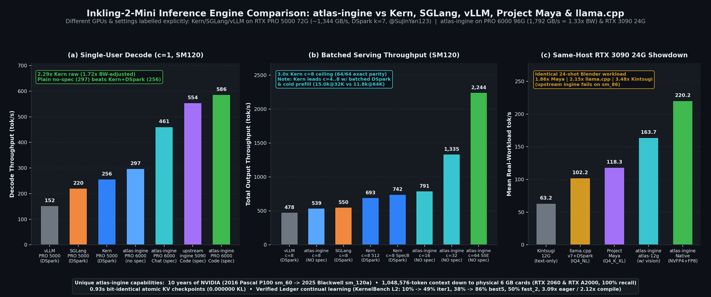
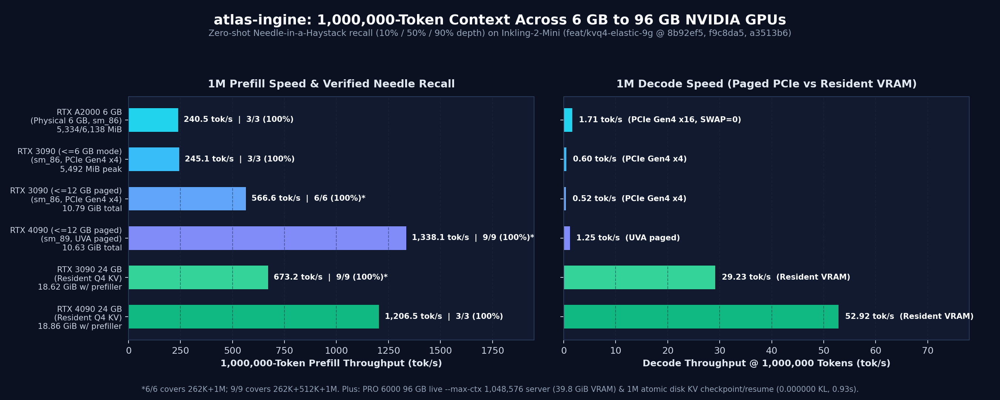
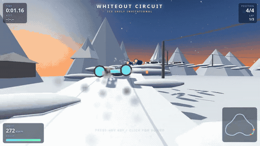
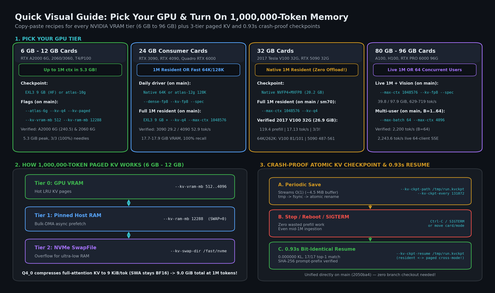

# atlas-ingine

Multi-architecture Apache-2.0 CUDA inference engine for
[thinkingmachines/Inkling-2-Mini](https://huggingface.co/thinkingmachines/Inkling-2-Mini), forked from
[satellitedown/ingine](https://github.com/satellitedown/inkling-2-mini-abliterated-ingine).

Inkling-2-Mini has been benchmarked on real cards across **six NVIDIA GPU generations (2016 Pascal through 2025 Blackwell)**: **Tesla P100 (`sm_60`), Tesla V100 (`sm_70`), Tesla T4 & Quadro RTX 6000 (`sm_75`), RTX 3090 & A100 (`sm_86`/`sm_80`), RTX 4090 & H100 (`sm_89`/`sm_90`), and RTX PRO 6000 Blackwell (`sm_120a`)**, with upstream results on the RTX 5090. The engine includes **native Elastic sub-4-bit MoE weights (`ATLAS2` / `ATLAS3`)**,
**DSpark speculative decoding**, **native vision input**, **OpenAI-compatible structured outputs (`response_format`:
`json_object` / `json_schema`) + automatic tool-ban**, and a standalone **Verified Ledger SDK (`ledger/`)**.
On the RTX 3090, all 24 BF16 dense output hashes matched between the pre-port build and the FP16 port. Blackwell and V100 runs passed `kernels_bitlock` (`48/48` on Blackwell) and full-model parity; P100 (`sm_60`) and Turing (`sm_75`) passed kernel tests and real-card speed benchmarks (full-model parity ctest was not run on the cloud P100/T4/RTX 6000/A100/H100 instances).

## Measured performance (16K, 64K & 262K context across 6 NVIDIA generations)


Unless noted, 64K rows use `ingine-bench --max-ctx 65536 --dense-fp8 --kv-fp8 --spec --spec-threshold 0.8 --effort medium --tokens 512 --runs 2 --long-prompt 64000` on commit `901d86e` (runtime opt-in SMEM dispatch for `<=64 KiB` Turing and `<=48 KiB` Pascal). 16K rows use `--max-ctx 16384 --long-prompt 16000`. The V100 262K row uses `--effort low --tokens 64 --runs 1` with no long prompt; A100 and H100 262K rows use `--max-ctx 262144 --tokens 512 --runs 2`.

| GPU | Arch | Year | Checkpoint / Mode | VRAM | Chat decode | Code decode | Prefill |
|---|---|---:|---|---:|---:|---:|---:|
| Tesla P100-PCIE 16 GB | `sm_60` (FP16) | 2016 | Elastic `atlas-10g` (16K, `--spec`) | `13.33 GB` | `20.2 tok/s` | `22.9 tok/s` | `282 tok/s` (16K) |
| Tesla P100-PCIE 16 GB | `sm_60` (FP16) | 2016 | Elastic `atlas-10g` (64K, `--spec`) | `14.34 GB` | `11.9 tok/s` | `10.2 tok/s` | `72.8 tok/s` (64K) |
| Tesla P100-PCIE 16 GB | `sm_60` (FP16) | 2016 | Elastic `atlas-10g` (64K, no-spec) | `13.17 GB` | `7.9 tok/s` | `7.5 tok/s` | `70.1 tok/s` (64K) |
| Tesla V100-PCIE 32 GB | `sm_70` (FP16) | 2017 | Native `NVFP4+MXFP8` (64K, `901d86e`) | `21.82 GB` | `59.8 tok/s` | `72.2 tok/s` | `717.7 tok/s` (64K) |
| Tesla V100-PCIE 32 GB | `sm_70` (FP16) | 2017 | Native `NVFP4+MXFP8` (64K, `feat/sm60-sm70-victory @ 2545a22`) | `21.82 GB` | **`81.0 tok/s`** | **`100.7 tok/s`** | **`2,052 tok/s`** (64K) |
| Tesla V100-PCIE 32 GB | `sm_70` (FP16) | 2017 | Native `NVFP4+MXFP8` (262K) | `25.04 GB` | `46.0 tok/s` | `54.9 tok/s` | — |
| Tesla T4 16 GB | `sm_75` (FP16) | 2018 | Elastic `atlas-10g` (16K, `--spec`) | `13.33 GB` | `23.5 tok/s` | `25.2 tok/s` | `303 tok/s` (16K) |
| Tesla T4 16 GB | `sm_75` (FP16) | 2018 | Elastic `atlas-10g` (64K, `--spec`) | `14.34 GB` | `22.1 tok/s` | `23.9 tok/s` | `237 tok/s` (64K) |
| Quadro RTX 6000 24 GB | `sm_75` (FP16) | 2018 | Native `NVFP4+MXFP8` (64K) | `21.83 GB` | `47.9 tok/s` | `64.0 tok/s` | `431 tok/s` (64K) |
| RTX 3090 24 GB | `sm_86` (BF16) | 2020 | Native `NVFP4+MXFP8` (64K) | `21.82 GB` | `154.9 tok/s` | `213.2 tok/s` | `2,980 tok/s` (64K) |
| RTX 3090 24 GB | `sm_86` (BF16) | 2020 | Elastic `atlas-12g` (64K) | `16.37 GB` | `132.4 tok/s` | `161.2 tok/s` | `2,970 tok/s` (64K) |
| RTX 3090 24 GB | `sm_86` (BF16) | 2020 | Elastic `atlas-10g` (64K) | `14.33 GB` | `145.6 tok/s` | `196.1 tok/s` | `3,012 tok/s` (64K) |
| A100 80 GB | `sm_80` (BF16) | 2020 | Native `NVFP4+MXFP8` (64K) | `21.82 GB` | `153.0 tok/s` | `194.6 tok/s` | `5,164 tok/s` (64K) |
| A100 80 GB | `sm_80` (BF16) | 2020 | Native `NVFP4+MXFP8` (262K) | `25.04 GB` | `152.8 tok/s` | `194.2 tok/s` | — |
| RTX 4090 24 GB | `sm_89` (BF16) | 2022 | Elastic `atlas-12g` (64K) | `16.36 GB` | `236.7 tok/s` | `278.3 tok/s` | `7,031 tok/s` (64K) |
| H100 80 GB | `sm_90` (BF16) | 2022 | Native `NVFP4+MXFP8` (64K) | `21.79 GB` | `240.8 tok/s` | `300.3 tok/s` | `7,004 tok/s` (64K) |
| H100 80 GB | `sm_90` (BF16) | 2022 | Native `NVFP4+MXFP8` (262K) | `25.01 GB` | `241.8 tok/s` | `300.8 tok/s` | — |
| RTX PRO 6000 96 GB | `sm_120a` (BF16) | 2025 | Native `NVFP4+MXFP8` (B=1, `feat/continuous-batching @ fa4ecb9`) | `20.53 GB` | **`460.6 tok/s`** | **`586.1 tok/s`** | — |
| RTX PRO 6000 96 GB | `sm_120a` (BF16) | 2025 | Elastic `atlas-12g` (64K) | `16.26 GB` | `411.0 tok/s` | `519.9 tok/s` | `11,728 tok/s` (64K) |
| RTX PRO 6000 96 GB | `sm_120a` (BF16) | 2025 | Elastic `atlas-10g` (64K) | `14.18 GB` | `410.7 tok/s` | `554.3 tok/s` | `11,806 tok/s` (64K) |

External baseline reference points (different hardware, quants, or settings — reported individually):



- **Kern, SGLang, and vLLM** (`@SuJinYan123`, Nov 22, 2026, single RTX PRO 5000 72 GB `SM120`, ~`1,344 GB/s` vs PRO 6000 `1,792 GB/s` [`1.33×` BW], DSpark `k=7`, `max_seqs=8`): `c=1` HumanEval `256` / `~220` / `~152 tok/s`; `c=8` 512-OSL `693` / `~550` / `~478 tok/s` (`742` SpecBench `c=8`); cold prefill `15.3k` (4K) / `15.0k` (32K) / `10.5k` (128K).
- **Upstream `satellitedown/ingine`** (RTX 5090 32 GB, native `NVFP4+MXFP8`, 262K ctx, `--spec`, default temp 1): `487 tok/s` chat, `554 tok/s` code, `9,600 tok/s` 64K prefill (`24.4 GiB` VRAM; full table below).
- **Kintsugi (`ExLlamaV3` / 12 GB community serving)** (reported reference on Blackwell): `4,895 tok/s` 64K prefill.
- **StrataEngine** (Tesla P100 16 GB, thinking off, prompt length unstated): `35.0 tok/s` (not directly comparable to `--effort medium` thinking-on rows).
- **Project Maya** (AMD ROCm/HIP & multi-GPU Inkling-2-Mini serving) and **`llama.cpp` / `Atlas3DSS/atlas-engine`** (GGUF serving; see [Atlas3DSS/atlas-engine](https://github.com/Atlas3DSS/atlas-engine)).
- **Like-for-like 6-engine RTX 3090 24 GB bare multi-turn Blender authoring showdown** (identical prompts, 6 sequences / 24 shots, no Verified Ledger, Blender 4.5.14 LTS verifier): `atlas-ingine` Native **`220.15 tok/s`** (`21.23 GiB`, `25.0%` bare pass / `43.93%` compliance — **`1.86×`** Project Maya `118.26 tok/s`, **`2.15×`** `llama.cpp v7+DSpark` `102.21 tok/s`, **`3.48×`** `Kintsugi-12G` `63.22 tok/s`), while `atlas-12g` ran **`163.73 tok/s`** (**`2.59×`** `Kintsugi-12G` with vision included; upstream `satellitedown/ingine` fails startup on `sm_86`). Adding Verified Ledger lifts `atlas-ingine` Native from `25%` bare to `100%` (`28/28` shots).

## 1,000,000-Token Context (6 GB to 96 GB Silicon)



Using Q4_0 full-attention KV caching (`--kv-q4`), 3-tier paged KV (`VRAM -> pinned host RAM -> NVMe`), bulk-DMA prefetching, and our EXL3 9 GB checkpoint ([`Atlas3D/Inkling-2-Mini-atlas-exl3-9g-fp8-ingine`](https://huggingface.co/Atlas3D/Inkling-2-Mini-atlas-exl3-9g-fp8-ingine), `0.000000` KL bit-identical to runtime `--dense-fp8`), `atlas-ingine` serves **1,048,576-token (1M)** contexts from **physical 6 GB cards** up to **96 GB workstations** with **100% zero-shot Needle-in-a-Haystack recall** (10%, 50%, 90% depth, scored strictly on exact final answer tokens):

| GPU & Configuration | Branch / Commit | Peak VRAM | 1M Prefill | Decode @ 1M | Needle Recall | Notes |
|---|---|---:|---:|---:|---:|---|
| **RTX 2060 6 GB** (Physical 6 GB, 2019 Turing `sm_75`) | `feat/kvq4-elastic-9g @ 8b92ef5` | **`5,346 / 6,144 MiB`** (`0.402 GiB` free) | `40.5 tok/s` (`6.87 h`) | `0.20 tok/s` | **`3/3` (100%)** | `INGINE_ACT_FP16=ON`, `15.5 GB` host RSS, `SWAP=0`, PCIe Gen3 x8 (works, slow at 1M) |
| **RTX A2000 6 GB** (Physical 6 GB, 2021 Ampere `sm_86`) | `feat/kvq4-elastic-9g @ 8b92ef5` | **`5,334 / 6,138 MiB`** (`0.445 GiB` free) | **`240.5 tok/s`** (`69.3 min`) | **`1.71 tok/s`** | **`3/3` (100%)** | 6g oracle `17/17` PASS; `15.46 GB` host RSS, `SWAP=0`, PCIe Gen4 x16 |
| **RTX 3090 (`<=6 GB` mode, `sm_86`)** | `feat/kvq4-elastic-9g @ 8b92ef5` | **`5,492 MiB`** | **`245.1 tok/s`** | `0.60 tok/s` | **`3/3` (100%)** | Devbox PCIe Gen4 x4 slot; `SWAP=0` |
| **RTX 3090 (`<=12 GB` paged, `sm_86`)** | `feat/kvq4-elastic-9g @ f9c8da5` | **`10.79 GiB`** | **`566.6 tok/s`** | `0.52 tok/s` | **`6/6` (100%)** | `262K` (`1,614.4` / `2.93 tok/s`) + `1M`; PCIe Gen4 x4; `SWAP=0` |
| **RTX 4090 (`<=12 GB` paged, `sm_89`)** | `feat/kvq4-elastic-9g @ a3513b6` | **`10.63 GiB`** | **`1,338.1 tok/s`** | `1.25 tok/s` | **`9/9` (100%)** | `262K` (`3,174`) + `524K` (`2,092`) + `1M` (`1,338.1 tok/s`) |
| **RTX 3090 24 GB (Resident Q4 KV)** | `feat/kvq4-elastic-9g` | **`17.70 GiB`** (`18.62 GiB` w/ prefiller) | **`673.2 tok/s`** | **`29.23 tok/s`** | **`9/9` (100%)** | `4.67 GiB` free VRAM; `9.00 GiB` Q4_0 KV; `262K` + `512K` + `1M` |
| **RTX 4090 24 GB (Resident Q4 KV)** | `feat/kvq4-elastic-9g` | **`17.94 GiB`** (`18.86 GiB` w/ prefiller) | **`1,206.5 tok/s`** | **`52.92 tok/s`** | **`3/3` (100%)** | Full 1M resident on single 24 GB consumer card |
| **RTX PRO 6000 96 GB (Live Server)** | `main` (`--max-ctx 1048576 --kv-fp8`) | **`39.8 / 97.9 GiB`** (`57.5 GiB` free) | Live continuous | **`629–719 tok/s`** | Live vision climb | Native `NVFP4+MXFP8`, vision + `--spec` enabled (see video below) |

- **1M Atomic Disk KV Checkpoint & Resume (`feat/kv-checkpoint-resume @ efefeb3`):** Streaming `O(1)` (~4.5 MiB buffer) atomic (`tmp -> fsync -> rename`) disk checkpoint/resume verified bit-identical (**`0.000000` KL, `0.000000` max logit diff, `17/17` top-1**) across resident Q4, 3-tier paged Q4, and cross-mode (`save resident -> load paged`), with loud SHA-256 prompt-prefix mismatch rejection and real multi-process `SIGTERM` stop -> `0.93s` resume (`--kv-ckpt-path`, `--kv-ckpt-every`, `--kv-ckpt-resume`).

## KernelBench Level-2 Benchmarks (100 Tasks, Continual Learning & Verified Ledger)


All 100 Stanford KernelBench Level-2 tasks (`423217d9`, fixed deterministic permutation `seed=20261123`), 5 iterations/task, `--effort medium`, `--max-tokens 16384`, running `atlas-ingine@901d86e` on RTX 5090 with an isolated exclusive-GPU verifier checking 5 random input seeds, a second fresh weight-state reload (anti-caching), cold & warm timings against both PyTorch eager and `torch.compile`, and automatic precomputation flagging:

| Stage & Memory Layout | Tasks | `iter1` Pass | `best5` Pass | `fast_1` (vs eager) | `fast_2` (>2× eager) | `fast_1` (vs compile) | Geomean Speedup (eager / compile) | Flagged |
|---|---:|---:|---:|---:|---:|---:|---:|---:|
| **Stage 1: `100×1` Bare** (no cross-task memory) | 100 | `10%` (`0.10`) | `38%` (`0.38`) | `36%` (`0.36`) | `11%` (`0.11`) | `31%` (`0.31`) | `1.77×` / `1.45×` | 1 |
| **Stage 2a: `10×10` Live Continual** (verified winners) | 100 | `29%` (`0.29`) | `74%` (`0.74`) | `68%` (`0.68`) | `39%` (`0.39`) | `59%` (`0.59`) | `2.74×` / `1.92×` | 1 |
| **Stage 2b: `10×10` Verified Ledger** (+ verified repairs) | 100 | `38%` (`0.38`, 3.8× bare) | `62%` (`0.62`) | `58%` (`0.58`) | `29%` (`0.29`) | `50%` (`0.50`) | `2.76×` / `1.93×` | 2 |
| **Stage 3a: `1×100` Live Continual** (full 100-task chain) | 100 | **`49%`** (`0.49`, **4.9× bare**) | `80%` (`0.80`) | `76%` (`0.76`) | `40%` (`0.40`) | **`72%`** (`0.72`) | **`3.09×` / `2.12×`** | 3 |
| **Stage 3b: `1×100` Verified Ledger** (full 100-task chain) | 100 | `44%` (`0.44`, 4.4× bare) | **`86%`** (`0.86`, **+48 pp**) | **`80%`** (`0.80`) | **`50%`** (`0.50`, **4.5× bare**) | **`72%`** (`0.72`) | `3.04×` / `2.06×` | 2 |

- **Exploratory A100 DEV Paired Repair-Transfer (`#805`, NVIDIA A100-SXM4-40GB, `TORCH_CUDA_ARCH_LIST=8.0`, 0 infra errors):** Across 89 disjoint Level-2 targets (`58` Attempt-1 passes, `31` eligible failures forked symmetrically under `grade1` + independent `regrade`), Treatment recovered **`21 / 31`** (`67.74%`, Wilson 95% CI `[50.14%, 81.43%]`) vs Control **`19 / 31`** (`61.29%`, `[43.82%, 76.27%]`), with `4` Treatment-only wins vs `2` Control-only wins (exact two-sided McNemar `p = 0.6875`, exploratory; `14/17` vs `12/17` on retrieval hits; all `14` no-hit pairs produced identical code including `4` empty pairs).

## Autonomous Multimodal Video Examples

All three showcase videos below were authored, rendered, visually critiqued through Inkling-2-Mini's native GPU vision tower, and verified autonomously using `atlas-ingine` + **Verified Ledger** on a single RTX PRO 6000 Blackwell:

| 10-Year NVIDIA Celebration Film v2 (Blender 4.5 Cycles CUDA) | Whiteout Circuit 3D Snow Podracer (350K Vision Hillclimb) | Whiteout Circuit Live 1M-Context Climb (`--max-ctx 1,048,576`) |
|---|---|---|
|  |  |  |
| 16-iteration Blender 4.5 LTS hillclimb (**`84.0/100`**, `+13 pts` over v1, 240 Cycles 64-spp OIDN frames, Verified Ledger: 26 ADD / 13 RETRACT / 6 REJECT).<br>[**Watch full 1080p MP4 (4.0 MB)**](https://github.com/Atlas3DSS/atlas-ingine/releases/download/media-v1/celebration_10yr_nvidia_inkling_1080p.mp4) | Single-file 60 FPS Three.js WebGL2 snow podracer built & visually self-critiqued via Playwright screenshots + Verified Ledger (**`82.5/100`**).<br>[**Watch full 720p MP4 (6.8 MB)**](https://github.com/Atlas3DSS/atlas-ingine/releases/download/media-v1/whiteout_circuit_720p.mp4) | Single continuous multi-turn conversation inside `--max-ctx 1,048,576` (`39.8 GiB` VRAM, `629–719 tok/s`, `1.05M` cum. tokens in 5.5 min, `obj 97.8`).<br>[**Watch full 720p MP4 (3.8 MB)**](https://github.com/Atlas3DSS/atlas-ingine/releases/download/media-v1/whiteout_circuit_1m_720p.mp4) |

## Quick Visual Guides: How to Use All the Extra Goodies

### 1. Pick Your GPU & Turn On 1,000,000-Token Memory



<details>
<summary><b>Copy-paste commands: 1M context on 6 GB, 12 GB, 24 GB, and 96 GB + 0.93s crash-proof KV checkpoints</b></summary>

First, download the EXL3 9 GB checkpoint for 6 GB–24 GB 1M runs (skip this if using the native 20.2 GB checkpoint on 96 GB cards):
```bash
hf download Atlas3D/Inkling-2-Mini-atlas-exl3-9g-fp8-ingine --local-dir ./Inkling-2-Mini-exl3-9g
```

- **6 GB – 12 GB GPU (`feat/kvq4-elastic-9g` branch) — 1M tokens in ~5.3–10.8 GB VRAM (3-tier paged KV, `SWAP=0`):**
  ```bash
  git checkout feat/kvq4-elastic-9g
  ./native/build-multiarch/apps/serve/ingine-serve --engine \
    --model-dir ./Inkling-2-Mini-exl3-9g --max-ctx 1048576 \
    --atlas-6g --kv-q4 --kv-paged --kv-vram-mb 512 --kv-ram-mb 12288 \
    --prefill-chunk 512 --no-vision --host 127.0.0.1 --port 8003
  # For 12 GB cards, replace --atlas-6g --kv-vram-mb 512 with --dense-fp8 --kv-vram-mb 2048
  # Optional Tier-2 NVMe spill for low-RAM machines: add --kv-swap-dir /fast/nvme/kvswap
  ```
- **24 GB GPU (`feat/kvq4-elastic-9g` branch) — Full 1M resident on-card (`29–53 tok/s`, ~17.8 GiB VRAM):**
  ```bash
  git checkout feat/kvq4-elastic-9g
  ./native/build-multiarch/apps/serve/ingine-serve --engine \
    --model-dir ./Inkling-2-Mini-exl3-9g --max-ctx 1048576 \
    --dense-fp8 --kv-q4 --prefill-chunk 2048 --no-vision --host 127.0.0.1 --port 8003
  ```
- **96 GB Workstation (`main`) — Live 1M context with vision + DSpark speculative decoding (`39.8 GiB` VRAM, `629–719 tok/s`):**
  ```bash
  ./native/build-multiarch/apps/serve/ingine-serve --engine \
    --model-dir /path/to/Inkling-2-Mini --max-ctx 1048576 \
    --dense-fp8 --kv-fp8 --spec --spec-threshold 0.8 --park-mb 0 --host 127.0.0.1 --port 8003
  ```
- **Crash-proof 1M Atomic Disk KV Checkpoints (`feat/kv-checkpoint-resume` branch) — save mid-prefill, resume in `0.93s` (`0.000000` KL):**
  ```bash
  git checkout feat/kv-checkpoint-resume
  # Save an atomic checkpoint every 131,072 prefilled tokens (safe on Ctrl-C / SIGTERM):
  ./native/build-multiarch/apps/serve/ingine-serve --engine \
    --model-dir ./Inkling-2-Mini-exl3-9g --max-ctx 1048576 --dense-fp8 --kv-q4 \
    --kv-ckpt-path /tmp/session.kvckpt --kv-ckpt-every 131072 --no-vision

  # Resume bit-identically later (even switching resident <-> paged; fails loudly on prompt mismatch):
  ./native/build-multiarch/apps/serve/ingine-serve --engine \
    --model-dir ./Inkling-2-Mini-exl3-9g --max-ctx 1048576 --dense-fp8 --kv-q4 \
    --kv-ckpt-resume /tmp/session.kvckpt --no-vision
  ```

</details>

### 2. Visual Map of All Extra Goodies


<details>
<summary><b>Copy-paste recipes: Elastic Shrinker, JSON Schema &amp; GPU Vision, Verified Ledger, Continuous Batching, Legacy GPUs, Mech-Interp</b></summary>

1. **Shrink the Model for 12–16 GB Cards (`main`):**
   ```bash
   python3 tools/quantize_elastic_ingine.py \
     --src /path/to/Inkling-2-Mini --dst /path/to/Inkling-2-Mini-atlas-12g --profile atlas-12g
   # Use --profile atlas-10g for 12.01 GB on disk; add --no-vision or --text-only to trim further.
   ```

2. **Guaranteed JSON Schema, Built-In GPU Vision, & Reasoning Dial (`main`):**
   ```python
   import base64
   from openai import OpenAI

   client = OpenAI(base_url="http://127.0.0.1:8003/v1", api_key="none")
   img_b64 = base64.b64encode(open("screenshot.png", "rb").read()).decode()

   resp = client.chat.completions.create(
       model="inkling-2-mini",
       messages=[{
           "role": "user",
           "content": [
               {"type": "text", "text": "Rate this render and list the top 2 visual fixes as JSON."},
               {"type": "image_url", "image_url": {"url": f"data:image/png;base64,{img_b64}"}},
           ],
       }],
       response_format={
           "type": "json_schema",
           "json_schema": {
               "name": "render_audit",
               "schema": {
                   "type": "object",
                   "properties": {
                       "score": {"type": "number"},
                       "fixes": {"type": "array", "items": {"type": "string"}},
                   },
                   "required": ["score", "fixes"],
               },
           },
       },
       extra_body={"reasoning_effort": "medium"},  # none | minimal | low | medium | high | max
   )
   print(resp.choices[0].message.content)
   ```

3. **Turn Inkling Into a Self-Improving Agent with Verified Ledger (`main`, [`ledger/`](ledger/README.md)):**
   ```bash
   # Try the zero-dependency SQLite Verified Ledger example right away:
   python3 ledger/examples/code_hillclimb_example.py --base-url http://127.0.0.1:8003/v1 --model inkling-2-mini
   # Inspect what your host verifier admitted (facts, winners, repairs, drift):
   python3 ledger/verified_ledger.py --db code_hillclimb.sqlite inspect
   ```
   See [`ledger/README.md`](ledger/README.md) for the 15-line Python loop (`VerifiedLedger` + `run_verified_loop`).

4. **Serve Up to 64 Concurrent Users / Agents (`feat/continuous-batching`):**
   ```bash
   ./native/build-multiarch/apps/serve/ingine-serve --engine \
     --model-dir /path/to/Inkling-2-Mini --max-batch 64 --max-ctx 4096 \
     --max-kv-tokens 131072 --max-queue 256 --kv-fp8 --no-vision --host 127.0.0.1 --port 8003
   ```

5. **Run on 2016–2018 Pascal / Volta / Turing GPUs (`main` & `feat/sm60-sm70-victory`):**
   ```bash
   cmake --preset sm70 -S native && cmake --build native/build-sm70 -j          # Tesla V100 32 GB
   cmake --preset legacy-fp16 -S native && cmake --build native/build-legacy-fp16 -j  # P100 + V100 + T4/2060
   ```

6. **Mechanistic Interpretability & Persona Steering Hooks (`feat/mech-interp-persona`):**
   ```bash
   ./native/build-multiarch/apps/serve/ingine-serve --engine \
     --model-dir /path/to/Inkling-2-Mini --persona-spec persona_spec.json \
     --refusal-map refusal_deny.json --persona-probe-mode --host 127.0.0.1 --port 8003
   ```

</details>

Additional verified architecture, branch, and live-serving details:
- **Pascal (`sm_60`/`sm_61`, 2016) & Turing (`sm_75`, 2018):** Runtime opt-in SMEM dispatch in `901d86e` enables both speculative (`--spec`) and non-speculative decoding on `<=48 KiB` Pascal (`Tesla P100-PCIE-16GB`) and `<=64 KiB` Turing (`Tesla T4 16 GB`, `Quadro RTX 6000 24 GB`). On `feat/sm60-sm70-victory @ fe18669`, all **7/7 kernel suites passed on real 2016 Tesla P100 (`sm_60`) silicon** (`kernels_bitlock`, `kernels_dense`, `kernels_moe`, `kernels_attn`, `prefill_moe`, `prefill_attention`, `spec_draft_kernels`); P100 speed rows above remain on the `901d86e` baseline pending a cooled, clock-controlled host comparison (passive cloud P100 rentals thermally throttled from `1328 MHz` to `405 MHz` at `79–80°C`).
- **Volta (`sm_70`, Tesla V100 32 GB, 2017):** On `feat/sm60-sm70-victory @ 2545a22`, README `--effort medium` decode reached **`81.0 tok/s` chat (+35.0%) / `100.7 tok/s` code (+39.9%)** and **`2,052 tok/s` 64K prefill (2.86×)** in `21.82 GB` VRAM. With `INGINE_ACT_FP16=ON`, 39 distinct CTest cases passed across qualification runs.
- **RTX 3090 (`sm_86`, 24 GB):** `atlas-10g` at 16K ctx with `--no-vision --dense-fp8 --kv-fp8 --spec --park-mb 0` uses **`12,984 MiB`** (`<12 GiB` without `--spec`).
- **RTX 4090 (`sm_89`, 24 GB):** `atlas-12g` at 128K ctx with `--no-vision` uses **`17,776 MiB`**; live long-output serving with vision enabled at 64K ctx runs at **~257 tok/s**.
- **Upstream RTX 5090 (`sm_120a`, 32 GB):** native `NVFP4+MXFP8` serves up to **262,144 tokens** of context in `24.4 GiB` (`490–560 tok/s` decode, `6,200–10,900 tok/s` prefill; see [Upstream RTX 5090 results](#upstream-rtx-5090-and-abliteration-results)).
- **Verified feature branches live on GitHub (built on `901d86e`):**
  - `feat/kvq4-elastic-9g` (`8b92ef5`): EXL3 sub-3-bit MoE (`Atlas3D/Inkling-2-Mini-atlas-exl3-9g-fp8-ingine`) + `--kv-q4` + 3-tier paged KV + bulk-DMA prefetching (`1,048,576` tokens proven on physical 6 GB `RTX A2000`, `RTX 3090`, and `RTX 4090`; `48/48` `kernels_bitlock` PASS).
  - `feat/kv-checkpoint-resume` (`efefeb3`): `O(1)` streaming atomic disk KV checkpoint/resume (`0.000000` KL bit-identical resume across resident, 3-tier paged, and cross-mode, `0.93s` multi-process resume).
  - `feat/sm60-sm70-victory` (`fe18669`): Volta V100 `81.0` chat / `100.7` code / `2,052` 64K prefill + real 2016 Pascal P100 `7/7` kernel suites PASS (0 register spills).
  - `feat/continuous-batching` (`fa4ecb9`): Continuous batching `B=1..64` with paged full KV and CUDA-graph buckets — **`2,200.1 tok/s` at `B=64`** (`34.4 tok/s/req`, `7.45×` plain `B=1`, `35.77 GB` VRAM), **`2,243.6 tok/s` live 64-client OpenAI HTTP SSE (`64/64 OK`)**, and `64/64` exact parity vs `B=1` on Blackwell PRO 6000.
  - `feat/mech-interp-persona` (`dd0f776`): Full 5-gate mechanistic interpretability hook & HTTP control-plane suite on Blackwell SM120a (`71/71` exact-0.0 no-ops, `12/12` CUDA graph == eager bitlock, `0.999745–0.999957` cosine vs Q8_0 across 6 visits).
  - `feat/atlas-6g-homology` (`7c7639c`): Decoupled 3-tier paging core and homology-guided `--atlas-6g` MoE offloading (`5.90 GB` VRAM, `87.4%` hit rate, `34.7` chat / `31.5` code tok/s on RTX 3090, `100%` token-exact vs UVA).

## What this fork adds over upstream `satellitedown/ingine`

1. **10-year NVIDIA multi-architecture support (`sm_60`/`61`, `sm_70`, `sm_75`, `sm_80`/`86`, `sm_89`, `sm_90`, `sm_120a`):**
   - Native **Ampere (`sm_80`/`86`)**, **Ada (`sm_89`)**, **Hopper (`sm_90`)**, and **Blackwell (`sm_120a`)** BF16 codepaths on CUDA 12.8+ / CUDA 13.x.
   - Compile-time **FP16 activation mode (`-DINGINE_ACT_FP16=ON`)** for **Volta (`sm_70`)**, **Turing (`sm_75`)**, and **Pascal (`sm_60`/`61`)** on CUDA 12.9 uses FP16 Tensor Core instructions for `sm_70`/`75` and FP32 SIMT for `sm_60`/`61`.
   - Software fallbacks for Hopper/Blackwell-only primitives (PDL, DSMEM/cluster reductions, hardware FP4/FP8 conversions), branchless FP8/E2M1/ATLAS2/ATLAS3 unpackers, and a CTA-wide synchronization fix in `native/src/kernels/head/head.cu` (`finish_part`) preventing multi-block top-p publication races under independent thread scheduling.
2. **Native Elastic sub-4-bit MoE weights (`ATLAS2` 2.50 b/w, `ATLAS3` 3.50 b/w):**
   - Mixed-precision MoE tier converter ([`tools/quantize_elastic_ingine.py`](tools/quantize_elastic_ingine.py)) that compresses the 20.2 GB base checkpoint to **`atlas-12g` (`14.05 GB` on disk incl. vision + `mtp.safetensors`)** or **`atlas-10g` (`12.01 GB` on disk incl. vision + `mtp.safetensors`)**.
   - Native fused decode (`native/src/kernels/moe/moe.cu`) and prefill (`native/src/kernels/prefill/wgemm.cu`) kernels verified against FP64 oracles (`kernels_moe`, `prefill_moe`).
3. **Structured outputs, tool-ban, and standalone Verified Ledger SDK:**
   - Native OpenAI `response_format` (`text`, `json_object`, `json_schema`) constrained decoding in `ingine-serve` (`serve_server` 22/22 PASS).
   - Automatic `<|content_invoke_tool_json|>` token banning when `tools` is absent from the request.
   - Zero-dependency SQLite Verified Ledger SDK in [`ledger/`](ledger/README.md).

## Requirements

- **OS:** Linux x86_64
- **CUDA build targets** (see the hardware results above)
  - **SM80+ (BF16, CUDA 12.8+ / 13.x):** Ampere (`sm_80`/`86`), Ada (`sm_89`), Hopper (`sm_90`), Blackwell (`sm_120a`).
  - **SM60–SM75 (FP16, CUDA 12.9, `-DINGINE_ACT_FP16=ON`):** Pascal (`sm_60`/`61`), Volta (`sm_70`, e.g. Tesla V100 32 GB), Turing (`sm_75`).
  - **VRAM guide:**
    - **32 GB:** The V100 allocated `25.04 GB` for a 262,144-token context with the native checkpoint. Upstream measured `24.4 GiB` on the RTX 5090.
    - **24 GB (RTX 3090 / 4090):** native checkpoint at 64K context (`~21.8 GB` VRAM) or Elastic `atlas-12g` up to 128K context (`~17.8 GB` VRAM).
    - **16 GB / 12 GB class:** Elastic `atlas-12g` (`~16.3 GB` @ 64K) or `atlas-10g` (`12,984 MiB` @ 16K with `--spec --no-vision`, `<12 GiB` without `--spec`).
- **Driver & Toolchain:** NVIDIA driver for CUDA 12.8+ / 13.x (CUDA 12.9 toolkit for `sm_60`/`61`/`70`/`75`; CUDA 13.4 private toolkit installer for `sm_86`/`89`/`120a`), C++20 compiler (GCC 12–16), CMake >= 3.28, Ninja.
- **Runtime:** `ingine-serve` is a standalone C++/CUDA binary; it needs no Python or PyTorch to run.

## Build and run

### Option A: Build directly with CMake

**Ampere / Ada / Hopper / Blackwell (`sm_80`/`86`/`89`/`90`/`120a`, BF16, CUDA 12.8+ / 13.x):**

```bash
git clone https://github.com/Atlas3DSS/atlas-ingine
cd atlas-ingine

# Build multi-arch (sm_86 + sm_89 + sm_120a) or pick your single GPU arch (e.g. "80", "86", "89", "90", "120a")
cmake -S native -B native/build-multiarch -G Ninja \
  -DCMAKE_BUILD_TYPE=Release \
  -DCMAKE_CUDA_ARCHITECTURES="86;89;120a" \
  -DINGINE_BUILD_APPS=ON \
  -DINGINE_BUILD_TESTS=ON
cmake --build native/build-multiarch -j

# Run unit tests (optional)
ctest --test-dir native/build-multiarch --output-on-failure
```

**Volta / Turing / Pascal (`sm_70`, `sm_75`, `sm_60`/`61`, FP16 activations, CUDA 12.9):**

```bash
# Run from the root of the clone. Presets are in native/.
# Single-arch Tesla V100 (sm_70):
cmake --preset sm70 -S native
cmake --build native/build-sm70 -j

# Or multi-arch legacy FP16 (Pascal sm_60/61 + Volta sm_70 + Turing sm_75, with tests):
cmake --preset legacy-fp16 -S native
cmake --build native/build-legacy-fp16 -j
```

Start the server on a 24 GB card (RTX 3090 / RTX 4090, 64K context with vision + DSpark speculative decoding):

```bash
./native/build-multiarch/apps/serve/ingine-serve \
  --engine \
  --model-dir /path/to/Inkling-2-Mini \
  --host 127.0.0.1 --port 8003 \
  --max-ctx 65536 --dense-fp8 --kv-fp8 \
  --spec --spec-threshold 0.8 --park-mb 0
```

Add `--no-vision` to save ~0.6 GiB VRAM on text-only workloads, or `--ablation /path/to/inkling-2-mini-abliterated.safetensors` to apply the optional abliteration patch (omitting `--ablation` serves the original model as `inkling-2-mini`).

### Option B: One-line interactive installer (private CUDA 13.4 toolkit + model download)

```bash
curl -fsSL https://raw.githubusercontent.com/Atlas3DSS/atlas-ingine/main/get.sh | bash
```

Or manually:

```bash
git clone https://github.com/Atlas3DSS/atlas-ingine
cd atlas-ingine
bash setup.sh
```

Choose **1** to install build tools, a private CUDA 13.4 toolkit, build `ingine-serve` (`sm_86;89;120a`), and download the
pinned model from [satellitedown/Inkling-2-Mini-abliterated-ingine](https://huggingface.co/satellitedown/Inkling-2-Mini-abliterated-ingine)
(20.2 GB), then **5** to link `~/.local/bin/ingine`. On 24 GB GPUs (RTX 3090 / 4090), set `INGINE_CTX=65536` in
`~/.config/ingine/env` (the default `262144` targets 32+ GB cards):

```bash
mkdir -p ~/.config/ingine
cat <<'EOF' > ~/.config/ingine/env
INGINE_CTX=65536
INGINE_EXTRA_ARGS="--park-mb 0"
EOF
ingine start
```

### Creating Elastic sub-4-bit MoE checkpoints (`atlas-12g` / `atlas-10g`)

Convert a downloaded base `Inkling-2-Mini` directory into a smaller mixed-precision `ATLAS2`/`ATLAS3` checkpoint using
[`tools/quantize_elastic_ingine.py`](tools/quantize_elastic_ingine.py) (links/copies unchanged dense, vision, tokenizer,
and `mtp.safetensors` files):

```bash
python3 tools/quantize_elastic_ingine.py \
  --src /path/to/Inkling-2-Mini \
  --dst /path/to/Inkling-2-Mini-atlas-12g \
  --profile atlas-12g   # or atlas-10g; add --no-vision (-0.64 GB), --no-mtp (-0.64 GB), or --text-only (-1.27 GB)
```

Then pass `--model-dir /path/to/Inkling-2-Mini-atlas-12g` to `ingine-serve` (add `--no-vision` if exported with `--no-vision`/`--text-only`, or set `INGINE_MODEL_DIR` in `~/.config/ingine/env`).

## Service management (`ingine` CLI)

```bash
ingine start      # start the server in the background (systemd user unit inkling-ingine), wait until it is ready
ingine stop       # stop it and free the GPU
ingine status     # unit state, health, served model, GPU memory; exit code 0 ready, 1 starting, 3 stopped
ingine logs       # server log; ingine logs -f follows it
ingine serve      # run in the foreground instead; extra arguments go to the server, e.g. --max-ctx 65536
ingine update     # pull updates and rebuild incrementally
```

Environment overrides (`~/.config/ingine/env` or shell environment):

| Variable | Default | Meaning |
|---|---|---|
| `INGINE_MODEL_DIR` | `models/Inkling-2-Mini` in the install folder | model folder (native checkpoint or Elastic `atlas-12g` / `atlas-10g` directory) |
| `INGINE_ABLATION` | `$INGINE_MODEL_DIR/inkling-2-mini-abliterated.safetensors` | optional abliteration file; empty serves the original model (`inkling-2-mini`) |
| `INGINE_CTX` | 262144 | context length (`65536` recommended on 24 GB GPUs with native weights) |
| `HOST`, `PORT` | 127.0.0.1, 8003 | bind address and port |
| `INGINE_EXTRA_ARGS` | empty | further server arguments (e.g. `--no-vision`, `--park-mb 0`, `--temperature`, `--top-p`, `--top-k`, `--spec-threshold 0.8`) |
| `INGINE_START_TIMEOUT` | 300 | seconds `ingine start` waits for `/health` |

## OpenAI-compatible API

Use **`http://127.0.0.1:8003/v1`**, model **`inkling-2-mini`** (or `inkling-2-mini-abliterated` when `--ablation` is set).
No API key is required and there is no authentication; keep the server bound to loopback. `GET /health` and
`GET /v1/models` report server status.

`POST /v1/chat/completions` supports:

* `reasoning_effort`: `none`, `minimal`, `low`, `medium`, `high`, `xhigh`, `max` (mapped to `0, 0.1, 0.2, 0.7, 0.9, 0.99, 0.99`) or a float in `[0, 0.99]`.
* `enable_thinking: false` (also accepted in `chat_template_kwargs`) to answer without reasoning.
* `response_format`: `{"type": "text"}`, `{"type": "json_object"}`, or `{"type": "json_schema", "json_schema": {"name": "...", "schema": {...}}}` for grammar-constrained JSON output.
* `tools` (function calling through the chat template). When `tools` is omitted, `<|content_invoke_tool_json|>` is automatically banned.
* `stop`, `max_tokens` / `max_completion_tokens`, `temperature`, `top_p`, `top_k`, `seed`.
* `stream: true` (SSE with `reasoning_content` and `content` deltas; `stream_options.include_usage` adds usage).
* Vision inputs as base64 `data:` URIs (`image_url`, `input_image`, or Anthropic `image` blocks; PNG, JPEG, WebP, GIF, BMP). Remote URLs are not fetched.

```bash
curl -s http://127.0.0.1:8003/v1/chat/completions -H 'Content-Type: application/json' -d '{
  "model": "inkling-2-mini",
  "messages": [{"role": "user", "content": "Explain how hash maps handle collisions."}],
  "reasoning_effort": "low",
  "max_tokens": 4096
}'
```

```python
from openai import OpenAI

client = OpenAI(base_url="http://127.0.0.1:8003/v1", api_key="none")
resp = client.chat.completions.create(
    model="inkling-2-mini",
    messages=[{"role": "user", "content": "Return a JSON object with keys city and country for Tokyo."}],
    response_format={"type": "json_object"},
    extra_body={"reasoning_effort": "none"},
)
print(resp.choices[0].message.content)
```

### Images

The model reads images through its built-in vision tower (part of the checkpoint, no extra download). Each image costs
**one token per 40×40 pixels**, `ceil(height / 40) * ceil(width / 40)` (432 tokens for 960×720, 1,296 for 1920×1080).
Images above 4,096 tokens are resized preserving aspect ratio (`--image-max-tokens N`, up to 10,609 for 4096×4096).
Pass `--no-vision` to serve text only and save ~0.6 GiB VRAM.

## Building your own Verified Ledger

[`ledger/`](ledger/README.md) provides a zero-dependency SQLite **Verified Ledger** ([`ledger/verified_ledger.py`](ledger/verified_ledger.py))
for pairing `atlas-ingine` with any host-verified workflow (SQL, `pytest`, CUDA/PyTorch kernels, Three.js, Blender, or
compilers). The host verifier is the sole write gate across four banks (`facts`, `winners`, `repairs`, and `drift`
invalidation on `env_version` changes), with deterministic character-budgeted retrieval and a CLI for inspecting and
updating ledgers. See [`ledger/README.md`](ledger/README.md), [`ledger/examples/code_hillclimb_example.py`](ledger/examples/code_hillclimb_example.py),
and our end-to-end multimodal GPU-vision example in [`ledger/examples/blender_celebration_hillclimb/`](ledger/examples/blender_celebration_hillclimb/README.md)
(16-iteration Blender 4.5 LTS hillclimb on RTX PRO 6000 Blackwell with audited add/subtract Verified Ledger, 3-tier rolling
context compression, and rendered 1080p MP4 showcase).

## Related: `Atlas3DSS/atlas-engine`

`atlas-ingine` is our primary Inkling-2-Mini engine across Pascal (`sm_60`/`61`), Volta (`sm_70`), Turing (`sm_75`),
Ampere (`sm_80`/`86`), Ada (`sm_89`), Hopper (`sm_90`), and Blackwell (`sm_120a`). For GGUF serving or `llama.cpp`-based
workflows, see our MIT `llama.cpp` fork: [Atlas3DSS/atlas-engine](https://github.com/Atlas3DSS/atlas-engine).

## Upstream RTX 5090 and abliteration results

The measurements below are from upstream `satellitedown/ingine` on a single RTX 5090 (32 GB, `sm_120a`, default 262K
profile, native `NVFP4+MXFP8` weights, DSpark speculative decoding):

| RTX 5090 (upstream) | chat | code | coding agent |
|---|---:|---:|---:|
| temperature 1 (default) | 487 tok/s | 554 tok/s | 501 tok/s |
| greedy (temperature 0) | 501 tok/s | 561 tok/s | 510 tok/s |

- Prefill on RTX 5090: `10,900 tok/s` (20K), `9,600 tok/s` (64K), `8,100 tok/s` (131K), `7,000 tok/s` (200K); `24.4 GiB` VRAM (`23.8 GiB` with `--no-vision`).
- Long-context needle retrieval on RTX 5090: passes at `131,443` tokens (`16.4 s` prefill, `354 tok/s` decode) and `254,019` tokens (`40.9 s` prefill, `258 tok/s` decode).
- Optional abliteration eval data from upstream is retained in [`results/`](results).

## License and credits

This repository is licensed under **Apache-2.0**; see [LICENSE](LICENSE) and [NOTICE](NOTICE). This work stands on the
shoulders of the open-source AI and systems community:

- **Base model:** [thinkingmachines/Inkling-2-Mini](https://huggingface.co/thinkingmachines/Inkling-2-Mini) by **Thinking Machines Lab** (Apache-2.0; model weights are not stored in this Git repository).
- **Upstream engine, installer, and abliteration tooling:** [satellitedown/ingine](https://github.com/satellitedown/inkling-2-mini-abliterated-ingine) (Apache-2.0), with upstream kernel inspirations credited in [NOTICE](NOTICE) (**fngine**, **cinference**, **NInfer**).
- **Broader Inkling-2-Mini & quantization open-source ecosystem:** **ggml-org / llama.cpp**, **realugbun** (initial Inkling-2-Mini `llama.cpp` support), **turboderp / ExLlamaV3** (QTIP/trellis quantization), **professorpalmer / Kintsugi-Inkling-2-Mini** (community 12 GB GGUF/EXL3 serving work), **mw00 / Project Maya** (Peasant Smith & Project Maya contributors, Niko1221 & Strata contributors — MIT AMD ROCm/HIP & multi-GPU Inkling-2-Mini serving), and **NVIDIA** (CUDA toolkit and 10 years of forward-compatible GPU architecture from Pascal through Blackwell).
- **10-year multi-architecture (`sm_60`/`61`/`70`/`75`/`80`/`86`/`89`/`90`/`120a`) port, Elastic `ATLAS2`/`ATLAS3` sub-4-bit MoE kernels and converter, native OpenAI `response_format` / tool-ban, and Verified Ledger SDK:** Atlas 3DSS.
- CUDA runtime/toolkit components remain subject to NVIDIA's license terms. Unofficial open-source community project, not affiliated with or endorsed by Thinking Machines Lab or NVIDIA.
