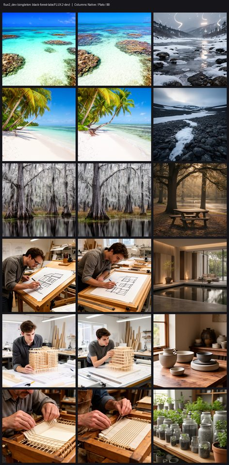
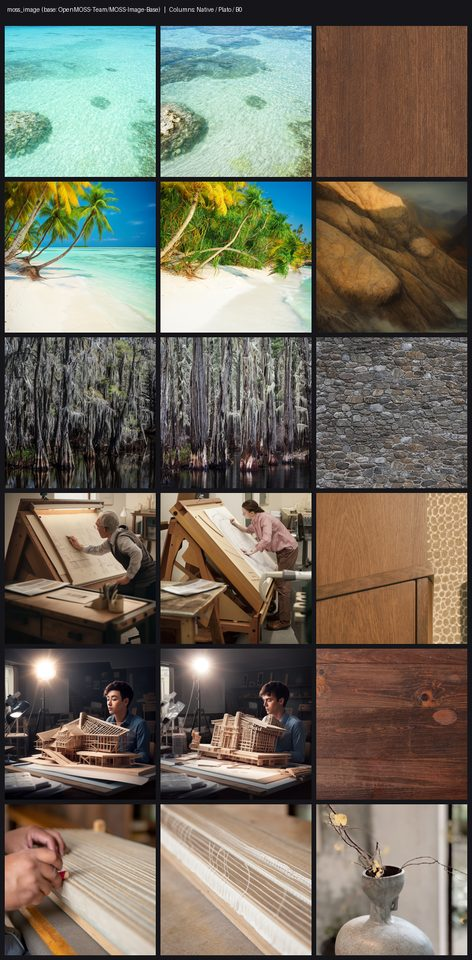
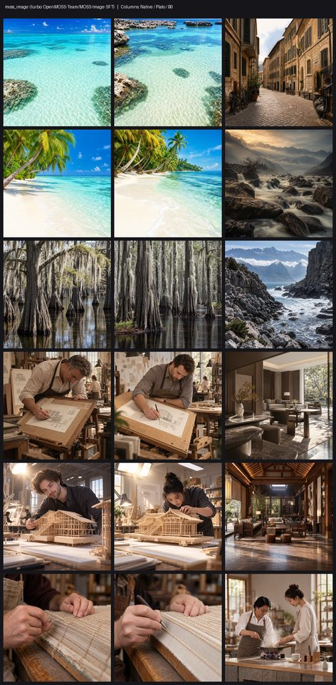

# Verified media gallery

Generated from `media_gallery_manifest.json`. Do not edit by hand.

Each item has a passed attestation receipt, an explicit QA pass verdict, and a file hash that matches the hash recorded in its QA report.

## Multi-card benchmark: one image and one 5-second video with audio per card

| Preview | Item | Hardware | Model | Measured | Receipt | SHA-256 of original |
|---|---|---|---|---|---|---|
|  | Coral reef, 1024x1024 image | RTX PRO 6000 Blackwell (sm_120, 95 GiB) | MiniMax-H3 image (NVFP4), conditioned by the Inkling-2-Mini Plato's Key (concat4) | Time to generate: 27.7 s Steps: 6 Peak VRAM: 12.9 GiB Memory mode: resident_or_comfy_auto | `att-af0ed07a` | `b812cb247c31304a…` |
|  [Play MP4](media/wave3-pro6000-video.mp4) | Coral reef, 5.9-second video with stereo audio | RTX PRO 6000 Blackwell (sm_120, 95 GiB) | MiniMax-H3 FL2VA video+audio (INT8), conditioned by the Inkling-2-Mini Plato's Key (concat4) | Time to generate: 99.6 s Frames: 141 Resolution: 768x448 Peak VRAM: 23 GiB Memory mode: resident_or_comfy_auto | `att-af0ed07a` | `cb1fd6df9f34c3cf…` |
|  | Coral reef, 1024x1024 image | RTX 3090 (sm_86, 24 GiB) | MiniMax-H3 image (INT8), conditioned by the Inkling-2-Mini Plato's Key (concat4) | Time to generate: 71.5 s Steps: 6 Peak VRAM: 20.8 GiB Memory mode: resident_or_comfy_auto | `att-82078ba5` | `7c48fa180b7b06e8…` |
|  [Play MP4](media/wave3-rtx3090-video.mp4) | Coral reef, 5.9-second video with stereo audio | RTX 3090 (sm_86, 24 GiB) | MiniMax-H3 FL2VA video+audio (INT8), conditioned by the Inkling-2-Mini Plato's Key (concat4) | Time to generate: 178.6 s Frames: 141 Resolution: 768x448 Peak VRAM: 22.1 GiB Memory mode: resident_or_comfy_auto | `att-82078ba5` | `19962856184c8fa7…` |
|  | Coral reef, 1024x1024 image | Tesla V100 32 GB (sm_70, 2017) | MiniMax-H3 image (INT8), conditioned by the Inkling-2-Mini Plato's Key (concat4) | Time to generate: 29.3 s Steps: 6 Peak VRAM: 22.3 GiB Memory mode: resident_or_comfy_auto | `att-717e4057` | `02b770e3385a26dd…` |
|  [Play MP4](media/wave3-v100-video.mp4) | Coral reef, 5.9-second video with stereo audio | Tesla V100 32 GB (sm_70, 2017) | MiniMax-H3 FL2VA video+audio (INT8), conditioned by the Inkling-2-Mini Plato's Key (concat4) | Time to generate: 796.0 s Frames: 141 Resolution: 768x448 Peak VRAM: 27 GiB Memory mode: resident_or_comfy_auto | `att-717e4057` | `94c9367fa2cb87c8…` |

## Image, video and music checks

| Preview | Item | Hardware | Model | Measured | Receipt | SHA-256 of original |
|---|---|---|---|---|---|---|
| [Listen (MP3)](media/packetd-anthem-48k.mp3) | The Star-Spangled Banner, 60-second 48 kHz stereo | RTX PRO 6000 Blackwell Server Edition | YuE2-3B with YuE2-Vae, native 48 kHz stereo | Time to generate: 31.6 s Clip length: 60.6 s Peak VRAM: 8.65 GiB | `att-0fcf223c` | `0242e9ff491f806b…` |

## On-device phone pipeline

| Preview | Item | Hardware | Model | Measured | Receipt | SHA-256 of original |
|---|---|---|---|---|---|---|
|  | Red spaceship over snow-capped pines, 512x512 image made on a phone | Galaxy S24 Ultra (on device, no server GPU) | SDXS-512 Q8 GGUF, 1 step; prompt written by Inkling-2-Mini on a Galaxy S26 | Time to generate: 37.9 s | `att-111b1358` | `6aeba3f39109f45b…` |
| [Listen (MP3)](media/voltron-tabs8p-voice.mp3) | Spoken line, 8-second 24 kHz voice made on a tablet | Galaxy Tab S8+ (on device, no server GPU) | Kokoro-82M INT8 ONNX; text written by Inkling-2-Mini on a Galaxy S26 | Time to generate: 5.74 s Clip length: 8.03 s | `att-111b1358` | `e0152bb1e5fa12a6…` |

## Base and turbo images

| Preview | Item | Hardware | Model | Measured | Receipt | SHA-256 of original |
|---|---|---|---|---|---|---|
|  | FLUX.1-dev: native text encoder, Plato's Key and shuffled control, side by side | Blackwell GPU (sm_120) | black-forest-labs/FLUX.1-dev, conditioned by a Plato's Key in place of its text encoder | Prompt match kept vs native encoder, 24 development prompts: 93.1 % Source groups: 16 | `att-62431c15` | `475da276529d9d22…` |
|  | FLUX.1-schnell: native text encoder, Plato's Key and shuffled control, side by side | Blackwell GPU (sm_120) | black-forest-labs/FLUX.1-schnell, conditioned by a Plato's Key in place of its text encoder | Prompt match kept vs native encoder, 24 development prompts: 91.4 % Source groups: 16 | `att-62431c15` | `22cd3e63d007a9fa…` |
|  | FLUX.2-dev: native text encoder, Plato's Key and shuffled control, side by side | Blackwell GPU (sm_120) | black-forest-labs/FLUX.2-dev, conditioned by a Plato's Key in place of its text encoder | Prompt match kept vs native encoder, 24 development prompts: 99.6 % Source groups: 16 | `att-f2803f13` | `cac1010f5726c8a1…` |
|  | FLUX.2-klein-9B (base): native text encoder, Plato's Key and shuffled control, side by side | Blackwell GPU (sm_120) | black-forest-labs/FLUX.2-klein-base-9B, conditioned by a Plato's Key in place of its text encoder | Prompt match kept vs native encoder, 24 development prompts: 97.2 % Source groups: 16 | `att-62431c15` | `ad9af558452e9df7…` |
|  | moss_image (base): native text encoder, Plato's Key and shuffled control, side by side | Blackwell GPU (sm_120) | OpenMOSS-Team/MOSS-Image-Base, conditioned by a Plato's Key in place of its text encoder | Prompt match kept vs native encoder, 24 development prompts: 98.3 % Source groups: 16 | `att-371e4b11` | `fe02c4dd066b6ec6…` |
|  | moss_image (turbo): native text encoder, Plato's Key and shuffled control, side by side | Blackwell GPU (sm_120) | OpenMOSS-Team/MOSS-Image-SFT, conditioned by a Plato's Key in place of its text encoder | Prompt match kept vs native encoder, 24 development prompts: 95.4 % Source groups: 16 | `att-371e4b11` | `01befd5fb2cd5cdf…` |
|  | p_image_oss: native text encoder, Plato's Key and shuffled control, side by side | Blackwell GPU (sm_120) | PrunaAI/P-Image-OSS, conditioned by a Plato's Key in place of its text encoder | Prompt match kept vs native encoder, 24 development prompts: 99.1 % Source groups: 16 | `att-371e4b11` | `ee161984322dad71…` |

## Blender, Godot and DragonFruit by Atlas

| Preview | Item | Hardware | Model | Measured | Receipt | SHA-256 of original |
|---|---|---|---|---|---|---|
|  | 18 brushes, before and after | CPU only (no GPU) | Blender by Atlas 5.2.5 LTS, Omni-Brush | Brushes: 18 Ledger checkpoints: 88 | `att-4c3064b2` | `88f8644c90070729…` |
|  | Ambiguous prompts forked into three candidates | CPU only (no GPU) | Blender by Atlas 5.2.5 LTS, Omni-Brush | Prompts: 5 | `att-4c3064b2` | `be6135b73df43d96…` |
