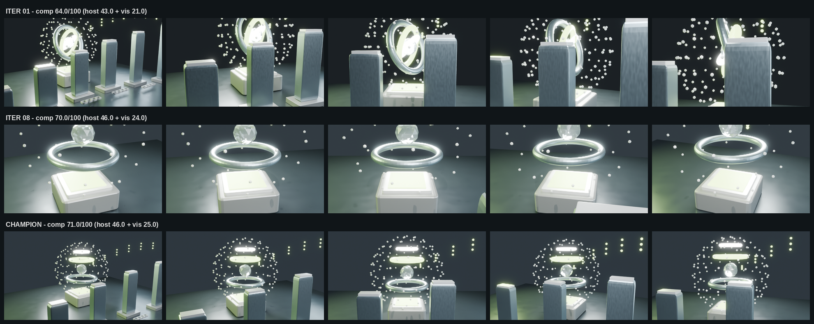

# Autonomous 1080p Celebration Film — Verified Ledger + Native GPU Vision Hillclimb

A standalone Blender 4.5 LTS multimodal hillclimb harness driven by frozen **Inkling-2-Mini** (`NVFP4+MXFP8`, original weights, no `--ablation`) served on **`atlas-ingine`** with native GPU vision and OpenAI `response_format: json_object`.

**Theme:** Celebrating 10 years of NVIDIA AI architecture (2016 Pascal → 2026 Blackwell), Thinking Machines Lab's Inkling-2-Mini, and the open-source + human–AI ("monkey centaur") ecosystem.



- **Rendered 1080p film (24 fps, 14.5 s, 64-spp Cycles CUDA OIDN + H.264 bt709):** [`showcase/celebration_10yr_nvidia_inkling_1080p.mp4`](showcase/celebration_10yr_nvidia_inkling_1080p.mp4) (`4.34 MB`)
- **Autonomous champion Blender 4.5 script (authored by Inkling-2-Mini):** [`showcase/champion_iter_02.py`](showcase/champion_iter_02.py)
- **Full 16-iteration quantitative + vision audit log:** [`showcase/hillclimb_report.json`](showcase/hillclimb_report.json)

## Architecture

1. **Standalone Add/Subtract Verified Ledger (`ledger.py`, SQLite):**
   - **Addition (`admit_entry`):** host- and vision-gated admission of verified scene techniques, aesthetic lessons, API truths, and crash→fix rules. Unverified claims are logged as `REJECT_UNVERIFIED`.
   - **Audited Subtraction (`retract_entry`, `supersede`, `prune_to_budget`):** retracts or supersedes rules that cause visual defects or lose to a higher-scoring iteration (`status='retracted'|'superseded'`, full `ledger_events` audit log).
2. **3-Tier Rolling Context Compressor (`context_compressor.py`):**
   - **Tier 1 (Pinned):** creative brief + compact active Verified Ledger + recent retractions.
   - **Tier 2 (Compressed Rolling History):** deterministic ~150-token structured iteration deltas with epoch rollover (bounded across long runs).
   - **Tier 3 (Live Verbatim Window):** reigning champion script + 5 multi-timestamp Cycles-rendered keyframes fed into `atlas-ingine`'s native GPU vision tower + exact host telemetry.
3. **Two-Process Blender 4.5 Verifier & 1080p Finishing (`verifier.py`, `hillclimb.py`):**
   - Isolates candidate execution (Process 1) from `--factory-startup` scene inspection, 5-keyframe Cycles rendering, and full `1920×1080` MP4 finishing (Process 2).

## Measured Blackwell Run (`RTX PRO 6000 Blackwell`, `sm_120a`)

| Metric | Measured Value |
|---|---|
| Inference speed (`atlas-ingine`, 128K ctx, DSpark) | `694–735.9 tok/s` code decode |
| Vision tower (`5× 640×360` keyframes, 720 image tokens) | `26 ms` (`0.026 s`) |
| All 16 multimodal hillclimb iterations | `6.5 min` (~`21 s`/iter) |
| Full `1920×1080` 24 fps Cycles CUDA OIDN (240 frames @ 64 spp + 4.5 s tribute card) | `28.7 min` (`4.34 MB` H.264 bt709) |
| Verified Ledger events | `ADD=12`, `RETRACT=5`, `REJECT_UNVERIFIED=31` |
| Rolling context bounds | Tier 1 pruned `9,110 → 7,784 chars`; Tier 2 capped at `~4.3–4.6 KB` across Iters 8–16 |

## Reproduce

```bash
# Run standalone unit tests (CPU only, no Blender or GPU required)
PYTHONPATH=ledger/examples python3 -B -m unittest blender_celebration_hillclimb.test_celebration_hillclimb -v

# Run a live 16-iter hillclimb + 1080p CUDA MP4 render (requires Blender 4.5+, ffmpeg, and Inkling-2-Mini-ingine)
bash ledger/examples/blender_celebration_hillclimb/run_celebration_hillclimb.sh 8199 16 CUDA 1 131072
```
