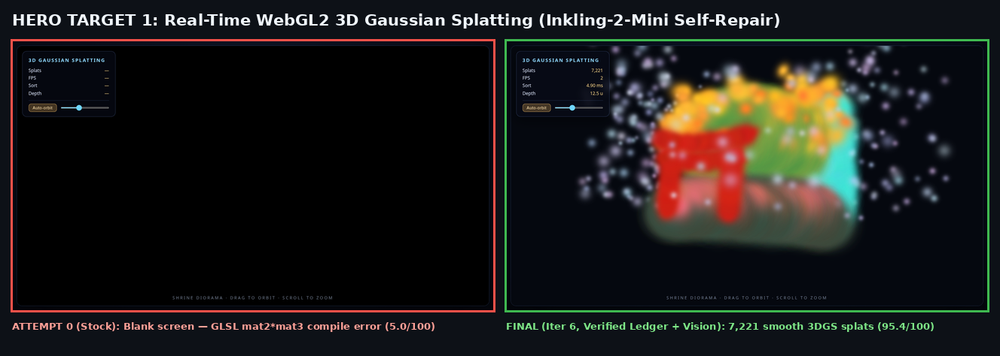
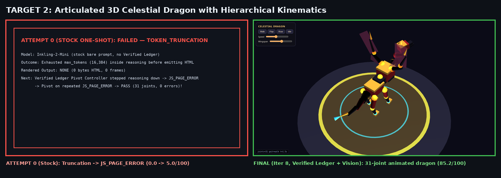
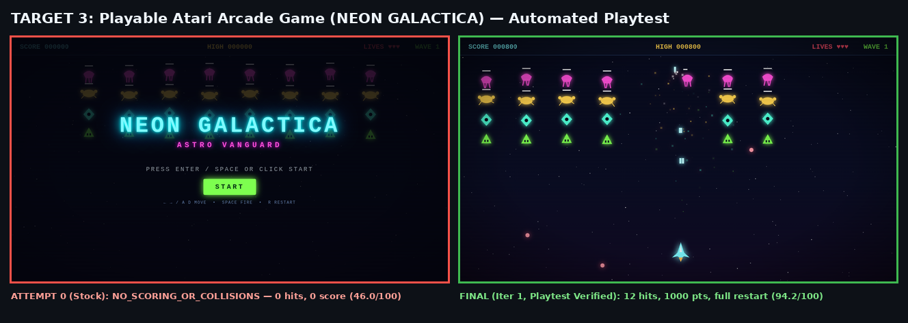

# Inkling-2-Mini + Verified Ledger: WebGL2, Kinematics & Arcade Self-Repair Showcase

Side-by-side comparison of **stock one-shot `Inkling-2-Mini`** vs **`Inkling-2-Mini` paired with `atlas-ingine` Verified Ledger + native GPU vision + headless Playwright/WebGL2 verification**, targeting four commonly reported weak spots of small local models:

1. **Low-level GPU plumbing (3D Gaussian Splatting):** instanced quads, 3D→2D covariance/conic projection, premultiplied alpha blend state, and back-to-front depth sorting.
2. **Detailed articulated / movable 3D creatures:** multi-segment hierarchical limbs, wings, spine, and continuous kinematics.
3. **Self-testing & reviewing playable code:** an Atari-style arcade game verified via automated live input, collision, scoring, damage, game-over, and restart assertions.
4. **Bounded stopping & pivoting:** avoiding blind failure loops via explicit error-signature tracking in SQLite (`ledger/verified_ledger.py`).

All HTML, GLSL ES 3.00, JavaScript kinematics, and game logic in these demos were **authored and self-repaired by `Inkling-2-Mini`** served via `atlas-ingine` (`ingine-serve --spec`, native vision enabled) on a single local 2017 Tesla V100-PCIE-32GB. Open [`index.html`](index.html) locally for the interactive side-by-side gallery.

---

## Side-by-Side Results (Stock One-Shot vs Verified Ledger + Vision)

| Target | Stock One-Shot (Attempt 0) | Verified Ledger + Vision (Final) | Trajectory | Artifacts |
|---|---|---|---|---|
| **1. WebGL2 3D Gaussian Splatting** | **FAIL (`5.0/100`)** — Pitch-black blank screen (`GLSL ES 3.00 mat2 * mat3` Jacobian compile error) | **PASS (`95.4/100`)** — **7,221** smooth anisotropic instanced splats, `blendFunc(ONE, ONE_MINUS_SRC_ALPHA)`, `depthMask(false)`, `~3.1 ms` back-to-front sort, `0` console/GL errors | 7 iterations (`iter_00`..`iter_06`) | [final_verified.html](01_gaussian_splats/final_verified.html) · [attempt_00_stock.html](01_gaussian_splats/attempt_00_stock.html) · [turntable MP4](01_gaussian_splats/shrine_diorama_3dgs_turntable.mp4) |
| **2. Articulated 31-Joint 3D Dragon** | **FAIL (`0.0/100`)** — `TOKEN_TRUNCATION` (exhausted 16,384 tokens before emitting HTML) | **PASS (`85.2/100` framed; `93.0/100` close-up)** — **31 hierarchical joints**, interactive `Walk`/`Flap`/`Roar`/`Idle` + `Speed`/`Wingspan`, full-body 3/4 framing, `0` errors | 9 iterations (explicit pivot on repeated `JS_PAGE_ERROR`, vision framing pass on `iter_08`) | [final_verified.html](02_articulated_creature/final_verified.html) · [showcase MP4](02_articulated_creature/celestial_dragon_showcase.mp4) |
| **3. Playable Atari Arcade (`NEON GALACTICA`)** | **FAIL (`46.0/100`)** — `NO_SCORING_OR_COLLISIONS` (`0` hits / `0` score in live playtest) | **PASS (`94.2/100`)** — Verified live `ArrowRight`/`ArrowLeft` motion (`+190.6px`/`-256.6px`), `12` enemy hits, score `1000`, `lives 3→0 → GAME OVER → clean restart`, `0` errors | 2 iterations (`iter_00`..`iter_01`, bounded early stop) | [final_verified.html](03_atari_arcade/final_verified.html) · [attempt_00_stock.html](03_atari_arcade/attempt_00_stock.html) · [playtest MP4](03_atari_arcade/neon_galactica_playtest.mp4) |

### 1. Real-Time WebGL2 3D Gaussian Splatting

- **`iter_00` (Stock One-Shot):** `JS_PAGE_ERROR` (`mat2 * mat3` GLSL compile error) → blank screen.
- **`iter_01`–`iter_02`:** Fixed shader compile (`6,216` splats sorting in `2.00 ms`), then WebGL2 state-machine inspector caught `SPLAT_SCALE_OR_PROJECTION_BLOWUP` and `TRANSPOSED_VIEW_MATRIX_LAYOUT` (row-major translation passed to column-major `uniformMatrix4fv`).
- **`iter_03`–`iter_06`:** Upgraded to `7,221` splats; per-vertex buffer inspector + native vision caught `WEBGL_PER_VERTEX_BUFFER_MISMATCH` (`aCorner` sharing `instBuf`), which the model fixed with orthonormal `lookAt()`, dedicated `cornerBuf` binding, and `TRIANGLE_STRIP` winding → **PASS (`95.42/100`)**.

### 2. Articulated 31-Joint 3D Celestial Dragon

- **`iter_00`–`iter_03`:** `TOKEN_TRUNCATION` → reasoning-effort step-down → repeated `JS_PAGE_ERROR` triggered an explicit Verified Ledger pivot.
- **`iter_04`–`iter_08`:** Clean 31-joint hierarchical kinematics (`92.95/100`) followed by a native vision framing audit (`CAMERA_TOO_CLOSE_CROPPED`) rotating to an uncropped 3/4 view (`top_edge_fg=0.0`, `85.2/100`).

### 3. Playable Atari Arcade (`NEON GALACTICA`)

- **`iter_00` (Stock One-Shot):** Rendered a start screen, but automated Playwright inputs recorded `0` hits and `0` score (`NO_SCORING_OR_COLLISIONS`).
- **`iter_01`:** Fixed projectile/hitbox collision loop → passed full movement, scoring, lives, game-over, and restart assertions (`94.2/100`) with immediate bounded early stop.

## Verified Ledger & Reproducible Harness

- [`verified_ledger_dump.json`](verified_ledger_dump.json): full export (`3` admitted winners, `5` auto-linked error→repair rules, `21` logged failures).
- [`harness/`](harness/): `showcase_loop.py`, `verifier.py`, `capture_media.py`, `build_gallery_and_report.py`.
