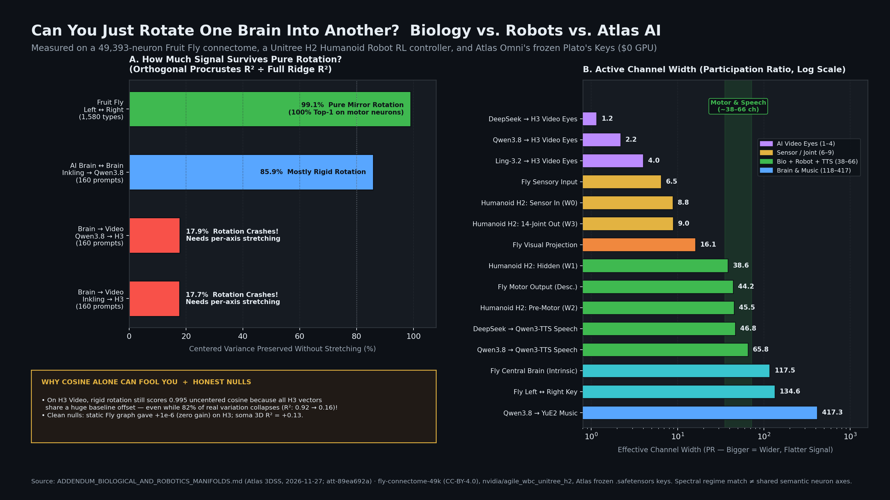

# Addendum: Manifold Rigidity and Spectral Geometry Across Biological Connectomes, Humanoid Whole-Body Control, and Atlas Omni Bridges

**Status:** Verified Zero-GPU Measurement Addendum (`$0.00` GPU cost; pure CPU FP64/FP32 verification)  
**Parent Paper:** *Zero-Gradient Omni-Modal Grafting: Closed-Form Linear Bridges, Failure Boundaries, and Multi-Donor Blends* (`v0.9.3`)  
**Author:** William Joseph Tatum (Monkey), `Atlas3DSS`  
**Date:** 2026-11-27

---

## 1. Main Measurements

Comparing linear bridge geometry across a complete biological central-brain connectome (`fernandofernandes/fly-connectome-49k`, `49,393` neurons, `9,050,172` signed synapses), a deployed humanoid whole-body control RL policy (`nvidia/agile_wbc_unitree_h2`, `agile_velocity.onnx`, `14`-DoF MLP, `743,142 B`), and Atlas Omni's frozen FP64 Plato's Keys (`MiniMax-H3` video/eyes, `Qwen3-TTS` mouth, `YuE2-3B` music) exposes two concrete structural properties and two clean nulls:

1. **Within-domain maps are near-rigid orthogonal rotations; cross-modal Brain → Video maps are heavily anisotropic rescalings.** On `1,580` held-out *Drosophila* bilateral cell types, pure orthogonal Procrustes retains `99.1%` of unconstrained Ridge `R²` (`0.7919` vs `0.7990`; Top-1 retrieval `91.90%` vs `92.34%`, `1,458×` over `0.063%` chance). Between two independent language trunks (`Inkling-2-Mini → Qwen3.8-27B`, `160` `val_dev` prompts), orthogonal Procrustes retains `85.9%` of Ridge `R²` (`0.5497` vs `0.6400`). In contrast, mapping frozen language trunks into `MiniMax-H3` video-conditioning space collapses under rigid rotation: Procrustes retains only `17.7%` (`Inkling → H3`, `R² = 0.1628` vs `0.9181`) and `17.9%` (`Qwen3.8 → H3`, `R² = 0.1667` vs `0.9324`) of centered variance, even though uncentered cosine remains `0.9948–0.9949` due to a dominant shared mean vector.
2. **Motor control and speech bridges share a mid-rank flat spectral hourglass distinct from visual diffusion and polyphonic music.** Sensory inputs start narrow (`Fly cb_sensory PR = 6.48`; `Unitree H2 W0 PR = 8.85`), expand into a flat mid-rank motor integration space (`Fly descending_neuron PR = 44.22`, `top10 = 36.1%`; `Unitree H2 W1/W2 PR = 38.60–45.53`, `top10 = 37.7%–41.3%`, `flat32 = 0.471–0.562`; `DeepSeek-V4.1 → Qwen3-TTS Mouth PR = 46.81`, `top10 = 35.5%`, `flat32 = 0.605`; `Qwen3.8 → Qwen3-TTS Mouth PR = 65.80`, `flat32 = 0.704`), and re-compress at actuators (`Unitree H2 W3 PR = 8.96`). By contrast, all three `LLM → MiniMax-H3` visual keys are ultra-spiked (`PR = 1.16–4.02`, `top1 = 42.6%–90.2%`, `flat32 = 0.058–0.131`), while polyphonic music (`Qwen3.8 → YuE2`) demands an order of magnitude wider flat bandwidth (`PR = 417.32`, `eff_rank = 742.04`, `r80 = 495`).
3. **Two explicit nulls bound these claims.** Routing frozen `Inkling-2-Mini` embeddings through `1–3` hops of the static signed *Drosophila* connectome `W_fly` versus a degree- and weight-preserving rewired null `W_rewired` on the `800`-prompt H3 benchmark produces zero gain (`hop_1` cosine `0.998280` vs `0.998279`, `delta = +1e-6`; `hop_3` `delta = 0.000000`). Predicting 3D soma coordinates from the synaptic spectral embedding over `9,143` neurons from disjoint cell types yields `R² = +0.1309` (`median_err = 160.31 µm` vs `172.99 µm` mean baseline).

---

## 2. Rigid Rotation (Procrustes) vs. Anisotropic Rescaling (Ridge)

For each paired mapping $(X_{\text{fit}}, Y_{\text{fit}}) \to (X_{\text{val}}, Y_{\text{val}})$, we compare unconstrained FP64 Ridge regression against exact rigid Orthogonal Procrustes (reduced thin-QR rank-$N$ SVD with a single global scalar gain $\alpha$, zero per-axis stretching). Both uncentered cosine and centered variance explained ($R^2$) are reported on identical held-out splits:

| Paired Mapping | Domain Class | Held-Out `n` | Ridge `cos` | Rigid Procrustes `cos` | Ridge `R²` | Rigid Procrustes `R²` | `R²` Retention (`Orth / Ridge`) | Geometric Regime |
|---|---|---:|---:|---:|---:|---:|---:|---|
| `Fly Left → Right` (all bilateral types) | Biological Connectome | `1,580` types | `0.8909` | `0.8753` | **`0.7990`** | **`0.7919`** | **`99.1%`** | Rigid near-isometry |
| `Inkling-2-Mini → Qwen3.8-27B` | Cross-LLM (Brain ↔ Brain) | `160` prompts | `0.9669` | `0.9587` | **`0.6400`** | **`0.5497`** | **`85.9%`** | Near-isometric rotation |
| `Inkling-2-Mini → MiniMax-H3` | Cross-Modal (Brain → Eyes/Video) | `160` prompts | `0.9986` | `0.9948` | **`0.9181`** | **`0.1628`** | **`17.7%`** | Anisotropic rescaling |
| `Qwen3.8-27B → MiniMax-H3` | Cross-Modal (Brain → Eyes/Video) | `160` prompts | `0.9988` | `0.9949` | **`0.9324`** | **`0.1667`** | **`17.9%`** | Anisotropic rescaling |

**Methodological finding on uncentered cosine:** On `→ MiniMax-H3`, uncentered cosine stays above `0.994` under rigid Procrustes (`rigidity_ratio_cos = 0.9961–0.9962`) only because H3 word-span conditioning vectors share a large non-zero mean offset $\mu_Y$. Centered `R²` exposes the true collapse (`0.9181 → 0.1628` and `0.9324 → 0.1667`). Evaluating cross-modal bridges with uncentered cosine alone hides severe variance miscalibration; Ridge's per-axis singular rescaling is structurally required for `LLM → H3` and cannot be replaced by an orthogonal rotation.

---

## 3. Biological Bilateral Isometry Across Modalities (`fly-connectome-49k`)

From the full `49,393`-neuron, `9,050,172`-edge signed CSR graph (`6,061,699` excitatory, `2,988,473` inhibitory, E/I weight ratio `1.8179`; `14/14` manifest SHA-256 verified), we compute a `256`-dimensional spectral embedding by concatenating scaled left and right top-`128` singular vectors ($[U\Sigma^{1/2}, V\Sigma^{1/2}]$, capturing `35.64%` of graph Frobenius energy; real connectome leading singular value `s0 = 1.6022` vs degree-matched rewired null `0.7671`, `2.09×` structural amplification).

Across `7,900` bilateral cell types (`6,320` fit / `1,580` strictly held-out unseen cell types, `lam = 1e-3`), the closed-form Left → Right Plato's Key (`fly49k_left_to_right_platos_key.safetensors`, `[256×256]`) achieves:

| Method (`1,580` Unseen Bilateral Cell Types) | Cosine Mean | `R²` | Top-1 Retrieval | Top-5 Retrieval | Top-10 Retrieval | MRR | Median Rank |
|---|---:|---:|---:|---:|---:|---:|---:|
| **FP64 Ridge Plato's Key** | **`0.8909`** | **`0.7990`** | **`92.34%`** | **`98.80%`** | **`99.11%`** | **`0.9528`** | `1.0` |
| **Pure Orthogonal Procrustes** | `0.8753` | `0.7919` | `91.90%` | `98.10%` | `98.99%` | `0.9468` | `1.0` |
| Raw unmapped identity (`L` directly vs `R`) | `0.5241` | `-0.1405` | `40.00%` | `57.41%` | `67.91%` | `0.4887` | `3.0` |
| `B0` shuffled-pairing control | `0.0339` | `-2.0434` | `0.00%` | `0.25%` | `0.51%` | `0.0041` | `816.0` |

Breaking down the same held-out `1,580` types by biological superclass shows rigid bilateral isometry (`orth_cos / ridge_cos = 0.9698–1.0014`) across every sensory, central, and motor subsystem, peaking at `100.0%` (`89/89`) Top-1 identity recovery on descending motor command neurons:

| Biological Superclass | Total Neurons | Unseen Types | Ridge `cos` | Ridge `R²` | Procrustes `cos` | Rigidity (`Orth/Ridge`) | Within-Class Top-1 | Feature `PR` | Eff. Rank | Top-10 Energy |
|---|---:|---:|---:|---:|---:|---:|---:|---:|---:|---:|
| `cb_sensory` (Sensory Input) | `4,868` | `31` | `0.8375` | `0.9595` | `0.8386` | `1.0014` | `87.10%` | **`6.48`** | `10.25` | `91.22%` |
| `visual_projection` (Eyes) | `9,201` | `75` | `0.8469` | `0.8906` | `0.8213` | `0.9698` | `96.00%` | **`16.15`** | `27.77` | `66.10%` |
| `ascending_neuron` (Body Feedback) | `1,846` | `108` | `0.8662` | `0.9354` | `0.8538` | `0.9857` | `95.37%` | **`30.65`** | `48.94` | `48.56%` |
| `descending_neuron` (Motor Command) | `1,314` | `89` | **`0.9192`** | `0.9023` | **`0.9077`** | `0.9874` | **`100.00%`** | **`44.22`** | `62.49` | `36.12%` |
| `cb_intrinsic` (Central Brain) | `32,164` | `1,277` | `0.9045` | `0.9081` | `0.8872` | `0.9808` | `92.64%` | **`117.53`** | `166.06` | `19.89%` |

---

## 4. Side-by-Side Spectral Geometry: Biological Connectome vs. Unitree H2 WBC vs. Atlas Omni Keys

Each linear operator or representation block below is evaluated with the same singular-value diagnostics: Participation Ratio $\text{PR} = (\sum_i \sigma_i^2)^2 / \sum_i \sigma_i^4$, Shannon effective rank $\exp(-\sum_i p_i \ln p_i)$, top-1 and top-10 Frobenius energy fraction, rank needed for `80%` energy (`r80`), and top-32 spectral flatness $\text{mean}(\sigma_{1..32}) / \sigma_1$ (`1.0` = perfectly flat orthogonal block, `-> 0` = rank-1 spike).

| System / Operator | Domain | Matrix Shape | Exact SVD | `PR` | Eff. Rank | Top-1 Energy | Top-10 Energy | `r80` | `flat32` |
|---|---|---|---:|---:|---:|---:|---:|---:|---:|
| **Fly `cb_sensory`** | Bio Sensory | `[4096×256]` | Yes | `6.48` | `10.25` | — | `91.22%` | — | — |
| **Fly `visual_projection`** | Bio Vision | `[4096×256]` | Yes | `16.15` | `27.77` | — | `66.10%` | — | — |
| **Fly `descending_neuron`** | Bio Motor | `[1314×256]` | Yes | **`44.22`** | `62.49` | — | `36.12%` | — | — |
| **Fly `Left → Right` Key** | Bio Bilateral Key | `[256×256]` | Yes | `134.60` | `183.03` | `2.97%` | `17.84%` | `140` | `0.6052` |
| **Unitree H2 `W0` (Input)** | RL Humanoid WBC | `[256×255]` | Yes | **`8.85`** | `25.94` | `23.33%` | `68.05%` | `22` | `0.2711` |
| **Unitree H2 `W1` (Hidden)** | RL Humanoid WBC | `[256×256]` | Yes | **`38.60`** | `78.84` | `8.30%` | `41.30%` | `59` | `0.4710` |
| **Unitree H2 `W2` (Pre-Motor)** | RL Humanoid WBC | `[128×256]` | Yes | **`45.53`** | `70.03` | `6.28%` | `37.68%` | `49` | `0.5618` |
| **Unitree H2 `W3` (14-Joint Head)** | RL Humanoid WBC | `[14×128]` | Yes | **`8.96`** | `10.73` | `19.65%` | `92.13%` | `7` | `0.5613` |
| **`Qwen3.8 → H3` Single Tap** | Atlas Eyes/Video | `[5120×5120]` | Rand-256 | **`2.19`** | `10.63` | `55.29%` | `58.76%` | `216` | `0.0940` |
| **`DeepSeek-V4.1 → H3` Single Tap** | Atlas Eyes/Video | `[5120×5120]` | Rand-256 | **`1.16`** | `1.88` | `90.24%` | `91.15%` | `1` | `0.0582` |
| **`Ling-3.2-air → H3` Single Tap** | Atlas Eyes/Video | `[2560×5120]` | Rand-256 | **`4.02`** | `28.45` | `42.62%` | `49.17%` | `174` | `0.1309` |
| **`Inkling → Qwen3-TTS` (`W_dig2`)** | Atlas Mouth (Prosody) | `[9216×4096]` | Rand-256 | `5.79` | `5.89` | `20.57%` | `100.00%` | `5` | `0.1680` |
| **`DeepSeek-V4.1 → Qwen3-TTS` (`W_inst`)** | Atlas Mouth (Speech) | `[20480×2048]` | Yes | **`46.81`** | `63.71` | `5.77%` | `35.54%` | `42` | `0.6045` |
| **`Qwen3.8 → Qwen3-TTS` (`W_inst`)** | Atlas Mouth (Speech) | `[20480×2048]` | Yes | **`65.80`** | `89.74` | `3.66%` | `28.02%` | `58` | `0.7039` |
| **`DeepSeek-V4.1 → YuE2` (`W_yue2`)** | Atlas Music | `[20480×2048]` | Yes | `52.47` | `133.85` | `10.76%` | `28.68%` | `110` | `0.3425` |
| **`Qwen3.8 → YuE2` (`W_yue2`)** | Atlas Music | `[20480×2048]` | Yes | **`417.32`** | `742.04` | `1.20%` | `8.08%` | `495` | `0.6972` |

*Note on `Inkling → Qwen3-TTS (W_dig2)`: this Packet C prosody key was trained specifically to transfer 4-class discrete prosody controls (urgency, pace, warmth, intonation), which explains why `100%` of its singular energy sits inside rank `10` (`r90 = 6`), whereas `Qwen3.8`/`DeepSeek-V4.1 → Qwen3-TTS (W_inst)` map full open-domain instruction conditioning.*

---

## 5. Honest Nulls & Scope Boundaries

1. **Untrained Biological Reservoir Null (`Test 4`):** Projecting `Inkling-2-Mini` `fit` (`640` prompts) and `val_dev` (`160` prompts) hidden states into a `512`-neuron sensory input slice of the real `49,393×49,393` signed connectome `W_fly` and propagating `1–3` linear+ReLU hops gave no advantage over an exact degree- and weight-preserving rewired null `W_rewired`:
   - Direct `Inkling → H3` ceiling (`val_dev`): `cos = 0.998592`, `R² = 0.918093`
   - `t=0` sensory projection only (`512d`): `cos = 0.998281`, `R² = 0.868738`
   - `W_fly` real connectome (`hop_1 / hop_2 / hop_3`): `cos = 0.998280 / 0.998280 / 0.998280`, `R² = 0.868133 / 0.868215 / 0.868224`
   - `W_rewired` null (`hop_1 / hop_2 / hop_3`): `cos = 0.998279 / 0.998280 / 0.998280`, `R² = 0.868495 / 0.868483 / 0.868477` (`delta_hop1 = +1e-6`, `delta_hop3 = 0.000000`).
   - Replacing raw readout with `W_fly` `hop_1` projected into the `256d` biological SVD basis dropped further to `cos = 0.997223`, `R² = 0.753778`.
2. **Synaptic Topology → 3D Soma Coordinates (`Test 2`):** Fitting FP64 Ridge from the `256d` synaptic spectral embedding to 3D soma positions (`µm`) across `35,136` train neurons and evaluating on `9,143` neurons from strictly disjoint cell types yielded `R² = +0.1309` (`median_err = 160.31 µm`, `mean_err = 165.68 µm` vs `172.99 µm` mean baseline; `B0` shuffled `R² = -0.0013`). In insect brains, cell bodies sit on the outer rind while wiring specificity occurs inside interior neuropil arbors, so synaptic topology weakly constrains soma coordinates.
3. **No Shared Latent Axis Claim:** Matching participation ratios across `Fly descending_neuron` (`44.22`), `Unitree H2 W2` (`45.53`), and `DeepSeek-V4.1 → Qwen3-TTS` (`46.81`) documents a shared **spectral regime** (effective dimensionality and eigenvalue flatness of motor/speech conditioning operators), not aligned semantic neurons across organisms or tasks.

---

## 6. Engineering Takeaways for Bridge Architecture

1. **Match bridge parameterization to target anisotropy.** Same-modality bridges (bilateral connectome, Brain ↔ Brain) are near-orthogonal (`85.9%–99.1%` `R²` retention under rigid Procrustes) and tolerate tight orthogonal or low-bit quantization. Cross-modal `Brain → Video Diffusion` bridges (`17.7%–17.9%` rigid `R²` retention; `PR = 1.16–4.02`) require unconstrained per-axis scaling (FP64 Ridge or explicit SVD scale factors).
2. **Budget bridge rank by target organ class.** Visual diffusion keys concentrate `43%–90%` of energy in the top mode (`PR = 1.2–4.0`), motor/speech keys spread evenly across `~40–70` modes (`PR = 39–66`, `r80 = 42–59`, `flat32 = 0.47–0.70`), and polyphonic music requires `~400+` flat modes (`PR = 417`, `r80 = 495`). Applying a single fixed low-rank cutoff across Eyes, Mouth, and Music either over-allocates Eyes or starves Music.
3. **Never grade cross-modal bridges on uncentered cosine alone.** Whenever a target encoder has a strong shared mean vector (such as `MiniMax-H3`), rigid Procrustes reaches `0.9949` uncentered cosine while failing `82%` of centered variance (`R² = 0.1667`). Always pair cosine with centered `R²` and matched `B0` null controls.

---

## 7. Artifact Provenance & Reproduction

All measurements ran on CPU (`$0.00` GPU cost) from SHA-256-verified public upstream datasets and existing frozen Atlas `.safetensors` keys:

| Artifact | Path | SHA-256 |
|---|---|---|
| Fly-49k Plato's Key Probe Report | `/mnt/storage/fly_connectome_49k_probe/out/fly_connectome_49k_platos_probe_report.json` | `8e517cfcc658fa4004cbd7e08bbf2a82a1db8a102ea18258047ee8d7bf32eff4` |
| Fly-49k Left→Right Key (`.safetensors`) | `/mnt/storage/fly_connectome_49k_probe/out/fly49k_left_to_right_platos_key.safetensors` | `ca8d42326cef7579f5cb32d8381ac0d81cbec397126a8d992bd7d594133c0d74` |
| Unitree H2 WBC ONNX Policy (`nvidia/agile_wbc_unitree_h2`) | `/mnt/storage/fly_connectome_49k_probe/agile_wbc_h2/agile_velocity.onnx` | `c9f9f1d2e5460683967921ead8ed00d165bd1cde623b5efaa0b0ea4f327cfe06` |
| Unitree H2 WBC Spectral Report | `/mnt/storage/fly_connectome_49k_probe/out/unitree_h2_wbc_spectral_report.json` | `75f8ec3107f923294e5013f81785e7563d26c5449ffd370b9e39ad07ca75de3b` |
| Cross-Domain Comparison Report (corrected `axis=1` Procrustes rigidity) | `/mnt/storage/fly_connectome_49k_probe/out/fly_vs_atlas_omni_comparison.json` | `4922561dc6e6756904a59cc63a64f179452387868dedaa1e3f89f40622b2fa0e` |
| Probe Script (`probe_fly_platos_keys.py`) | `/mnt/storage/fly_connectome_49k_probe/probe_fly_platos_keys.py` | `283bc4bc26cc89814d3f50e9c96b76b96c69b2292889c3138dee7064800d95f7` |
| Comparison Script (`compare_fly_vs_atlas_omni.py`) | `/mnt/storage/fly_connectome_49k_probe/compare_fly_vs_atlas_omni.py` | `413676bd47b1354407dc66adfbced164e267fcaf0d399273ea1a78f2b4135abb` |

### Upstream Credits
- Biological connectome dataset: `fernandofernandes/fly-connectome-49k` (CC-BY-4.0, derived from MaleCNS / FlyWire *Drosophila* central-brain connectome).
- Whole-body humanoid RL velocity controller: `nvidia/agile_wbc_unitree_h2` (`agile_velocity.onnx`).
