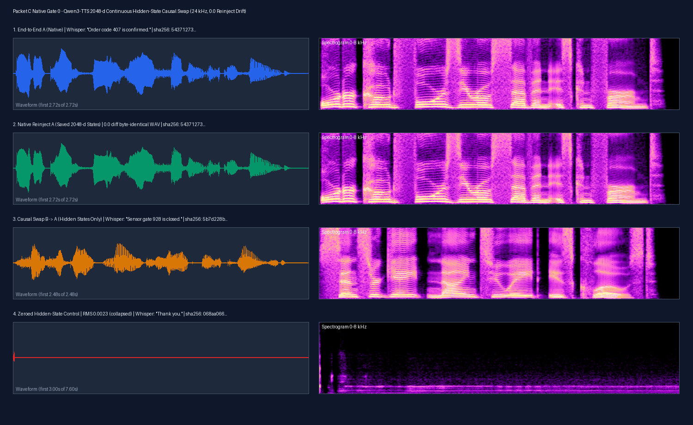
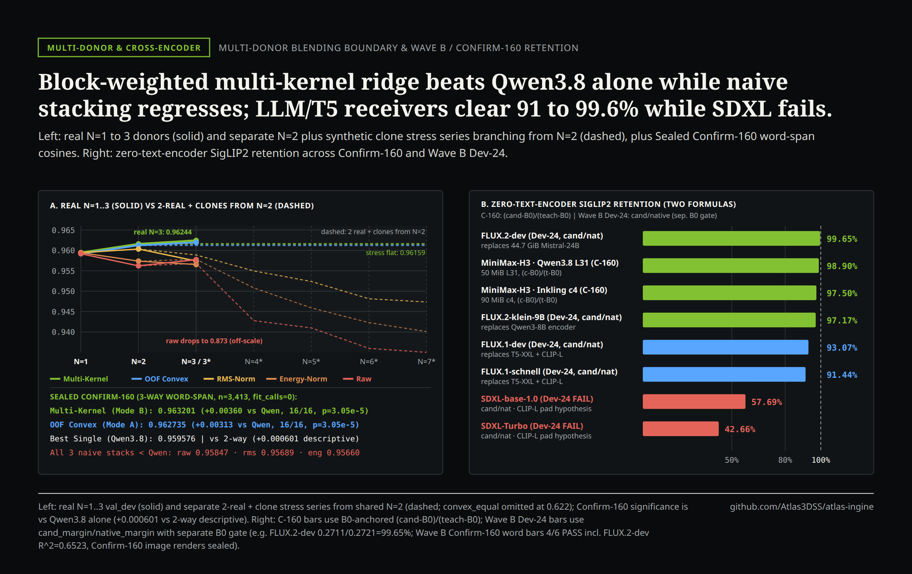
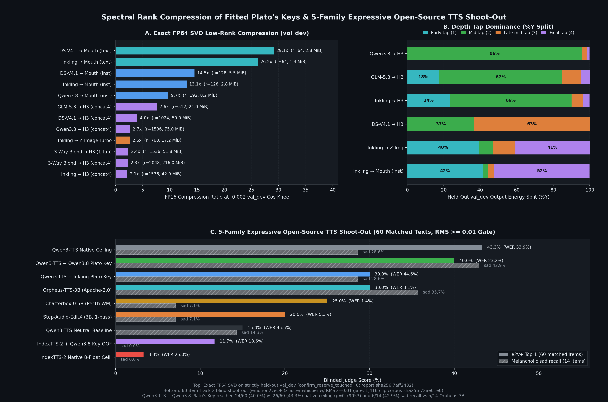
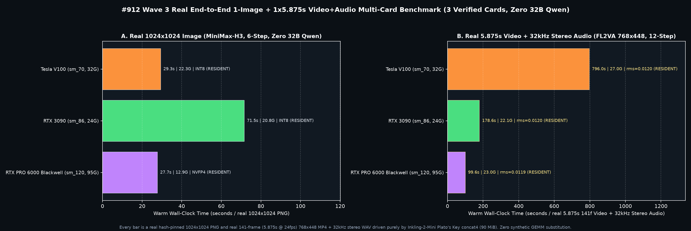
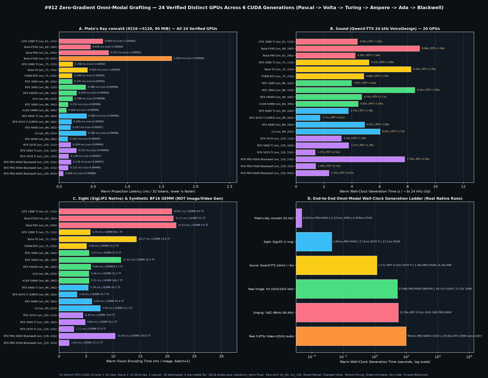
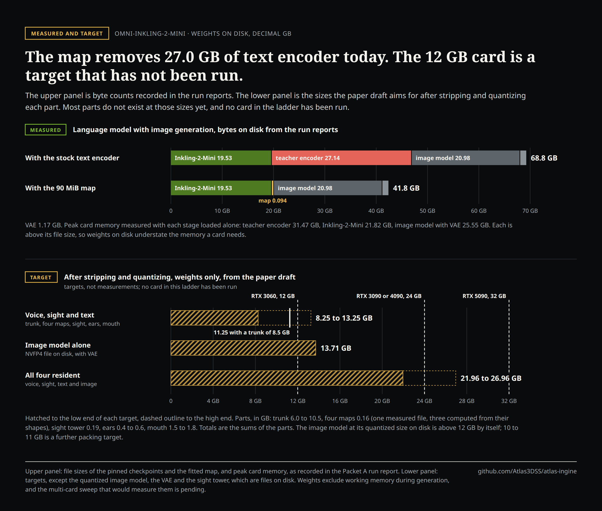

# Zero-Gradient Omni-Modal Grafting: Closed-Form Linear Bridges, Failure Boundaries, and Multi-Donor Blends

**Manuscript v0.9.3 (2026-11-27)** · **Author:** William Joseph Tatum (Monkey), `Atlas3DSS` *(with special thanks and dedicated opening-page acknowledgment to **Neon**, Atlas 3DSS AI engineering & research system)*
**Formatted LaTeX PDF:** [PAPER.pdf](PAPER.pdf) ([LaTeX source](PAPER.tex)) · **360° World-Model Turnaround ("This Is Not a Video"):** [WORLD_MODEL_TURNAROUND.md](world_model_turnaround/WORLD_MODEL_TURNAROUND.md) · **Companion Walkthrough:** [TUTORIAL.md](TUTORIAL.md) · **Side-by-Side Image Gallery:** [COMPARISONS.md](COMPARISONS.md) (23 byte-identical contact sheets) · **Host-Enforced Alignment & Live Pliny Proof:** [HOST_ENFORCED_ALIGNMENT.md](HOST_ENFORCED_ALIGNMENT.md) · **HF Collection (`Omni by Atlas`):** https://huggingface.co/collections/Atlas3D/omni-by-atlas-6b09daccd0f65e23233163b3 · **Provenance Ledger:** [PROCESS_LOG.md](PROCESS_LOG.md)

---

## Abstract

Closed-form linear representation maps can graft image diffusion, native video+audio diffusion, coarse visual perception, speech perception, and prosodic speech control onto a frozen looped-MoE language model (`Inkling-2-Mini`) with zero gradient steps and zero trunk weight edits. Replacing the `27.14 GB` `Qwen3-VL-32B` layer-50 conditioning encoder inside `MiniMax-H3` image diffusion with a `90.0 MiB` closed-form `concat4` FP64 ridge map fitted on `640` prompts (`13,872` word spans, `355 s` CPU) holds up on a **sealed 160-prompt confirmation split** (`640` `1024×1024` images, `16` disjoint groups, `fit_calls = 0`): `concat4` retains `97.50%` of the teacher's `B0`-anchored SigLIP2 margin (`0.1982` vs `0.2045` teacher; delta `-0.0063`, 95% CI `[-0.0117, -0.0010]`; `0.8942` image-vs-teacher cosine; `0.9228` pooled word cosine / `R² = 0.9982`), while the pre-declared primary `22.5 MiB` `single_tap` key passes every confirmation bar (`16/16` groups over matched shuffled `B0`, `p = 3.05e-5`, `80.02%` retention). An orthogonal **DINOv3-ViT-L/16** audit over the same `640` sealed PNGs confirms the ordering across `16/16` groups (`p = 3.05e-5` on CLS `0.7599`, patch-mean `0.8697`, and spatial patch `0.6910` vs `B0` `0.0309`/`0.1936`/`0.1729`), and a matched-data `76.56M`-parameter residual GELU MLP (`29.37M`-parameter residual branch on top of exact ridge) adds no statistically detectable grouped word-span cosine gain over ridge (`+0.00018`, `8/16`, `p = 1.0`). The same frozen `90.0 MiB` key transfers at zero extra bytes to `MiniMax-H3` `FL2VA` native video+audio and `12.54 GB` NVFP4 image DiT (`n = 4` dev prompts).

Stress-testing linear grafting exposes two sharp boundaries in our tested configurations. In the reverse direction (Vision → LLM), closed-form ridge preserves spatial counting (`45/48` agree) while failing dense OCR (`1–3/48`) and UI charts (`1–2/48`, `ridge_norm` rejected `p = 0.727`); replacing the coarse backbone with stripped high-resolution vision towers (`GOT-OCR2` + `SigLIP2-NaFlex`, `arm3a`) lifts overall Dev-192 teacher agreement (`64 → 81/192`, `p = 7.63e-5`), yet clears only `2/5` dev bars and leaves OCR near zero (`2/48` agree, `0/48` gold; `448`-item test sealed). On speech synthesis (`Qwen3-TTS-12Hz-1.7B`), direct linear substitution transfers style (`27/32`) while collapsing contrastive lexemes (`0/32`); supplying discrete LLM words alongside a linear style key (`M_explicit_lexical_plus_hidden`) passes `6/6` amended `val_dev` gates (`32/32` blind human audibility), then **fails one-shot sealed confirmation (`mouth_confirm_reserve`, `80` items, `4/6` amended gates, zero retuning)** because lexical preservation (`29/32`) and silence gating (`0/16` FP) pass while style (`21/32` vs `11/32` swapped, `p = 0.1102`) drops due to a `0/8` intonation reversal under the frozen acoustic scorer (`ears_confirm_reserve` `0/80` sealed). Finally, across heterogeneous donors on sealed Confirm-160 word-span alignment (`n = 3,413`, `fit_calls = 0`, `B0` dev-only), block-weighted multi-kernel ridge scales monotonically past the Confirm-`R²`-selected best single donor (`Qwen3.8-27B`, `0.95958`) across `16/16` groups and `8/8` domains — reaching **`0.962601`** (2-way) and **`0.963201`** (3-way, `+0.003602`, `p = 3.052e-5`; Mode A OOF convex `0.962735`, while unweighted/normed stacked controls all score below `Qwen3.8` alone) — and a single half-depth `Qwen3.8` `layer_31 / 64` key (`50.02 MiB`) retains **`98.90%`** in controlled `PRO 6000` `cu130` Confirm-160 (`0.201639` vs `0.204513` teacher, `16/16` vs `B0`; historical within-Vast `101.55%` preserved separately).

---

## 1. Contributions & Summary of Verified Results

This work makes four concrete empirical contributions under frozen trunks, mandatory `0.0` RMSE native reinjection floors, matched shuffled controls (`B0`), and sealed disjoint confirmation splits:

1. **Zero-gradient diffusion conditioning at 288× lower encoder footprint (Packet A):** A `90.0 MiB` FP64 ridge map (`concat4`, `355 s` CPU on `640` prompts, `0` grad steps) replaces a `27.14 GB` `Qwen3-VL-32B` encoder at `97.50%` sealed Confirm-160 margin retention (`16/16` DINOv3-ViT-L/16 agreement), outperforms single-tap Orthogonal Procrustes (`R² = 0.9948` vs `-0.405` on `2304 → 5120`), shows no statistically detectable grouped word-span cosine gain from a `1.62×`-larger residual 2-layer GELU MLP (`+0.00018`, `8/16`, `p = 1.0`), and transfers at zero extra bytes to Dev-4 `FL2VA` video+audio.
2. **Empirical isolation of two linear grafting limits:** We document exact configurations where frozen linear bridges fail rather than hide them — dense Vision → LLM OCR (`2/48` agree / `0/48` gold even after upgrading to `GOT-OCR2` + `SigLIP2-NaFlex`) and LLM → TTS exact lexemes (`0/32` direct) plus cross-persona intonation polarity (`0/8` reversal in one-shot `mouth_confirm_reserve` `FAIL 4/6`).
3. **Block-weighted multi-donor blending and transitive hubs (word-span scope):** Unweighted and RMS/energy-normalized stacked ridge regress when `N >= 2–3` heterogeneous donors are combined (`0.9566–0.9585` vs `0.95958` `Qwen3.8`), whereas block-weighted multi-kernel ridge (`0.963201`, `+0.003602`) and OOF convex blending (`0.962735`, `+0.003126`) beat `Qwen3.8` alone across `16/16` groups and `8/8` domains on Sealed Confirm-160 (`p = 3.052e-5`; `B0` dev-only, `3-way` vs `2-way` `+0.000601` descriptive only), and transitive cross-LLM hubs (`Qwen3.8 → Inkling → H3`, `0.93407`) beat Inkling's direct map (`0.92282`).
4. **Middle-layer conditioning sufficiency & forensic cross-host discipline:** On a controlled `PRO 6000` `cu130` Confirm-160 replay (`160/160` teacher PNGs identical to Packet A at `0.204513`), activations through `Qwen3.8-27B` `layer_31 / 64` alone (`50.02 MiB`) sufficed to pass the matched-`B0` bar (`16/16`, `98.90%` retention; end-to-end early-exit prefill speedup was not timed), after forensic tensor auditing localized a pre-render divergence in an earlier Vast `cu128` run (`101.55%` preserved separately; first nonzero BF16 diff at token `0`/`1` in `153`/`7` prompts, first `max_abs > 0.125` at zero-based token index `24` across `148/148` long prompts with smallest index-24 max `12.46875`, backend attribution unresolved).

Every quantitative result below comes from sealed or attested hardware runs. Untouched confirmation splits (`448` Packet B2 vision items and `80` Packet C Ears items) are explicitly marked `SEALED`; Packet C Mouth (`80` items, `M_explicit_lexical_plus_hidden`) completed its preregistered one-shot confirmation (`FAIL 4/6`, preserved with zero retuning). Provenance hashes and receipt IDs are cataloged in Appendix B.

| Track | Graft Seam & Frozen Donor → Receiver | Bridge Size (FP16) | Verified Metric (Exact Counts) | Control / Comparator | Confirmation Status |
|---|---|---:|---|---|---|
| **Packet A — Confirm-160 (`concat4`, separate)** | `Inkling-2-Mini` (`concat4`, 9216→5120) → `MiniMax-H3` DiT (`0` fits) | **90.0 MiB** *(replaces 27.14 GB teacher)* | **Sealed `n = 160` (`16` groups, `640` imgs):** Pooled word cos **0.9228** (`R² = 0.9982`, `n = 3,413`); SigLIP2 **0.1982** (**97.50%** vs ST `B0` ref; delta `-0.0063` vs `0.2045` teacher, 95% CI `[-0.0117, -0.0010]`, `4/16` above / `12/16` below); SigLIP2 img-vs-teacher **0.8942**; **DINOv3-ViT-L/16** (vs teacher) CLS **0.7599** / Patch-Mean **0.8697** / Spatial **0.6910** | Beats `single_tap` `16/16` (`p = 3.05e-5`) on SigLIP2 & all 3 DINOv3 metrics; matched Residual Ridge+MLP grouped word cos delta `+0.00018` (`8/16`, `p = 1.0`) | **SEALED CONFIRM-160 PASS** |
| **Packet A — Confirm-160 (`single_tap`, primary)** | `Inkling-2-Mini` (`visit_41`, 2304→5120) → `MiniMax-H3` DiT (`0` fits) | **22.5 MiB** | **Sealed `n = 160` (`16` groups):** Word cos **0.7961** (`R² = 0.9949`); SigLIP2 **0.1544** (**80.02%** matched margin retention); img-vs-teacher **0.7669**; **DINOv3-ViT-L/16** (vs teacher) CLS **0.4871** / Patch-Mean **0.7026** / Spatial **0.5285** | Matched `2304`-d shuffled `B0`: SigLIP2 `-0.0463`, DINOv3 CLS `0.0309` (**`16/16` groups**, `p = 3.05e-5` on all metrics) | **SEALED CONFIRM-160 PASS** |
| **Packet A — Zero-Refit `FL2VA` & NVFP4** | Frozen `90.0 MiB` Inkling (and `200.1 MiB` Qwen3.8) `concat4` → `FL2VA` & NVFP4 | **0 extra bytes** | **Inkling FL2VA (`n = 4`, `56f` + `32 kHz` stereo):** SigLIP2 **0.18164** vs `0.17745` teacher, img-vs-teacher **0.94300**; **NVFP4 Image (`n = 4`):** **0.20060** vs `0.21319`, img-vs-teacher **0.92993**. **Qwen3.8 FL2VA (`cu130`, `4` prompts × `3` arms = `12` verified MP4/WAV pairs):** video latent cos **0.78640**, audio latent cos **0.86186**, midframe SigLIP2 **0.18599** vs `0.17745` teacher, img-vs-teacher **0.93769** | Shuffled single-tap `B0`: Inkling FL2VA `-0.04059` (`0.57243` img-teacher); Qwen3.8 FL2VA video `0.33717`, audio `0.50682`, img-teacher `0.63922` (`104.54%` descriptive midframe margin only, not AV equivalence) | **DEV-4 PASS** *(small `n = 4`)* |
| **Packet B → B2** (Vision → LLM) | Cached `B4@L42` → stripped `GOT-OCR2` (`191 MB`) + `SigLIP2-NaFlex` (`343 MB`) → `EmbedRows` | `20.6 MiB` / `8–16 MiB` | **Packet B (historical):** Counting `45/48` agree / `40/48` gold; OCR `1–3/48`; `ridge_norm` rejected (`p = 0.727`). **B2 Dev-192 (`arm3a_masked_blank_pad`):** **`81/192`** teacher agreement vs `64/192` pinned ridge (`+17`, `p = 7.63e-5`), gold `63/192` vs `62/192` pinned (`p = 1.0`), KL `1.895` vs `2.241`, `charts_ui` `1→8/48`, `natural_photos` `24→33/48`, OCR `1→2/48` agree / `1→0/48` gold | B2 `arm3a` shuffled `B0`: `25/192` teacher agreement (historical Packet B `B0`: `36/192` agree / `29/192` gold); B2 passed **`2/5`** predeclared dev bars | **Clean Negative + B2 Dev-192 (`2/5`); Locked-448 `SEALED`** |
| **Packet C** (Mouth Direct vs Hybrid, Lace, Ears) | `Qwen3-TTS-12Hz-1.7B` · `Inkling-2-Mini` Visit Lace · `Whisper-turbo` Ears | `9.4–37.7 MiB` | **Direct (`val_dev`):** Style `27/32` (`p = 1.13e-4`), Lexical `0/32` pairs both correct. **Hybrid (`M_explicit_lexical_plus_hidden`, words supplied to receiver) `val_dev`:** Amended `6/6` gates (`32/32` dev blind human audibility); Style **`28/32`** vs `4/32` swapped (`p = 1.93e-5`) and zero (`11/32` orig / `10/32` CPU raw / `0/32` amended, `p = 7.45e-9`), Lexical `28/32`. **Hybrid Confirm-80 (`400` WAVs, `0` retuning):** Supplied Lexical **`29/32`** vs `27/32` historical Stage 2b native ref (`27/32` swapped `p = 0.5`; `0/32` zero `p = 3.73e-9`); Roundtrip `2/2` exact; Silence `0/16` gated (`16/16` raw); Style **`21/32`** vs `11/32` swapped (`+31.25 pp`, 95% CI `[-6.25, +62.50] pp`, `p = 0.1102`) & `0/32` gated zero (`p = 9.54e-7`; subtypes urgency `8/0`, pace `8/0`, warmth `5/3`, intonation `0/8` reversal under frozen acoustic scorer). **Visit Lace:** `64/64` exact zero-dose, `0/32→26/32` steering, `32/32` math. **Ears:** `1.00000` nonspeech ROC-AUC, `8/8` pace | Original `val_dev` Hybrid preserved as `FAIL (5/6)` (`16/16` silent `"Thank you."`); dev amended gate suppressed `57/64` zero-style clips; confirm amended gate suppressed `63/64` zero-style clips | **Direct `FAIL`; Hybrid Dev Amended `6/6`; Mouth Confirm-80 `FAIL` (`4/6`); Ears Confirm-80 `SEALED`** |
| **Multi-Donor Blends (2-Way & 3-Way), Hubs & Half-Depth Early Exit** | `Inkling-2-Mini` + `Qwen3.8-27B` (+ `DeepSeek-V4.1-Flash`) → `MiniMax-H3` (`stacked_multikernel_concat4`, Hubs, `layer_31`) | `50.0–490.1 MiB` | **Sealed Confirm-160 Word-Span Scope (`n = 3,413`, `0` fits, `B0` dev-only):** 2-Way Mode B **`0.962601`** (`+0.00300` vs Qwen3.8, `16/16` & `8/8`); **3-Way Mode B `0.963201`** (`R² = 0.999293`, **`+0.003602`** `[+0.002815, +0.004585]`, `16/16` & `8/8`, `p = 3.052e-5`; descriptive `+0.000601` over 2-way); **3-Way Mode A `0.962735`** (`+0.003126`, `16/16` & `8/8`, `p = 3.052e-5`); Hub **`Qwen3.8→Inkling→H3` `0.93407`**. **Half-depth `layer_31` (`50.02 MiB`, controlled `PRO 6000` `cu130`, `640` imgs, `0` refits):** SigLIP2 **`0.201639`** vs `0.204513` teacher (**`98.90%`** matched `B0` margin retention; delta `-0.002874`, CI95 `[-0.00694, +0.00147]`, `6/16` higher, `p = 0.4545`), img-vs-teacher `0.91783`, latent cos `0.82231`; `concat4` `0.200844` (`98.60%` using ST `B0`, no demonstrated advantage or teacher equivalence) | All three 3-way naive/normed concat4 controls scored below Qwen3.8 alone on Confirm-160 (`raw 0.958474`, `rms 0.956886`, `energy 0.956599`); `layer_31` beat matched `cu130` `B0` (`-0.057508`) **`16/16`** (`p = 3.052e-5`); historical within-Vast `101.55%` preserved separately | **SEALED CONFIRM-160 PASS** *(2-Way & 3-Way Word-Span + controlled `cu130`)* |

---

## 2. Method: Closed-Form Linear Bridges Over Frozen Organs

Every bridge solves a single closed-form FP64 ridge regression between paired donor and receiver representations with zero backpropagation into any trunk, encoder, or diffusion weight:

$$\hat{y}_i = \mu_Y + s \cdot (x_i - \mu_X) R, \qquad R = (X_c^\top X_c + \lambda I)^{-1} X_c^\top Y_c$$

where $\mu_X, \mu_Y$ are fit-split means, $\lambda$ is selected strictly on a source-group-disjoint inner holdout inside `fit`, and optional fit-only variance-matching scale $s = \|Y_c\|_F / \|\hat{Y}_c\|_F$ is disabled unless inner validation selects it. When $d_{\text{donor}} > N$, we solve the exact Dual Woodbury system $R = X_c^\top (X_c X_c^\top + \lambda I)^{-1} Y_c$ in FP64. For cross-tokenizer text-to-media grafts, subword hidden states are aligned over whitespace-delimited word spans by mean-pooling overlapping token offsets in FP64.

Three architectural invariants govern every graft:

1. **Zero trunk weight modification.** The donor trunk (`Inkling-2-Mini`: `24` layers looped to `48` visits, `128` routed experts, top-`8`, `d = 2304`, forbidden sink coordinate `d_2027` zero-masked) stays strictly frozen; existing text, coding, and tool-calling weights are untouched because no gradient step ever modifies the trunk.
2. **Continuous native seams, not text-string orchestration.** Output grafts read donor internal hidden states directly (`visit_41`, `concat4` across four visits, or a single middle layer) and project them into the receiver's continuous cross-attention or conditioning seam. Input grafts inject projected sensory rows directly through the runtime's native `EmbedRows` input boundary (verified `0.0` max abs logit diff on GPU).
3. **Mandatory causal controls before any claim.** Every bridge track is evaluated against the causal controls applicable to that seam: (a) a zero-drift native reinjection floor (`0.0` RMSE / byte-identical output), (b) a source-group-disjoint prompt-deranged / shuffled control (`B0`) fitted with the same solver (in Packet A and `Qwen3.8`, `B0` is dimension-matched to the primary `single_tap` arm, while `concat4` is analyzed in its own paired block against `single_tap` and the native teacher), and (c) zeroed-input or swapped-instruction controls on the perceptual and audio seams.

---

## 3. Packet A: Replacing a 27.14 GB Diffusion Text Encoder with a 90 MiB Linear Map

Packet A tests whether frozen internal hidden states from `Inkling-2-Mini` can replace the `27.14 GB` `Qwen3-VL-32B` conditioning encoder inside `MiniMax-H3` image and `FL2VA` video+audio diffusion using a single closed-form FP64 ridge map (`0` gradient steps). Sections 3.1–3.6 report the mandatory zero-drift reinjection floor, Dev-24 solver ablations (including Procrustes rejection), Sealed Confirm-160 (`640` `1024×1024` images), an orthogonal `DINOv3-ViT-L/16` audit, a matched-data 2-layer MLP baseline, and zero-extra-byte `FL2VA`/NVFP4 transfer.

### 3.1 Experimental Setup & Zero-Drift Floor Gate
- **Eliminated teacher at deployment:** `qwen3vl_32b_minimax_h3_int8_convrot.safetensors` (`27,141,342,152` bytes disk, `31.47 GB` peak VRAM, `17.65 GB` host RSS).
- **Frozen donor:** `Inkling-2-Mini` NVFP4 (`21.82 GB` peak VRAM; `10.5 GB` / `8.46 GB` in elastic packs). Deployment prompts are tokenized exclusively with Inkling's tokenizer (`add_special_tokens=False`, zero Qwen tokenizer or encoder loaded).
- **Splits (`960` prompts, `96` source groups across `8` domains):** `640` `fit` (`13,872` aligned word spans), `160` `val_dev` (`3,446` word spans, including `24` pinned functional DiT prompts with fixed `dit_seed` and `initial_noise_sha256`), and `160` sealed `confirm_reserve` (`16` disjoint source groups, `3,413` unseen words).
- **Mandatory native reinjection floor (`4` prompts × `6` PDD steps):** `0.0` max abs latent diff, `0.0` latent RMSE, `1.0000` cosine at all `24/24` steps, and `4/4` byte-identical PNGs (`PSNR = 100.0 dB` sentinel).

### 3.2 Dev-24 Functional Results & Solver Ablations

| Arm (6-step Euler, 1024×1024, CFG 1.0) | Disk Map Size | Held-Out Word Cos (`n=3446`) | Word `R²` | SigLIP2 Text-Image (`n=24`) | Margin Retention vs Teacher | SigLIP2 Img-vs-Teacher | Final Latent Cos |
|---|---:|---:|---:|---:|---:|---:|---:|
| **Teacher Reinject (`Qwen3-VL-32B`)** | 27,141 MB | 1.0000 | 1.0000 | **0.2013 ± 0.0278** | 100.00% | 1.0000 | 1.0000 |
| **Inkling `concat4` Ridge** | **90.0 MiB** | **0.9146** | **0.9982** | **0.1993 ± 0.0263** | **99.21%** *(group mean 100.12%)* | **0.9131** | **0.7864** |
| **Inkling `visit_41` Single-Tap** | **22.5 MiB** | 0.8123 | 0.9949 | 0.1577 ± 0.0541 | 82.29% | 0.7825 | 0.6650 |
| **Shuffled Control (`B0` single-tap)** | 22.5 MiB | 0.6715 | 0.8810 | -0.0449 ± 0.0517 | 0.00% | 0.4805 | 0.3923 |

- **`concat4` vs Teacher (`Dev-24`):** Paired SigLIP2 delta is `-0.00194` (95% CI `[-0.0112, +0.0090]`, sign-test `p = 0.152`). Against `B0`, `concat4` gains `+0.2442` SigLIP2 (`24/24` wins, `p = 1.19e-7`) and `+0.4325` image-vs-teacher cosine (`24/24` wins).
- **Multi-visit concatenation vs single tap:** Concatenating four loop visits (`visit_5`, `visit_23`, `visit_41`, `final_xf_normed`; `9216 → 5120`, `λ = 10,000`, `norm_variance = False`) cuts held-out word MSE nearly `3×` (`10.11 → 3.60`), lifts `p10` word cosine from `0.5099` to `0.8159`, and closes the `17`-point functional retention gap (`82.29% → 99.21%`).
- **Orthogonal Procrustes failure on rectangular cross-family transfer:** Inner-holdout Orthogonal Procrustes with variance matching (Cheng et al., 2026) scored `R² = -0.405` (`cos = 0.575`) on `2304 → 5120`, compared to regularized ridge `R² = 0.9948` (`cos = 0.809`). Rectangular cross-architecture projection requires non-orthogonal shrinkage.

Four columns across all 8 domains (`teacher_reinject` · `inkling_platos_key_single_tap` · `inkling_platos_key_concat4` · `b0_shuffled_single_tap`), identical `dit_seed` and initial noise per row:

### 3.3 Sealed 160-Prompt Confirmation (`640` Images, `16` Disjoint Groups, `fit_calls = 0`)

Unsealing `confirm_reserve` (`160` prompts, `16` disjoint source groups, `3,413` unseen words) with the exact frozen Stage B maps (`sha256` verified; built-in 4-prompt dev floor `4/4` byte-identical at `0.0` RMSE) replicated transfer with a small measured drop relative to the `27.14 GB` native teacher:

| Arm (`160` Sealed Prompts, `16` Groups) | Word Cos (`n=3413`) | Word `R²` | SigLIP2 Text-Img (`G=16`) | Margin Retention | SigLIP2 Img-vs-Teacher | Final Latent Cos | Group Wins vs `B0` / Teacher |
|---|---:|---:|---:|---:|---:|---:|---|
| **Teacher Reinject (`27.14 GB`)** | 1.0000 | 1.0000 | **0.2045** | 100.00% | 1.0000 | 1.0000 | `16/16` vs `B0` |
| **Inkling `concat4` (`90.0 MiB`)** *(separate)* | **0.9228** | **0.9982** | **0.1982** | **97.50%** *(vs ST `B0` ref)* | **0.8942** | **0.7958** | `16/16` vs `single_tap` (`p=3.05e-5`); delta `-0.0063` (95% CI `[-0.0117, -0.0010]`, `4/16` above / `12/16` below teacher) |
| **Inkling `single_tap` (`22.5 MiB`)** *(primary)* | 0.7961 | 0.9949 | **0.1544** | **80.02%** *(matched `B0`)* | 0.7669 | 0.6774 | **`16/16` vs matched `B0`** (`p=3.05e-5`) |
| **Shuffled `B0` (`22.5 MiB`, `2304`-d)** | 0.6425 | 0.8637 | -0.0463 | 0.00% | 0.4873 | 0.3747 | — |

*(Methodological separation: `b0_shuffled_single_tap` is dimension-matched to `single_tap` `2304`-dim, not `concat4` `9216`-dim; `concat4` is therefore reported in its own analysis block alongside its paired `16/16` wins over `single_tap` and direct paired comparison vs the `27.14 GB` teacher.)*

### 3.4 Orthogonal Feature-Similarity Audit: `DINOv3-ViT-L/16` Over All `640` Sealed Confirm-160 PNGs

To verify that Packet A's image-to-teacher similarity ordering is not an artifact of evaluating exclusively with `SigLIP2`, we scored all `640` existing sealed Confirm-160 PNGs (`160` prompts × `4` arms, `0` re-renders) with a self-supervised vision backbone trained without text pairs (`facebook/dinov3-vitl16-pretrain-lvd1689m`, `224×224`). We measure global CLS cosine, mean-patch cosine, and positional patch-to-patch cosine against each prompt's `teacher_reinject` image. Values below report mean `±` SD across the `G = 16` disjoint source groups:

| DINOv3-ViT-L/16 Feature Similarity vs Teacher (`G = 16` Group Mean `±` SD) | `concat4` (`90.0 MiB`) | `single_tap` (`22.5 MiB`) | Shuffled `B0` (`22.5 MiB`) | `concat4` vs `single_tap` (95% CI, Sign Test) | `concat4` vs `B0` (95% CI, Sign Test) |
|---|---:|---:|---:|---|---|
| **Global CLS Cosine** | **0.7599 ± 0.1041** | 0.4871 ± 0.1200 | 0.0309 ± 0.0254 | **`+0.2728`** (`[+0.2194, +0.3370]`, **`16/16`**, `p = 3.05e-5`) | **`+0.7290`** (`[+0.6689, +0.7877]`, **`16/16`**, `p = 3.05e-5`) |
| **Mean-Patch Cosine** | **0.8697 ± 0.0592** | 0.7026 ± 0.0941 | 0.1936 ± 0.0600 | **`+0.1672`** (`[+0.1296, +0.2131]`, **`16/16`**, `p = 3.05e-5`) | **`+0.6761`** (`[+0.6298, +0.7170]`, **`16/16`**, `p = 3.05e-5`) |
| **Spatial Patch-to-Patch Cosine** | **0.6910 ± 0.1083** | 0.5285 ± 0.0929 | 0.1729 ± 0.0347 | **`+0.1625`** (`[+0.1281, +0.2058]`, **`16/16`**, `p = 3.05e-5`) | **`+0.5181`** (`[+0.4654, +0.5703]`, **`16/16`**, `p = 3.05e-5`) |

`single_tap` also beats matched `B0` across `16/16` groups (`p = 3.05e-5`) on all three DINOv3 metrics (`+0.4563` CLS, `+0.5090` patch-mean, `+0.3556` spatial patch). Because `DINOv3` compares candidate images directly against `teacher_reinject` images rather than text prompts, high spatial patch-to-patch cosine (`0.6910` vs `0.1729` `B0`) establishes strong positional feature similarity to the teacher image rather than independent text-prompt fidelity or literal layout preservation.

### 3.5 Matched-Data 2-Layer Nonlinear MLP Baseline (`N = 640` Prompts / `13,872` Word Spans)

A central question for zero-gradient linear grafting is whether gradient-trained nonlinear projectors outperform closed-form ridge given identical data. Using the exact same `640` fit prompts (`13,872` aligned word spans) and the exact same fold-0 source-group-disjoint inner validation split (`11,147` train / `2,725` inner val; zero peeking at `val_dev` or `confirm_reserve`), we trained two matched-data nonlinear baselines on an `RTX 3090` (`d_hidden = 2048`, `LayerNorm + GELU`, AdamW + cosine LR, 4 inner-fold selection trials taking `9.0–10.1 s` each, followed by a full-640 refit; `184.62 s` total script wall time):

1. **Residual Ridge + 2-Layer GELU MLP (`76.56M` params, `146.0 MiB` FP16 equiv):** Initialized at the exact closed-form ridge solution (`λ = 10,000`, `norm_variance = False`) plus a zero-initialized nonlinear residual branch (`9216 → 2048 → 5120`), directly testing whether nonlinearity improves over ridge.
2. **Scratch 2-Layer GELU MLP (`29.37M` params, `56.0 MiB` FP16 equiv):** Trained from random initialization (`40` epochs, `lr ∈ {1e-3, 3e-4}`, `wd ∈ {1e-2, 1e-1}`).

Table columns distinguish pooled word-level averages (`n = 3,446` `val_dev` / `n = 3,413` `confirm_reserve`) from equal-weight `G = 16` source-group paired cosine deltas; GPU timings report the final full-640 refit only (excluding inner-fold hyperparameter search):

| Model (`concat4` `9216 → 5120`, Exact Same `640` Fit Prompts) | Params (FP16 Equiv) | Pooled `val_dev` Cos (`n=3446`) | Pooled `val_dev` `R²` / MSE | Pooled `confirm_reserve` Cos (`n=3413`, post-hoc) | Pooled `confirm_reserve` `R²` / MSE / `rel_l2` | Equal-Group `G=16` Paired Cos Delta vs Ridge (`confirm_reserve`) |
|---|---:|---:|---:|---:|---:|---|
| **Closed-Form Ridge (`0` grad steps)** | `47.20M` (`90.0 MiB`) | `0.91455` | `0.99817` / `3.6036` | `0.92282` | **`0.99822` / `3.5411` / `0.04070`** | baseline (`G=16` mean `0.92263`) |
| **Residual Ridge + 2-Layer GELU MLP** (`ep=12`, full-fit refit `4.19 s` GPU) | `76.56M` (`146.0 MiB`) | `0.91473` | `0.99820` / `3.5381` | `0.92300` | **`0.99824` / `3.4898` / `0.04040`** | **`+0.00018`** (`0.92281` vs `0.92263`, `[-0.00074, +0.00115]`, **`8/16` higher**, `p = 1.0`) |
| **Scratch 2-Layer GELU MLP** (`ep=40`, full-fit refit `11.69 s` GPU) | `29.37M` (`56.0 MiB`) | `0.92806` | `0.50547` / `973.87` | `0.92638` | `0.50521` / `983.34` / `0.67816` | `+0.00371` (`0.92635` vs `0.92263`, `[-0.00112, +0.00883]`, `10/16` higher, `p = 0.454`) — *amplitude unconverged* |

Two findings stand out:
- **No statistically detectable gain on grouped word-span cosine over ridge at `N = 640` prompts:** Initializing at ridge and adding a `29.4M`-parameter nonlinear residual branch converges cleanly at epoch `12` (`inner_val_mse = 4.258`) and shifts equal-group (`G = 16`) word cosine by `+0.00011` on `val_dev` (`0.91400` vs `0.91388`, `7/16` groups, `p = 0.804`; pooled `0.91473` vs `0.91455`) and `+0.00018` on `confirm_reserve` (`8/16` groups, `p = 1.0`; pooled `MSE 3.541 → 3.490`, `rel_l2 0.04070 → 0.04040`) at `1.62×` the parameter count. This null finding is specific to grouped word-span cosine (we did not test grouped MSE significance or run 640-image DiT renders for the MLPs).
- **Why scratch gradient training struggles on anisotropic LLM hidden states:** `Qwen3-VL-32B` layer-50 states have large anisotropic magnitude axes (`RMS ≈ 47`). Within a 40-epoch AdamW budget (`best_ep = 40`, not yet converged in scale), the scratch MLP aligns direction well (equal-group `val_dev` delta `+0.01412`, `14/16`, `p = 0.00418`; `confirm_reserve` delta `+0.00371`, `10/16`, `p = 0.454`) but leaves `49.5%` of target variance unexplained (`R² = 0.505`, `MSE = 983.3` vs `3.54` for ridge, `rel_l2 = 0.678` vs `0.041`). Closed-form FP64 ridge solves both direction and scale in one deterministic step with zero learning-rate tuning. *(Note: both MLP baselines were evaluated on representation-level `val_dev` / `confirm_reserve` alignment rather than full 640-image DiT renders.)*

### 3.6 Zero-Extra-Byte Transfer to Native `FL2VA` Video+Audio & `12.54 GB` NVFP4 Image

Because `MiniMax-H3`'s native video+audio diffusion transformer (`FL2VA`, `56` frames at `24 fps` + synchronized `32 kHz` stereo audio) and its `12.54 GB` NVFP4 image DiT condition on the exact same `Qwen3-VL-32B` layer-50 `5120`-dim space, the frozen `concat4` keys transfer at zero extra bytes and zero refits (`4` pinned dev prompts, `0/160` confirm touched):

| Receiver (`4` Pinned Dev Prompts, `0` Refits) | Arm | SigLIP2 Text-Image | SigLIP2 Img-vs-Teacher | Latent Cos vs Teacher | DiT Wall Time |
|---|---|---:|---:|---:|---:|
| **`FL2VA` Video (`56f`) + `32 kHz` Stereo** | Teacher Reinject (`27.14 GB`) | `0.17745` | `1.00000` | `1.0000` | — |
| **`FL2VA` Video (`56f`) + `32 kHz` Stereo** | **Inkling `concat4` (`90.0 MiB`)** | **`0.18164`** | **`0.94300`** | Video `0.678–0.844` · Audio `0.505–0.977` | `6.99–14.13 s` (PRO 6000) |
| **`FL2VA` Video (`56f`) + `32 kHz` Stereo** | Shuffled `B0` (`22.5 MiB`) | `-0.04059` | `0.57243` | Audio `0.737` (h3p0_0080) | `14.02 s` |
| **`FL2VA` (`640×384`, `56f`, `32 kHz` Stereo, `12` verified MP4/WAV pairs, `cu130`)** | **Qwen3.8 `concat4` (`200.1 MiB`)** | **`0.18599`** *(vs `0.17745` T; `104.54%` descriptive ST-`B0` margin only)* | **`0.93769`** *(vs `0.63922` ST `B0`)* | Mean Video **`0.78640`** (`B0 0.33717`) · Audio **`0.86186`** (`B0 0.50682`) | `6.73–6.83 s` (PRO 6000) |
| **`MiniMax-H3` NVFP4 Image (`12.54 GB`)** | Teacher Reinject (`27.14 GB`) | `0.21319` | `1.00000` | `1.0000` | — |
| **`MiniMax-H3` NVFP4 Image (`12.54 GB`)** | **Inkling `concat4` (`90.0 MiB`)** | **`0.20060`** | **`0.92993`** | `0.663–0.887` | **`0.80–0.84 s/img`** (PRO 6000) |
| **`MiniMax-H3` NVFP4 Image (`12.54 GB`)** | Shuffled `B0` (`22.5 MiB`) | `-0.04993` | `0.52890` | `0.416` (h3p0_0080) | `0.77 s` |

---

## 4. Packet B → B2: Vision-to-LLM Failure Boundary

### 4.1 Packet B Clean Negative: Variance Rescaling Does Not Rescue OCR (`N = 192`)

In the reverse direction (Vision → `Inkling-2-Mini` `EmbedRows`), we tested whether variance-matched ridge rescaling (`ridge_norm`, motivated by ridge shrinking prediction RMS to `0.665×` teacher RMS) recovers low-accuracy vision domains on `val_select` (`N = 192`, `48` cases per domain, `0/448` locked test touched):

| Domain (`n = 48` each) | Teacher Gold | `ridge_frozen` Agree / Gold | `ridge_norm` Agree / Gold | Shuffled `B0` Agree / Gold |
|---|---:|---:|---:|---:|
| **`counting_spatial`** | 41/48 (85.4%) | **45/48** / **40/48** | **44/48** / **38/48** | 22/48 / 17/48 |
| **`natural_photos`** | 23/48 (47.9%) | 25/48 / 20/48 | 24/48 / 19/48 | 14/48 / 12/48 |
| **`text_typography_infographics`** | 21/48 (43.8%) | **1/48** / **1/48** | **3/48** / **2/48** | 0/48 / 0/48 |
| **`charts_ui`** | 4/48 (8.3%) | **1/48** / **1/48** | **2/48** / **1/48** | 0/48 / 0/48 |
| **Overall (`N = 192`)** | **89/192 (46.4%)** | **72/192 / 62/192** | **73/192 / 60/192** | **36/192 / 29/192** |

`ridge_norm` was rejected (`73/192` vs `72/192` agree, McNemar `p = 1.0`; `60/192` vs `62/192` gold, `p = 0.727`; mean KL worsened `2.24 → 2.38`). Coarse spatial counting transfers linearly (`45/48` teacher agreement, `40/48` gold vs `17/48` `B0`), while fine glyph reading fails (`1–3/48`).

### 4.2 Packet B2 Causal Intervention: High-Resolution Vision Pyramids (`Dev-192`, `Locked-448 SEALED`)

To test whether upstream spatial-frequency blur alone caused the OCR failure in this configuration, we stripped the `620.5M`-parameter text decoder off `stepfun-ai/GOT-OCR2_0` (retaining its `191.2 MB`, `95.6M`-param high-resolution vision pyramid) and `google/siglip2-base-patch16-naflex` (`343.4 MB` vision-only), extracted features across Dev-192 (`186.8 s`, `1.56 GiB` peak VRAM), applied gradient-guided tile masking (`121/260` uniform background tiles dropped while preserving spatial positions), and fitted closed-form FP64 ridge maps on Quincy CPU against the pinned `ridge_frozen` comparator (`64/192` teacher agreement: `38/48` `counting_spatial`, `24/48` `natural_photos`, `1/48` `charts_ui`, `1/48` `text_typography`; `62/192` gold; `KL 2.241`; `0/448` locked test touched):

| Packet B2 Arm (`Dev-192`) | Overall Agree (vs `64/192`, McNemar `p`) | Overall Gold (vs `62/192`) | Mean KL (vs `2.241`) | `counting_spatial` (Agree/Gold) | `natural_photos` (Agree/Gold) | `charts_ui` (Agree/Gold) | `text_typography` (Agree/Gold) | Predeclared Dev Gates |
|---|---:|---:|---:|---:|---:|---:|---:|---|
| `arm1a_got_only` | `34/192` (`p = 2.83e-6`, worse) | `29/192` | `2.657` | `16/48` / `19/48` | `15/48` / `9/48` | `2/48` / `0/48` | `1/48` / `1/48` | `0/5` |
| `arm1b_siglip2_naflex_only` | `71/192` (`p = 0.189`) | `62/192` | `2.128` | `36/48` / `41/48` | `30/48` / `19/48` | `4/48` / `1/48` | `1/48` / `1/48` | `1/5` |
| `arm2c_hybrid_b4_both` | `75/192` (`p = 0.0127`) | `65/192` | `1.983` | `36/48` / `41/48` | `30/48` / `21/48` | `8/48` / `2/48` | `1/48` / `1/48` | `2/5` |
| **`arm3a_masked_blank_pad`** | **`81/192` (`+17`, `p = 7.63e-5`)** | `63/192` (`p = 1.0`) | **`1.895` (`-0.346`)** | `38/48` / `40/48` | **`33/48`** / `21/48` | **`8/48`** / `2/48` | `2/48` / `0/48` | **`2/5`** |
| `arm3b_selective_ocr_active` | `69/192` (`p = 0.227`) | `62/192` | `1.998` | `37/48` / `41/48` | `26/48` / `19/48` | `5/48` / `1/48` | `1/48` / `1/48` | `1/5` |

**Boundary law (tested `EmbedRows` configuration):** Against the pinned `ridge_frozen` comparator and `arm3a` shuffled `B0` (`25/192` teacher agreement, `p = 3.18e-15`), `arm3a_masked_blank_pad` improves overall teacher agreement (`64 → 81/192`, `p = 7.63e-5`), lowers KL (`2.241 → 1.895`), and raises `charts_ui` (`1 → 8/48` agree) and `natural_photos` (`24 → 33/48` agree), while overall gold accuracy stays statistically unchanged (`63/192` vs `62/192`, McNemar `p = 1.0`). It **passes only `2/5` predeclared dev gates**: it misses `>=82/192` overall agreement by `1` case, holds `counting_spatial` unchanged vs the frozen comparator (`38 → 38/48` agree, `p = 1.0`) yet below the separate `>=41/48` gate, and misses the OCR milestone (`text_typography_infographics` moves from `1 → 2/48` teacher agreement and `1 → 0/48` gold). In this tested frozen-`EmbedRows` configuration, replacing the vision tower alone does not recover dense OCR: a token-independent linear projection onto frozen `Inkling-2-Mini` input embeddings did not decode sequential character layouts from these vision encoders. Locked `448`-item test evaluation stays sealed (`0/448` touched).

---

## 5. Packet C: Continuous Audio Seams & The Prosody-vs-Lexeme Boundary

### 5.1 Zero-Drift Native Gate 0 (Mouth, Ears, Inkling GPU)

Before fitting audio bridges, Native Gate 0 verified all three continuous seams (`272.67 s`, `0/160` confirm touched):

1. **Mouth (`Qwen3-TTS-12Hz-1.7B-VoiceDesign` + `Tokenizer-12Hz` + blinded `faster-whisper-large-v3-turbo-ct2`):**
   - **Reinjection floor:** Saving and reinjecting continuous `[1, T, 2048]` `text_projection` states gave `0.0` max abs diff, `0.0` RMSE, and a byte-identical `24 kHz` WAV (`65,280` samples).
   - **Causal hidden-state swap (`B → A`):** Replacing *only* the continuous `2048`-dim `text_projection` stream with script `B`'s states yielded a byte-identical WAV to script `B` (`59,520` samples), shifting blinded Whisper transcription from `"Order code 407 is confirmed."` to `"Sensor gate 928 is closed."` with zero change to discrete text inputs.
   - **Zero control:** Collapsed to near-silence (`RMS = 0.0023`, Whisper hallucinated `"Thank you."`).
2. **Ears (`Gemma-4-E2B` Conformer + `audio_projector`):** `[1, 40, 1536]` reinjection gave `0.0` max abs diff / `0.0` RMSE; causal swap `B → A` matched end-to-end `A-vs-B` to 8 decimal places (`cos = 0.77120739`, `RMSE = 1.23483789`).
3. **Inkling-2-Mini GPU `EmbedRows`:** Native reinjection matched `4/4` tokens at `0.0` max abs logit diff and `0.0` KL (vs `0.8494` KL and `1/4` exact tokens on zeroed control).

Verified Gate 0 audio proofs: [mouth_gate0_causal_swap.mp4](samples/mouth_gate0_causal_swap.mp4) · [mouth_e2e_A.wav](samples/mouth_e2e_A.wav) · [mouth_swap_B_into_A.wav](samples/mouth_swap_B_into_A.wav) · [mouth_zero_A.wav](samples/mouth_zero_A.wav).

### 5.2 Direct Continuous Mouth (`val_dev`): Prosody Transfers (`27/32`), Exact Lexemes Collapse (`0/32`)

On `mouth_val_dev` (`400` synthesized `24 kHz` clips on RTX PRO 6000, `4.34 GiB` peak VRAM, `1,889.04 s`, `zero_qwen_text_lookup_at_valdev = true`, `0/160` confirm touched, `2/2` exact `0.0` roundtrip fit checks), direct ridge projection from `Inkling-2-Mini` into `Qwen3-TTS-12Hz-1.7B` exposed a sharp functional split:

| Track (`val_dev`, Direct Continuous Substitution) | Native Ceiling | Inkling Ridge | Swapped Control | Zero Control | Paired Exact Test |
|---|---:|---:|---:|---:|---|
| **Style / Prosody (`32` pairs)** | **30/32** (`93.8%`) | **27/32** (`84.4%`) | `5/32` (`15.6%`) | `12/32` (`37.5%`) | vs swapped: **`+22` (`p = 1.13e-4`)**; vs zero: **`+15` (`p = 1.49e-3`)** (`8/8` pace, `7/8` urgency, `7/8` warmth, `5/8` intonation) |
| **Lexical Content (`32` pairs)** | **27/32** (`84.4%`) | **0/32** (`0.0%`) | `0/32` (`0.0%`) | `0/32` (`0.0%`) | `0/8` across every subtype (`digit`, `name`, `negation`, `order`; `p = 1.0`) |
| **EOS / Zero Silence Controls (`16` clips)** | `0/16` FP target | `16/16` Whisper `"Thank you."` | — | — | `8` `eos_only` (`RMS 0.000794`) + `8` `zero_cond` (`RMS 0.002809`) |

**Exact failure shape:** In 4-fold speaker-disjoint CV over `256` fit clips (`16` speakers), the style instruction ridge head achieved `cos = 0.9589` / `R² = 0.8805` (`λ = 30.0`), whereas the lexical text head reached only `cos = 0.7922` / `R² = 0.2387` (`λ = 30,000`). Blinded Whisper transcripts on lexical pairs preserve English cadence while failing to preserve both contrastive critical spans in any of the `32` pairs (`0/32` pairs both correct; e.g., `8520` vs `8250` → `"Treep Taw 7000 2061 Dradtry"` vs `"Treep 2-1-D-Civito-7 cried side."`; `Kowalski-1` vs `Patel-1` → `"Draft Balwar Alavo 1, send RAR."` vs `"Trad alverfua finn send Raymurn."`; note that `0/32` pairs both correct is a strict pair-level metric and does not imply every individual token was wrong). In this tested `Qwen3-TTS` `text_projection` seam, smooth delivery directions align linearly while sharp discrete vocabulary lookups do not survive ridge shrinkage across mismatched tokenizers.

### 5.3 Hybrid Mouth (`M_explicit_lexical_plus_hidden`): Discrete Tokens Supplied to Receiver, Linear Bridge for Style

Because a frozen LLM already emits exact discrete text tokens, we tested supplying identical declared discrete lexical token IDs directly to the `Qwen3-TTS` receiver across arms while routing only the continuous `Inkling`-projected `inst_emb` (`matched`, `swapped`, `zero`) into the style seam (`400` clips on RTX PRO 6000, `1,693.49 s`, `0/160` confirm touched during dev; original direct run stays preserved as `FAIL`):

| Track (`M_explicit_lexical_plus_hidden`, `val_dev`) | Native Ceiling | Inkling Matched `inst_emb` | Swapped `inst_emb` | Zero `inst_emb` | Paired Exact Test |
|---|---:|---:|---:|---:|---|
| **Style / Prosody (`32` pairs)** | `30/32` (`93.8%`) | **`28/32` (`87.5%`)** | `4/32` (`12.5%`) | Orig `11/32` · CPU raw `10/32` · Amended `0/32` | vs swapped **`p = 1.93e-5`** (all scorings); vs zero: orig `p = 1.53e-5`, amended **`p = 7.45e-9`** (`8/8` urgency, `8/8` pace, `6/8` intonation, `6/8` warmth) |
| **Supplied Lexical Preservation (`32` pairs)** | `27/32` (`84.4%`) | **`28/32` (`87.5%`, `103.7%` native)** | `27/32` (`84.4%`) | `0/32` (`0.0%`) | `8/8` digits, `8/8` negation, `8/8` order, `4/8` names; vs zero **`p = 7.45e-9`** |
| **Roundtrip Fit Check (`2` gold clips)** | `0.0` drift | **`0.0` max abs WAV diff** (`2/2`) | — | — | Exact sample-for-sample match (`65,280` & `80,640` samples) |
| **EOS / Zero Silence Controls (`16` clips)** | `0/16` FP | Raw: `16/16` `"Thank you."` · Amended: **`0/16`** | — | — | All `16/16` physically near-silent (`RMS 0.000794–0.002809`) |

**Original vs amended `val_dev` scorer discipline:** Under the original un-gated GPU ASR run on `val_dev`, `all_val_dev_gates_passed` remains recorded as `false` (`FAIL 5/6`) because `faster-whisper` hallucinates `"Thank you."` on all `16/16` near-silent control clips (`max_rms = 0.002809`). After this original development failure and before rescoring or confirmation, we froze a scorer amendment (`mono float32 16 kHz`, no gain normalization, `RMS >= 0.01 AND duration >= 0.20 s`, applied blind across all arms with suppressed expected speech counted as missed). On `val_dev`, matched (`28/32`) and swapped (`4/32`) style scores stayed identical across all three scorings (original GPU, CPU raw replay, and amended gated), while the style zero-control score moved from `11/32` (original GPU) and `10/32` (CPU raw replay) to `0/32` (amended gated, `p = 7.45e-9` vs matched) as the amended gate suppressed `57/64` zero-style clips (and `57/64` zero-lexical clips plus `16/16` EOS/zero silence controls; `0` matched or swapped clips suppressed), passing **`6/6` amended `val_dev` gates**. An independent dev blind human listening audit over `32` opaque `val_dev` WAVs (locked prior to unsealing the key) confirmed **`32/32` (`100%`) dev binary audibility agreement** (`16/16` controls judged `NONE`; `16/16` speech clips judged audible; binary audibility only, not exact-phrase accuracy).

### 5.4 One-Shot Sealed Confirmation (`mouth_confirm_reserve`, `80` Items, `400` WAVs): Valid `FAIL (4/6)`

Running the frozen `M_explicit_lexical_plus_hidden` bridge (`cd9a2158...`, `lace_enabled = false`) once without retuning on `mouth_confirm_reserve` (`80` unseen items: `64` speech pairs assigned across `8` held-out synthetic voice personas plus `16` separately identified silence controls; `400/400` WAVs = `115,997,120 B`, `1,678.23 s` on RTX PRO 6000 Blackwell; `ears_confirm_reserve` `0/80` `SEALED`) produced a **valid one-shot confirmation `FAIL` (`4/6` preregistered amended gates passed)**:

| Track (`mouth_confirm_reserve`, One-Shot, `0` Retuning) | Reference / Target | Matched `inst_emb` | Swapped `inst_emb` | Zero `inst_emb` | Paired Exact Test & Gate Verdict |
|---|---|---:|---:|---:|---|
| **Roundtrip Fit Check (`2` gold clips)** | `0.0` drift | **`0.0` max abs WAV diff** (`2/2`) | — | — | **PASS** |
| **EOS / Zero Silence Controls (`16` clips)** | `0/16` FP | Raw `16/16` · Amended **`0/16`** | — | — | **PASS** (`max_rms = 0.002804`; `16/16` suppressed) |
| **Supplied Lexical Preservation (`32` pairs)** | `27/32` *(hist. Stage 2b native ref)* | **`29/32` (`90.6%`, `107.4%` ref)** | `27/32` (`84.4%`) | `0/32` (`0.0%`) | **PASS (`2/2` lexical gates)**: `8/8` digits, `8/8` negation, `8/8` order, `5/8` names; vs swapped `p = 0.5`; vs zero **`p = 3.73e-9`** (`0` cand/swap, `58/64` zero suppressed) |
| **Style / Prosody (`32` pairs)** | `>=22/32` & beat swap+zero | **`21/32` (`65.6%`)** | `11/32` (`34.4%`) | Raw `12/32` · Amended **`0/32`** | **FAIL (`0/2` style gates)**: missed `>=22/32` by 1 pair; vs swapped `+31.25 pp` (bootstrap 95% CI `[-6.25, +62.50] pp`, exact McNemar `p = 0.110184`); vs gated zero **`p = 9.53674e-7`** (`0` cand/swap, `63/64` zero suppressed) |

**Exact failure shape (subtype breakdown across `8` pairs each, matched / swapped):** `calm_neutral_vs_urgent_emphatic` **`8/0`**, `slow_deliberate_vs_brisk_conversational` **`8/0`**, `warm_reassuring_vs_terse_clipped` **`5/3`**, and **`rising_question_vs_falling_declarative` `0/8`**. All `64` swapped style WAVs matched the opposite-side candidate WAV bytes identically by construction. Thus, while supplied text preservation (`29/32`), urgency (`8/8`), and pace (`8/8`) held cleanly across the held-out synthetic voice personas, **`rising_question_vs_falling_declarative` exhibited a complete `0/8` vs `8/8` reversal under the frozen acoustic scorer** (a scorer-level acoustic reversal; no human intonation listening claim is made), pulling overall style one pair below the `22/32` bar and failing conjunctive superiority vs swapped (`p = 0.110184`). This one-shot confirmation `FAIL` is preserved as final with zero retuning or repeat on `mouth_confirm_reserve`; `ears_confirm_reserve` (`80` items) stays `0/80` `SEALED`.

### 5.5 Visit Lace & Continuous Whisper Ears (`val_dev`)
- **Visit Lace:** Zero-dose replay matched `64/64` tokens identically; monotonic causal steering scaled `0/32 → 26/32` at `alpha = 3.0` while preserving `32/32` (`100%`) arithmetic reasoning (`p = 1.0`).
- **Whisper-Turbo Continuous Ears:** Closed-form FP64 ridge from `Whisper-large-v3-turbo` continuous `1280`-dim features into `Inkling-2-Mini` `2304`-dim `EmbedRows` achieved `1.00000` nonspeech ROC-AUC and `8/8` speaking-pace discrimination on `val_dev` (`ears_confirm_reserve` `0/80` sealed).

---

## 6. Multi-Donor Blends, Cross-LLM Hubs, and Half-Depth Early Exit

### 6.1 Sealed Confirm-160 Multi-Donor Blends (2-Way & 3-Way) & Transitive Hubs (`n = 3,413` Words, `fit_calls = 0`)

Using the exact same frozen Packet A split (`160` sealed prompts, `16` source groups, `3,413` unseen words, `fit_calls = 0`; word-span alignment scope, `B0` controls development-only), we tested combining closed-form representations from heterogeneous donor families (`Inkling-2-Mini` looped MoE, `Qwen3.8-27B-NVFP4` dense, and `DeepSeek-V4.1-Flash` MoE; `14/14` SHA-256 pins verified for 2-way, `22/22` manifest artifacts and `24` solver pins verified for 3-way) against the Confirm-`R²`-selected best single donor (`Qwen3.8-27B`), and tested transitive cross-LLM hubs into `MiniMax-H3`:

| Strategy (`Sealed Confirm-160`, Word-Span Scope, `fit_calls = 0`) | Key Size (FP16) | Pooled Word Cos (`n=3413`) | Word `R²` | `rel_l2` | Paired `G=16` Delta vs Best Single (`Qwen3.8`) |
|---|---:|---:|---:|---:|---|
| Single `DeepSeek-V4.1-Flash` `concat4` | `200.1 MiB` | `0.82190` | `0.991667` | `0.08801` | single donor baseline |
| Single `Inkling-2-Mini` `concat4` | `90.0 MiB` | `0.92282` | `0.998218` | `0.04070` | single donor baseline |
| Single `Qwen3.8-27B` `concat4` | `200.1 MiB` | `0.95958` | `0.999216` | `0.02699` | Confirm-`R²`-selected best single comparator |
| Single `Qwen3.8-27B` `layer_31` (middle-layer early exit) | `50.0 MiB` | `0.95274` | `0.999087` | `0.02914` | single-tap baseline (`99.3%` of `concat4` cos) |
| **2-Way Mode A: Convex Blend** (`0.1565 Ink + 0.8435 Qwen`) | `290.1 MiB` | **`0.96222`** | **`0.999266`** | `0.02612` | **`+0.00261`** (`CI95 [+0.00198, +0.00349]`, `16/16` groups, `p = 3.052e-5`) |
| **2-Way Mode B: `stacked_multikernel_concat4`** (`alpha = [0.1, 0.9]`) | `290.1 MiB` | **`0.962601`** | **`0.999285`** | **`0.02578`** | **`+0.00300`** (`CI95 [+0.00232, +0.00377]`, **`16/16` groups & `8/8` domains**, `typography_signage +0.00641`, `p = 3.052e-5`) |
| **2-Way Compact: `stacked_single_tap_rms`** | **`72.5 MiB`** | **`0.95860`** | `0.999208` | `0.02714` | **`+0.00584`** vs `Qwen3.8` single tap (`16/16` groups, `p = 3.052e-5`) |
| **3-Way Mode A: OOF `convex_mse_opt`** (`0.7922 Qwen + 0.1456 Ink + 0.0622 DS4.1`) | `490.1 MiB` | **`0.962735`** | `0.999260` | `0.02623` | **`+0.003126`** (`CI95 [+0.002379, +0.004192]`, **`16/16` groups & `8/8` domains**, `p = 3.052e-5`) |
| **3-Way Mode B: `stacked_multikernel_concat4`** (`alpha = [0.867, 0.096, 0.037]`) | `490.1 MiB` | **`0.963201`** | **`0.999293`** | **`0.02563`** | **`+0.003602`** (`CI95 [+0.002815, +0.004585]`, **`16/16` groups & `8/8` domains**, `p = 3.052e-5`; descriptive `+0.000601` over prior 2-way Mode B, not paired to 2-way) |
| **3-Way Compact: `stacked_single_tap_rms`** | **`122.5 MiB`** | **`0.957254`** | `0.999121` | `0.02858` | **`+0.00448`** vs matched `Qwen3.8` single tap `0.95274` (`16/16` & `8/8`, `p = 3.052e-5`) |
| *3-Way Negative Controls (`Confirm-160`):* `stacked_raw` / `rms_norm` / `energy_norm` | `490.1 MiB` | `0.958474` / `0.956886` / `0.956599` | `0.999110` / `0.998962` / `0.998958` | `0.02876`–`0.03112` | **All three scored below `Qwen3.8` (`0.95958`)** (`6/16`, `3/16`, `1/16` groups) |
| **Mode C: Hub `Inkling → Qwen3.8(L31)` → `H3`** | `90.0 MiB` hub | `0.94177` (hub) · **`0.91739`** (→H3) | `0.998053` | — | Transitive conditioning via frozen Qwen3.8 middle layer |
| **Mode C: Hub `Qwen3.8 → Inkling(V41)` → `H3`** | `90.0 MiB` hub | `0.92945` (hub) · **`0.93407`** (→H3) | **`0.998595`** | — | **Beats Inkling's own direct `concat4` (`0.92282`)** while routing through Inkling's latent space |

**Why unweighted stacking breaks at `N >= 2` while block-weighted multi-kernel ridge scales monotonically:** On `val_dev` across real donors (`N = 1 → 2 → 3`: `Qwen3.8 → +Inkling → +DeepSeek-V4.1`), naive `stacked_raw` regresses immediately at `N = 2` (`0.95919 → 0.95621`), `stacked_rms_norm` improves at `N = 2` (`0.96033`) then regresses at `N = 3` (`0.95739`), and `stacked_energy_norm` regresses at both `N = 2` and `N = 3` (`0.95655`). On sealed Confirm-160 at `N = 3`, all three unweighted/normed concat4 controls (`0.958474`, `0.956886`, `0.956599`) fall below `Qwen3.8` alone (`0.95958`), whereas both preregistered block-weighted methods (`stacked_multikernel_concat4` `0.963201`, `+0.003602`, and OOF `convex_mse_opt` `0.962735`, `+0.003126`) beat `Qwen3.8` across all `16/16` source groups and `8/8` domains (`p = 3.052e-5`). *(Scope: word-span alignment over `3,413` unseen words; end-to-end 3-way DiT renders remain follow-up.)*

*Figure 4: Left panel plots real `N = 1..3` `val_dev` donors (`Qwen3.8`, `Inkling-2-Mini`, `DeepSeek-V4.1-Flash`, solid) and the separate `2`-real + synthetic clone stress series branching from shared `N = 2` (dashed; stress multi-kernel stays at `0.961592` while real `N = 3` reaches `0.962435`), alongside Sealed Confirm-160 3-way word-span cosines (`n = 3,413`, `fit_calls = 0`; Confirm-160 significance is vs `Qwen3.8` alone, and `3-way` vs `2-way` `+0.000601` is descriptive only). Right panel compares two retention definitions with zero receiver text encoder loaded: `MiniMax-H3` (`C-160`) bars use `B0`-anchored margin retention `(candidate - B0) / (teacher - B0)`, while Wave B Dev-24 bars (`FLUX.2-dev` replacing `44.7 GiB` Mistral-24B, `FLUX.2-klein-9B`, `FLUX.1-dev`, `FLUX.1-schnell`, and `SDXL`) use `candidate_group_margin / native_group_margin` with a separate `B0` sign-test gate (e.g. `FLUX.2-dev` `0.271135 / 0.272101 = 99.65%`; across all `6/6` Wave B Confirm-160 word-bar evaluations, `4/6` pass including `FLUX.2-dev` `cos = 0.878041`, `R² = 0.652314`, `16/16` vs `B0`, while Wave B Confirm-160 image renders remain `0/160` sealed).*

### 6.2 Half-Depth Early-Exit (`Qwen3.8-27B` `layer_31 / 64`) on Sealed Confirm-160 (`640` `1024×1024` Images)

We evaluated frozen `Qwen3.8-27B` keys (`layer_31 / 64` single tap at `50.02 MiB` and `concat4` at `200.05 MiB`) directly on the exact same `160` sealed `MiniMax-H3` confirmation prompts, domains, and `dit_seed`s (`fit_calls = 0`, 4-prompt dev floor `4/4` exact `0.0` RMSE / `99.0 dB`). In the controlled same-host `PRO 6000` `cu130` evaluation (identical hardware, software stack, and weights to Section 3.3), independent auditing confirmed that all `160/160` `teacher_reinject` conditioning tensors, PNG bytes, and per-prompt SigLIP2 scores match Packet A identically (`0.204513` vs `0.204513`):

| Arm (`Qwen3.8-27B` Controlled `PRO 6000` `cu130` Confirm-160, `640` Images, `0` Refits) | Key Size (FP16) | SigLIP2 Text-Img (`G=16`) | `B0`-Margin Retention | Img-vs-Teacher | Final Latent Cos | Controlled Paired Comparisons (`G = 16`) |
|---|---:|---:|---:|---:|---:|---|
| **`Qwen3-VL-32B` Teacher Reinject** | `27,141 MB` | **`0.204513`** | `100.00%` | `1.00000` | `1.00000` | `16/16` vs `B0`; exact `160/160` match to Packet A |
| **`Qwen3.8` `single_tap` (`layer_31 / 64`)** *(primary)* | **`50.02 MiB`** | **`0.201639`** | **`98.90%`** *(matched `B0`)* | **`0.91783`** | `0.82231` | **`16/16` vs matched `B0`** (`p = 3.052e-5`, **PASS**); vs teacher **`-0.002874`** (95% CI `[-0.00694, +0.00147]`, `6/16` higher, `p = 0.4545`; equivalence not tested) |
| **`Qwen3.8` `concat4`** *(separate)* | `200.05 MiB` | `0.200844` | `98.60%` *(using ST `B0` ref)* | **`0.91795`** | **`0.82504`** | vs `layer_31` `-0.000794` (`6/16` higher, `p = 0.4545`); vs teacher `-0.003669` (`7/16` higher, `p = 0.8036`; no demonstrated advantage over `layer_31` or teacher equivalence) |
| **Matched Shuffled `B0` (`layer_31`)** | `50.02 MiB` | `-0.057508` | `0.00%` | `0.48138` | `0.35798` | — |

**Historical within-Vast run preserved separately:** An earlier evaluation of the same frozen keys on a `2× RTX 5090` Vast host (`pytorch:2.7.1-cuda12.8`) yielded a `0.00613` lower `teacher_reinject` baseline (`0.19838` vs `0.204513` on `cu130`) and within-Vast `single_tap` retention of `101.55%` (`0.20234` vs `0.19838` Vast teacher, `+0.00396`, `13/16` groups, `p = 0.02127`; Vast `B0` `-0.05670`; `concat4` `0.19992` / `100.60%`).[^host-shift] That historical within-Vast result is preserved separately rather than pooled across hosts.

**Scope:** Across `160` held-out prompts rendered in four arms (`640` `1024×1024` images) on the controlled `PRO 6000` `cu130` stack, a single half-depth layer (`layer_31 / 64`, `50.02 MiB`) of `Qwen3.8-27B` passes the primary matched-`B0` bar (`16/16` groups, `p = 3.052e-5`) and retains `98.90%` of the teacher-minus-`B0` margin (`0.201639` vs `0.204513` teacher; `0.91783` image-vs-teacher cosine; `0.82231` final latent cosine), while `concat4` (`200.05 MiB`, `98.60%`) shows no demonstrated advantage over `layer_31` (`p = 0.4545`) and formal teacher equivalence is not tested for either arm. The `layer_31` key passed the matched-`B0` confirmation criterion using only activations through layer 31. The paired `concat4`-minus-`layer_31` SigLIP2 difference was `-0.000794` (95% CI `[-0.00350, +0.00254]`); equivalence between the two keys and end-to-end prefill speedup were not tested. Generalization to other donors, receivers, or video conditioning remains unmeasured.

[^host-shift]: **Historical Vast vs controlled `PRO 6000` `cu130` teacher tensor audit (backend attribution unresolved):** Independent audit of all `160` saved teacher conditioning tensors confirms that `cu130` replay tensors, PNG bytes, and per-prompt SigLIP2 scores match Packet A identically (`160/160`). Comparing `cu130` against the historical Vast `cu128` teacher tensors: all `160` tag arrays match, while the first nonzero BF16 difference occurs at token `0` for `153` prompts and token `1` for `7` prompts. The `12` short prompts (`seq_len <= 24`) stay within `max_abs <= 0.03125`, whereas in all `148` long prompts (`seq_len > 24`), zero-based token index `24` is the first token with `max_abs > 0.125`, and at index `24` the smallest such maximum across all `148` prompts is `12.46875` (on `h3p0_0100` `[1, 29, 5120]`, FP64 reductions give flattened cosine `0.9998642253`, mean tokenwise cosine `0.9820359666`, L2 norms `16997.80642` PRO vs `16995.11616` Vast, `MAE = 0.20652539`, `RMSE = 0.72689043`, `max = 38.0`). This localizes a large pre-render divergence beginning at zero-based token index `24` on long prompts, while root-cause backend attribution (GPU vs CUDA/PyTorch kernel stack) remains unresolved.

### 6.3 Exact FP64 Spectral Rank & Mid-Depth Tap Dominance (`#944` Part 1A, Held-Out `val_dev`)

Exact FP64 SVD across all `20` fitted Video, Image, Multi-Donor Blend, and Speech/Mouth Plato's Keys on strictly held-out `val_dev` (`confirm_reserve_touched = 0`, `att-3634267d`) reveals sharp modality-dependent intrinsic rank and depth concentration:

- **Ultra-low-rank Speech/Mouth keys (`Qwen3-TTS` `2048`-d):** Text heads compress **`26.2×–29.1×`** at rank `r = 64` with `< 0.001` cosine loss for `Inkling` (`inkling_to_mouth__text` `r_eff = 51.0`, `1.4 MiB`) and `DeepSeek-V4.1` (`2.8 MiB`), while `Qwen3.8` text and instruct heads require `r = 192` (`9.7×`, `8.25 MiB` text / `8.2 MiB` inst, `cos = 0.98416`), and `Inkling`/`DeepSeek` instruct heads compress **`13.1×–14.5×`** at `r = 128` (`2.8 / 5.5 MiB`).
- **Bimodal Video H3 (`5120`-d) & Image DiT keys:** H3 `concat4` keys combine a low stable rank (`1.1–1.8`) with a semantic tail (`r_eff = 2,387–2,937`), hitting the `-0.002` cosine knee at **`2.1×–7.6×`** (`inkling_to_h3_concat4` `2.1×` @ `r = 1536`, `42.0 MiB`; `qwen38_to_h3_concat4` `2.7×` @ `r = 1536`, `75.0 MiB`; `deepseek_v41_to_h3_concat4` `4.0×` @ `r = 1024`, `50.0 MiB`; `glm53_to_h3_concat4` `7.6×` @ `r = 512`, `21.0 MiB`; `blend3_multikernel` `2.3×` @ `r = 2048`, `216 MiB` vs `490 MiB` full). Image DiT keys carry higher stable rank (`12.4–48.7`), compressing `2.0×–2.6×` (`inkling_to_z_image_turbo` `2.6×` @ `r = 768`, `17.2 MiB`).
- **Mid-depth tap dominance & live V100 MoE cold-expert pruning (`val_dev` word-span scope, `fb8db8f0`):** Held-out output energy (`%Y`) concentrates heavily in mid-depth layers for Video H3 (`Qwen3.8` `layer_31 = 95.8%`, `Inkling` `visit_23 = 66.5%`, `GLM-5.3` `layer_21 = 67.1%`), whereas `Z-Image-Turbo` splits across early and final taps (`visit_5 = 39.5%`, `final_xf_normed = 40.7%`; 1-tap `visit_5` alone reaches `0.9279` vs `0.9625` full). On live V100 `Inkling-2-Mini` (`24` layers × `128` experts, top-`8`, `n = 3,446` `val_dev` words, `0` confirm, `0` DiT renders), Media vs Code/Math routing cosine is `0.3926` vs `0.99812` within Media (`142×` higher JS divergence, `0.3794` vs `0.00266` bits); fit-ranked pruning removes `60%` of cold experts (`51/128` surviving) for a `1.71×` donor prompt-prefill speedup (`497.1 → 290.6 ms/prompt`, excluding diffusion) at `-0.00400` `val_dev` cosine on `hf_native_concat4` (`0.92015 → 0.91616`; frozen NVFP4 Packet A key on the same HF V100 trunk `0.87454 → 0.87004`), while pass-1 early exit (`exit_pass1_v29`, `62.5%` FLOPs) retains `0.91185`.

### 6.4 5-Family Expressive Open-Source TTS Shoot-Out & Singing Causal Control (`#942`, `1,416` Blinded Clips)

To benchmark continuous Plato's Key prosody transfer against the open-source expressive TTS landscape, we evaluated **`1,416` anonymized clips** across `25` arms spanning `5` TTS families (`Qwen3-TTS-12Hz-1.7B-VoiceDesign`, `Orpheus-TTS-3B`, `Chatterbox-0.5B`, `Step-Audio-EditX-3B`, `IndexTTS-2`) plus `YuE2-3B` 48 kHz stereo singing under frozen community judges (`emotion2vec+`, `faster-whisper-large-v3-turbo` gated by `RMS >= 0.01`, `librosa`; `256` cross-shard human anchor pairs `max_wer_diff = 0.0`, `max_prob_diff = 0.001488`; `att-aedf1343`, calibrated wording `att-213dab41`):

- **`Qwen3-TTS` + `Qwen3.8` Plato's Key continuous style:** Reached **`24/60 (40.0%)`** `emotion2vec+` top-1 vs **`26/60 (43.3%)`** hand-written native ceiling (`-3.3 pp`, `6` improvements vs `8` regressions, 95% CI `[-15.0, +8.3]` pp, exact McNemar `p = 0.79053`), matched `16/40 (40.0%)` vs `16/40 (40.0%)` on RAVDESS-40 (`+30.0 pp` vs neutral `p = 0.0118`, `+32.5 pp` vs swapped `B0` `p = 0.00235`), achieved **`6/14 (42.9%)`** melancholic `sad` recall (highest observed across 20 TTS arms vs `4/14` ceiling and `5/14` `Orpheus-3B`, small-sample descriptive), and cut `n = 60` `Qwen3-TTS` WER by `-10.73 pp` (`33.91% → 23.18%`; Track 2 silence-gate pass-only WER `17.39%` on `48/60` → `11.36%` on `52/60`; all-80 native ceiling pass-only `18.17%` on `68/80`). Short 6-word RAVDESS prompts exposed a greedy silence attractor (`5.68 s`, `2e-5` RMS) across stock `Qwen3-TTS` arms (on EmergentTTS, `qwen3_armA_simple_tag` passed `39/40 = 97.5%`, native ceiling `40/40`, and both Plato's Key continuous arms `20/20` on their `20`-item EmergentTTS subset); lightly sampled decoding + a pre-emit `RMS >= 0.01` retry guard is a proposed mitigation awaiting evaluation.
- **Rival TTS families & causal `IndexTTS-2` lift:** `Orpheus-TTS-3B` (Apache-2.0) was the strongest commercial-safe fallback (`18/60 = 30.0%` e2v+, `60/60` above RMS threshold, `3.09%` WER, `0.00%` RAVDESS WER, `5/14` `sad` recall). `Chatterbox-0.5B` (`15/60 = 25.0%`, `1.42%` WER, retired research Aug 2026) carried a `1.000` Resemble PerTh implicit watermark on all `10/10` checked clips and `1/14` (`7.1%`) `sad` recall. `Step-Audio-EditX` single-pass edit reached `12/60 (20.0%)` (`-23.3 pp` vs Qwen3 native ceiling, `p = 0.00434`, `11.07 GiB` VRAM). `IndexTTS-2` (non-commercial Bilibili license, fastest `0.389` RTF) exhibited a `happy`-timbre bias (`0/14` `sad`), yet strict 4-fold OOF Plato's Key vectors (`Qwen3.8` `cos = 0.9362`, `R² = 0.8067`) causally lifted RAVDESS-40 from `0/40 (0.0%)` (neutral & swapped `B0`) to `6/40 (15.0%)` (nominal exploratory `p = 0.03125`; overall `n = 60` was `7/60` vs `2/60` native ceiling, exact McNemar `p = 0.125` n.s., and vs `1/60` neutral/swapped `p = 0.0703` n.s.).
- **`YuE2-3B` 48 kHz singing:** Continuous Plato's Key affect (`0` style tokens, Gate 0 exact `0.0`) matched melancholic tempo/key `4/4` (`78.5 BPM`, `K:Bb` vs `73.5 BPM` plain tag), while swapped upbeat context doubled tempo to `156.75 BPM` (`K:F/Fm/Dm`).

### 6.5 Closing the Full Alignment Loop: Verified Ledger × `LoopRes` × Neuron Lens × Plato's Key

Live adversarial red-teaming on `Inkling-2-Mini-atlas-12g` (`--persona-probe-mode`, `40` Pliny Tier-1/Tier-2 attacks + `10` benign controls; [HOST_ENFORCED_ALIGNMENT.md](HOST_ENFORCED_ALIGNMENT.md), `att-0be1ebd9`) established that **Host-Enforced Verified Ledger** holds **`0/40 (0.0%)` committed violations** at **`10/10 (100.0%)` benign utility** (`3/3` direct `d = 2027` tamper blocked `HTTP 400`), while a system-prompt constitution alone breached **`22/40 (55.0%)`** — with live Neuron Lens MoE routing shifts jumping `5×–10×` on base64/hex IP obfuscation.

Integrating **`LoopRes`** (Zhao et al., 2026; [NUS-HPC-AI-Lab/LoopRes](https://github.com/NUS-HPC-AI-Lab/LoopRes), `arXiv:2611.31094`, MIT — which converts any pretrained transformer into a prelude → looped core (`static_read` over bounded `previous_step` window with trainable loop-aware keys and per-`(layer, step)` KV cache) → coda via SFT) closes the loop between external verification and internalized alignment: (1) Verified Ledger hillclimbing emits deterministic, host-verified `(prompt, failure/attack, proof, winner/refusal)` trajectories; (2) `LoopRes` internalizes multi-turn verification into per-token recurrent depth passes to close the `55% → 0%` *internal* breach gap; (3) Verified Ledger + Neuron Lens + `--loopcd` remain the unconditional `0%` outer execution boundary; and (4) closed-form FP64 Plato's Keys re-attach all omni-modal generators in seconds with zero diffusion/audio gradient retraining. A preregistered `Qwen3-1.7B → Qwen3.8` `LoopRes` closed-loop pilot is active (unmeasured in this revision).

---

## 7. Related Work & Positioning

- **Model stitching and representation alignment:** Lenc & Vedaldi (2015) and Bansal et al. (2021) introduced trainable linear stitching layers between frozen vision networks to measure functional equivalence. Moschella et al. (2023) introduced zero-shot *Relative Representations* via anchor-cosine coordinates, and Huh et al. (2024) articulated the *Platonic Representation Hypothesis* that scaling multimodal and language models converges toward aligned latent geometry. Our work tests this hypothesis operationally across four distinct generative and perceptual seams (`Text → Image/Video+Audio DiT`, `Vision → LLM`, `Audio → LLM`, and `LLM → Neural TTS`) while mapping the empirical boundaries where linear maps failed in our tested configurations (dense OCR glyphs and direct continuous TTS lexemes).
- **Closed-form linear cross-LLM bridges:** Cheng et al. (2026, Stanford Hazy Research, *Plato’s Key*) showed that closed-form orthogonal Procrustes rotation plus global variance matching transfers factual recall across 12 text LLMs. Bakker & Louizos (2026) analyzed anchor-relative linear probe transfer across frozen language models without fitted rotations. `Alissonerdx/TE-PK-Minimax-H3` applied closed-form ridge regression from dense `Qwen3.5/3.8` and `Gemma 4` LLMs into `MiniMax-H3` `Qwen3-VL-32B` layer-50 conditioning. Extending that line, we (1) prove closed-form ridge transfers across heterogeneous architectures (looped-MoE `Inkling-2-Mini` → dense `Qwen3-VL-32B` space) where Orthogonal Procrustes fails (`R² = -0.405`), (2) verify the result on a sealed 160-prompt confirmation split with both `SigLIP2` and orthogonal `DINOv3-ViT-L/16` feature similarity to the teacher, (3) show a matched-data residual 2-layer MLP yields no statistically detectable gain on grouped word-span cosine over closed-form ridge at `N = 640` prompts, (4) expose exact reverse-vision and speech-lexeme failure boundaries in the tested configurations, and (5) introduce block-weighted multi-kernel multi-donor blends and transitive cross-LLM hubs.
- **Gradient-trained multimodal projectors:** Flamingo (Alayrac et al., 2022), BLIP-2 (Li et al., 2023), LLaVA (Liu et al., 2023a, single linear projection), and LLaVA-1.5 (Liu et al., 2023b, 2-layer MLP projector) connect frozen vision encoders to LLMs using gradient-trained perceiver resamplers, Q-Formers, linear layers, or 2-layer MLPs over hundreds of thousands to millions of image-text pairs. Our Packet B → B2 results indicate that in the tested frozen-`EmbedRows` configuration, a closed-form linear projection carries coarse counting (`45/48`) and improves chart agreement (`1 → 8/48`) with high-resolution towers, whereas recovering dense typography and UI OCR (`1 → 2/48` agree, `1 → 0/48` gold) remains unachieved without sequence-level alignment or gradient-trained adaptation.

---

## 8. Limitations & Threats to Validity

1. **Remaining confirmation splits & preserved one-shot failure:** Packet A (`160` prompts, `640` images) and Multi-Donor Blends / Hubs / `Qwen3.8` `layer_31` (`160` prompts) are sealed-confirmed (`fit_calls = 0`). Packet C Mouth (`80` items, `M_explicit_lexical_plus_hidden`) completed its valid one-shot confirmation as **`FAIL` (`4/6` amended gates)** due to an `0/8` vs `8/8` intonation reversal under the frozen acoustic scorer and is preserved with zero retuning or repeat. Packet B2 locked vision (`448` items) and Packet C Ears (`80` items) remain `0` touched (`SEALED`).
2. **Small sample size on `FL2VA` and NVFP4 transfer:** Zero-refit `FL2VA` video+audio and NVFP4 image checks currently cover `n = 4` pinned dev prompts per donor; broader confirmation splits with temporal-coherence and audio-alignment human ratings remain open.
3. **Unresolved backend attribution for historical Vast teacher divergence:** While the controlled `PRO 6000` `cu130` replay (Section 6.2) matched Packet A on all `160/160` teacher tensors, PNGs, and SigLIP2 scores (`0.204513`) and localized the historical Vast shift to a pre-render tensor divergence exceeding `max_abs = 0.125` starting at zero-based token index `24` in all `148` long prompts (smallest index-24 max `12.46875`), isolating the exact backend cause between GPU hardware and CUDA/PyTorch kernels remains unresolved.
4. **Scope of the Packet A MLP baseline & perceptual checks:** The matched-data `ResidualRidgeMLP` and `ScratchMLP` comparators (Section 3.5) were evaluated on held-out word-span representations (`val_dev` and post-hoc `confirm_reserve`) rather than full 640-image DiT renders, the null result (`p = 1.0`) is specific to grouped word-span cosine (`MSE` shifted `3.541 → 3.490`), and `ScratchMLP` had not converged in target amplitude within `40` epochs (`R² = 0.505`). Packet A image evaluation combines `SigLIP2` text-image alignment with orthogonal `DINOv3-ViT-L/16` teacher feature similarity (which does not independently score prompt fidelity or literal layout), and does not yet include a blinded human A/B preference study on Confirm-160 images.
5. **Linear grafting boundary on discrete symbolic sequences & intonation polarity (tested configurations):** Both reverse Vision → `Inkling-2-Mini` `EmbedRows` dense OCR (`1 → 2/48` agree, `1 → 0/48` gold) and direct continuous `Inkling-2-Mini` → `Qwen3-TTS` lexemes (`0/32` contrastive pairs both correct) show that in the tested frozen linear configurations, closed-form ridge bridges did not support exact discrete symbol transmission across mismatched tokenizers; under these seams, discrete channels (such as supplying text tokens directly to the TTS receiver, which held `29/32` on Mouth confirm) or non-linear/sequence-aligned adapters remain necessary for exact symbols. Moreover, even with supplied words, one-shot Mouth confirmation failed overall prosody (`21/32`, `p = 0.1102` vs `11/32` swapped) because `rising_question_vs_falling_declarative` inverted `0/8` vs `8/8` under the frozen acoustic scorer despite `8/8` urgency and `8/8` pace — showing that linear prosody transfer across held-out synthetic voice personas does not uniformly hold across all prosodic contrasts without further study on fresh data.

---

## 9. References

1. Alayrac, J.-B., Donahue, J., Luc, P., et al. (2022). *Flamingo: a Visual Language Model for Few-Shot Learning.* NeurIPS 2022.
2. Alissonerdx (2026). *TE-PK-Minimax-H3.* Hugging Face repository, `https://huggingface.co/Alissonerdx/TE-PK-Minimax-H3`.
3. Bakker, T., & Louizos, C. (2026). *Relative Representations Enable Portable White-Box Monitoring Across Language Models.* arXiv:2610.28366 (2026-10-20), `https://arxiv.org/abs/2610.28366`.
4. Bansal, Y., Nakkiran, P., & Barak, B. (2021). *Revisiting Model Stitching to Compare Neural Representations.* NeurIPS 2021.
5. Cheng, V., Liu, J., Yau, M., & Ré, C. (2026). *Plato’s Key.* Stanford Hazy Research (2026-11-25), `https://hazyresearch.stanford.edu/blog/2026-11-25-platos-key`.
6. Huh, M., Cheung, B., Wang, T., & Isola, P. (2024). *The Platonic Representation Hypothesis.* ICML 2024.
7. Lenc, K., & Vedaldi, A. (2015). *Understanding Image Representations by Measuring Their Equivariance and Equivalence.* CVPR 2015.
8. Li, J., Li, D., Savarese, S., & Hoi, S. (2023). *BLIP-2: Bootstrapping Language-Image Pre-training with Frozen Image Encoders and Large Language Models.* ICML 2023.
9. Liu, H., Li, C., Wu, Q., & Lee, Y. J. (2023a). *Visual Instruction Tuning (LLaVA).* NeurIPS 2023.
10. Liu, H., Li, C., Li, Y., & Lee, Y. J. (2023b). *Improved Baselines with Visual Instruction Tuning (LLaVA-1.5).* arXiv:2310.03744, `https://arxiv.org/abs/2310.03744`.
11. Moschella, L., Maiorca, V., Fumero, M., Norelli, A., Locatello, F., & Rodolà, E. (2023). *Relative Representations Enable Zero-Shot Latent Space Communication.* ICLR 2023.
12. Siméoni, O., Vo, H. V., Seitzer, M., et al. (2025). *DINOv3.* arXiv:2508.10104, `https://arxiv.org/abs/2508.10104` (`facebook/dinov3-vitl16-pretrain-lvd1689m`).
13. Tschannen, M., Gritsenko, A., Wang, X., et al. (2025). *SigLIP 2: Multilingual Vision-Language Encoders with Improved Semantic Understanding, Localization, and Dense Features.* Google Research (`SigLIP2-SO400M-512`, `SigLIP2-NaFlex`).
14. Zhao, X., Xu, H., Wang, K., Luo, Y., Ren, Y., Zhu, Z., Lou, Y., Xu, K., Wang, Y., Sarkar, K., & You, Y. (2026). *Unlocking the Power of Loops in Pretrained LLMs with Loop Residuals (LoopRes).* arXiv:2611.31094, `https://github.com/NUS-HPC-AI-Lab/LoopRes` (MIT).

---

## Appendix A: Cross-Silicon Deployment, Native Music Seam, Footprint & Mobile Mesh

### A.1 Real `1024×1024` Image & `5.875 s` Video+Audio Generation Across Sixteen Verified GPUs (`Volta → Blackwell`, `17` Runs)

Every run below generated a real hash-pinned `1024×1024` `MiniMax-H3` image (6-step) and a real `5.875 s` (`141`-frame `768×448`, 12-step) `FL2VA` video + `32 kHz` stereo audio clip conditioned by saved conditioning tensors from the frozen `90.0 MiB` Inkling `concat4` key (`cos = 0.999996` vs FP64 CPU, zero `Qwen3-VL-32B` loaded). **Measurement scope:** Image and AV timings measure warm DiT + VAE generation from saved conditioning (excluding cold model load and output PNG/MP4/WAV encoding/muxing); the Plato's Key column times key projection separately on a seeded random `32`-row input; GPU capacities report visible GiB; and all table memory peaks are **PyTorch peak CUDA allocated** (including the first `12 GB` consumer card `RTX 5070` running `comfy_lowvram_block_offload` at `9.00 GiB` image / `9.33 GiB` AV peak, and a second-host `RTX 5070 Ti` replication giving `17` total verified runs across `16` distinct SKUs and `5` CUDA architectures `Volta → Turing → Ampere → Ada → Blackwell`):

| GPU (Architecture, Visible VRAM) | Separate Key Probe (`32` rows) | Real `1024×1024` Image (Warm DiT+VAE, Format, Mode, Peak CUDA Alloc) | Real `5.875 s` `141f` `FL2VA` Video + `32 kHz` Audio (Warm DiT+VAE, Mode, Peak CUDA Alloc, RMS, Motion L1) |
|---|---:|---|---|
| **2017 Tesla V100** (`sm_70`, `31.7 GiB`) | `1.566 ms` | **`29.31 s`** (`int8_convrot`, `resident_or_comfy_auto`, `22.32 GiB` alloc) | **`796.01 s`** (`resident_or_comfy_auto`, `27.02 GiB` alloc, `rms = 0.012029`, `motion_l1 = 8.147`) |
| **Quadro RTX 8000** (`sm_75`, `44.3 GiB`) | `1.633 ms` | **`28.64 s`** (`int8_convrot`, `resident_or_comfy_auto`, `21.75 GiB` alloc) | **`792.12 s`** (`resident_or_comfy_auto`, `26.94 GiB` alloc, `rms = 0.010036`, `motion_l1 = 8.288`) |
| **RTX 3090** (`sm_86`, `23.6 GiB`) | `0.121 ms` | **`71.52 s`** (`int8_convrot`, `resident_or_comfy_auto`, `20.77 GiB` alloc) | **`178.62 s`** (`resident_or_comfy_auto`, `22.09 GiB` alloc, `rms = 0.012009`, `motion_l1 = 8.153`) |
| **A100-SXM4-40GB** (`sm_80`, `39.5 GiB`) | `0.094 ms` | **`23.54 s`** (`int8_convrot`, `resident_or_comfy_auto`, `20.09 GiB` alloc) | **`206.28 s`** (`resident_or_comfy_auto`, `23.37 GiB` alloc, `rms = 0.010546`, `motion_l1 = 8.124`) |
| **NVIDIA A40** (`sm_86`, `44.4 GiB`) | `0.179 ms` | **`13.90 s`** (`int8_convrot`, `resident_or_comfy_auto`, `20.09 GiB` alloc) | **`237.71 s`** (`resident_or_comfy_auto`, `23.37 GiB` alloc, `rms = 0.011668`, `motion_l1 = 8.065`) |
| **RTX 4070 Ti SUPER** (`sm_89`, `15.6 GiB`) | `0.169 ms` | **`19.81 s`** (`int8_convrot`, `lowvram`, `11.37 GiB` alloc) | **`234.32 s`** (`lowvram`, `11.85 GiB` alloc, `rms = 0.011966`, `motion_l1 = 7.896`) |
| **RTX 4080** (`sm_89`, `15.6 GiB`) | `0.164 ms` | **`13.45 s`** (`int8_convrot`, `lowvram`, `11.48 GiB` alloc) | **`239.50 s`** (`lowvram`, `11.96 GiB` alloc, `rms = 0.011911`, `motion_l1 = 7.898`) |
| **L40S** (`sm_89`, `44.6 GiB`) | `0.064 ms` | **`9.65 s`** (`int8_convrot`, `resident_or_comfy_auto`, `20.09 GiB` alloc) | **`145.75 s`** (`resident_or_comfy_auto`, `23.37 GiB` alloc, `rms = 0.010207`, `motion_l1 = 8.151`) |
| **RTX 6000 Ada** (`sm_89`, `47.4 GiB`) | `0.032 ms` | **`10.15 s`** (`int8_convrot`, `resident_or_comfy_auto`, `20.09 GiB` alloc) | **`154.39 s`** (`resident_or_comfy_auto`, `23.37 GiB` alloc, `rms = 0.013023`, `motion_l1 = 8.261`) |
| **RTX 5070** (`sm_120`, `11.6 GiB` / 12G) | `0.168 ms` | **`23.02 s`** (`int8_convrot`, `lowvram`, **`9.00 GiB`** alloc) | **`269.24 s`** (`lowvram`, **`9.33 GiB`** alloc, `rms = 0.011027`, `motion_l1 = 8.204`) |
| **RTX 5070 Ti** (`sm_120`, `15.5 GiB`, `n=2`) | `0.131 ms` | **`11.85 s`** (`int8_convrot`, `lowvram`, `11.37 GiB` alloc) | **`191.93 s`** (`lowvram`, `11.74 GiB` alloc, `rms = 0.011444`, `motion_l1 = 8.093`) |
| **RTX 5080** (`sm_120`, `15.5 GiB`) | `0.118 ms` | **`17.86 s`** (`int8_convrot`, `lowvram`, `11.37 GiB` alloc) | **`168.62 s`** (`lowvram`, `11.74 GiB` alloc, `rms = 0.011798`, `motion_l1 = 8.253`) |
| **RTX PRO 4000 Blackwell** (`sm_120`, `23.4 GiB`) | `0.168 ms` | **`12.59 s`** (`int8_convrot`, `lowvram`, `19.84 GiB` alloc) | **`239.35 s`** (`lowvram`, `20.72 GiB` alloc, `rms = 0.011444`, `motion_l1 = 8.093`) |
| **RTX 5090** (`sm_120`, `31.4 GiB`) | `0.049 ms` | **`5.72 s`** (`int8_convrot`, `resident_or_comfy_auto`, `20.09 GiB` alloc) | **`93.34 s`** (`resident_or_comfy_auto`, `23.37 GiB` alloc, `rms = 0.010535`, `motion_l1 = 8.152`) |
| **RTX PRO 4500 Blackwell** (`sm_120`, `31.5 GiB`) | `0.128 ms` | **`12.92 s`** (`int8_convrot`, `resident_or_comfy_auto`, `20.09 GiB` alloc) | **`168.56 s`** (`resident_or_comfy_auto`, `23.37 GiB` alloc, `rms = 0.010972`, `motion_l1 = 8.027`) |
| **RTX PRO 6000 Blackwell** (`sm_120`, `95.0 GiB`) | `0.022 ms` | **`27.68 s`** (`nvfp4`, `resident_or_comfy_auto`, `12.95 GiB` alloc) | **`99.61 s`** (`resident_or_comfy_auto`, `22.97 GiB` alloc, `rms = 0.011936`, `motion_l1 = 8.157`) |

*Figure caption (attested PNG preserved byte-identically, `sha256 52a76b0a...`): All bar durations measure warm DiT + VAE generation from saved `concat4` conditioning tensors and exclude cold model load, key-projection probe time (timed separately on a seeded random `32`-row input), and final PNG/MP4/WAV encoding or muxing. VRAM values annotated on the bars report PyTorch peak CUDA allocated GiB (`9.00 / 9.33 GiB` on `12 GB` `RTX 5070`). Bar mode tags abbreviate `resident_or_comfy_auto` (`RESIDENT`) and explicit `comfy_lowvram_block_offload` (`LOWVRAM`).*

### A.2 30-GPU Cross-Generation Fleet Sweep (`Pascal → Blackwell`)

Across local cards plus bounded cloud instances (`all_teardowns_zero_confirmed = true` across Stage 1/2 and Waves 3–4b), **`30` distinct NVIDIA GPUs** spanning all `6` CUDA generations (`Pascal`, `Volta`, `Turing`, `Ampere`, `Ada`, `Blackwell`) verified Plato's Key projection parity (`min cos = 0.999947`, `cos >= 0.99994`, lowest: `RTX 4090` `0.9999468`), alongside `20` GPUs running native `Qwen3-TTS` Voice and `16` distinct GPUs (`17` runs, `5` architectures) running real end-to-end `1024×1024` Image + `5.875 s` `141f` Video+32 kHz Audio (`omni912_master_multicard_summary.json`, `sha256 0a5d535f...`).

### A.3 Packet D Native `YuE2-3B` 48 kHz Music Seam & Flagship Anthem Showcase v5

- **Native Seam:** Gate 0 on `m-a-p/YuE2-3B` + `YuE2-Vae` verified `0.0` max abs diff seam parity and 16-step exact rollout parity, synthesizing a `60.639 s` `48 kHz` stereo track (`audio_rms = 0.1679`) in `31.59 s` warm (`0.521×` real-time factor, `8.65 GiB` peak CUDA allocation).
- **Flagship Anthem Showcase v5 (`att-87bcde4d`):** Full `88.75 s` (`2,130` frames @ `24 fps`, `1024×576`, `48 kHz` stereo AAC) live music video rendered in `2,188.56 s` on Colab `G4-4` Blackwell with `zero_qwen_loaded = true` and `7/7` trace-audit stages `errors = []` (`anthem_mode_b_master_locked_inkling_platos_key_concat4.mp4`, `35,388,840 B`, `sha256 0cb82552...`). The delivered MP4 passed the Host-Enforced Verified Ledger Music Gate (`K:Bb 3/4 74 BPM`, `72/72` bars exact, `96.83%` diatonic, delivered audio `Bb_major r = 0.78267` [rank 2 behind `F_major r = 0.81233`, `estimated_bpm = 83.33`, `whisper_audit = null`], `Bb - Dm = +0.02547`, `duration_ratio_err = 0.0137`, `rms = 0.1660`, `all_finite = true`). In `anthem_v5_host_visual_crop_audit.json`, `0/7` frames passed default daylight thresholds due to dark stage lighting (`crushed_black_frac 0.197–0.556`, scores `0.660–0.861`; `0.8611` is single climax frame `seg04_t57s.png`). See [COMPARISONS.md](COMPARISONS.md#6-flagship-showcase-1--omni-inkling-musical-savant-anthem-v5-8875-s-zero-qwen3-vl-32b-verified-ledger-music-gate-pass).

### A.4 Verified Ledger 360° World-Model Turnaround ("This Is Not a Video")

To test spatial persistence across a full `360°` camera orbit under frozen zero-gradient Plato's Key conditioning (`zero_qwen_loaded = true`), we built a reproducible controlled A/B benchmark ([WORLD_MODEL_TURNAROUND.md](world_model_turnaround/WORLD_MODEL_TURNAROUND.md); `39.875 s`, `957` frames @ `24 fps`, `48 kHz` AAC, Packet C narration *"This is not a video. This is a world model being turned around."*, `1,728.52 s` on Blackwell):

- **Shared `0° → 240°` orbit (`651` frames) + branched `240° → 360°` return (`306` frames):** `LEDGER-OFF` (`turnaround_ledger_off.mp4`, `sha256 0c30b114...`) loses the starting studio wall plaque (`0.0%` OCR across all return frames, `0.4147` anchor cos, `-2.08` wardrobe margin), whereas `LEDGER-ON` (`turnaround_ledger_on.mp4`, `sha256 a894d4dc...`) recovers the painted plaque on unpinned approach frames at `61.87%` mean OCR (`81.6%` at `yaw = 345°`, `92.0%` at `355°`, `93.6%` at `360°`, `0.0%` phantom leak at `180°`), `0.8877` anchor cosine, `0.7394` founder cosine, and `+11.88` wardrobe margin (**`3/4` strict Anti-Goodhart gates PASS**).
- **Continuity disclosure & full reproducibility:** The official strict verdict remains `FAIL` (`3/4` gates) on unshifted pixel-SSIM (`min 0.5548` at frame `430`, `tail20 0.3759`), while a pan-compensated continuity diagnostic (`v5_pan_continuity_diagnostic.json`) confirms a `6.78×` reduction in worst-frame seam jump vs v4 (`0.14119 → 0.02083` max L1, `3 px` max `dx`). All Blender anchor generation, Ref2VA rendering, and OCR/identity/continuity verification scripts are vendored in [`world_model_turnaround/`](world_model_turnaround/).

### A.5 On-Device Android 3-Device Neural Mesh & Cooperative Matrix

- **Live 3-Device LAN Pipeline (zero cloud, zero server GPUs):** `Galaxy S26` Brain (`Inkling-2-Mini EXL3-9g` on Adreno 840, `9.81 tok/s`; Pass-2 peak `10.463 tok/s`) → `Galaxy Tab S8+` Voice (`Kokoro-82M INT8 ONNX`, `8.03 s` `24 kHz` speech in `5.74 s` warm = `1.40×` RT) + `Galaxy S24 Ultra` Artist (`1-step SDXS-512 Q8_0 GGUF`, `37.88 s` warm co-hosted alongside `Inkling-2-Mini` in `4.40 GB` PSS, zero LMK kills).
- **Mobile DiT Silicon, Bit-Exact Packet Projection & Simulator:** Live Vulkan benchmarks of `Tongyi-MAI/Z-Image-Turbo` (`6.15B` S3-DiT) linear shapes measured `VK_KHR_cooperative_matrix` (`64×64×16 FP16`) on `Galaxy S26` Adreno 840 at `2.50–2.68` FP16 TFLOPS (`49.21 s` isolated 30-block × 8-forward `512px` linear subtotal vs `218.32 s` SIMT on Adreno 750 `S24 Ultra`). Android `VoltronPlatoKeyProjector.kt` (`FileChannel.map`, zero Java heap for `R`, pinned SHA-256 and `d_2027 = 0.0` fail-closed) matches Python `VPKE v1` packet packing bit-for-bit (`328,223 B`, `0` ULP across `64×2560` FP16 elements, `32/32` JVM tests, `76.92 ms` min LAN RTT); a separate modeled `2×` vs `4×` S26 simulator (`voltron_2vs4_s26_sim_report.md`) projects `5` swaps / `90.32 s` vs `0` swaps / `60.49 s` per full-studio turn.

### A.6 Measured Footprint vs Consumer-GPU Targets (Decimal GB)

| Component | Measured Disk (GB) | Measured Peak VRAM (GB) | Projected Stripped / Quantized Target (GB) |
|---|---:|---:|---|
| Eliminated Teacher (`Qwen3-VL-32B` L50 INT8) | **27.14** | **31.47** | Replaced by `0.094 GB` Packet A `concat4` key (`288×` smaller) |
| `Inkling-2-Mini` Donor Trunk | **19.53** (NVFP4) · **10.49** (`atlas-10.5g`) · **8.46** (`EXL3-8.4g`) | **21.82** (NVFP4) | `6.0–10.5` (`<=8.5 GB` required for 12 GB card residency) |
| All 4 Plato's Key Bridges (`A` measured + `B2/C` shape arithmetic) | **0.094** (`A concat4`) / **0.024** (`A ST`) | — | `~0.16` FP16 total |
| Sight (`GOT-OCR2` stripped tower) | **0.191** | **1.56** *(Stage 1)* | `0.19` (already stripped) |
| Ears (`Gemma-4-E2B` INT8) | **5.20** *(unstripped)* | — | `0.40–0.60` (Conformer stripped, unmeasured) |
| Mouth (`Qwen3-TTS-1.7B` BF16 + codec) | **~5.31** (`4.62 + 0.68`) | **4.34** *(eval)* | `1.50–1.80` (talker quantized, codec FP16, unmeasured) |
| Diffusion Image (`MiniMax-H3` NVFP4 DiT + FP16 VAE) | **13.71** (`12.54 + 1.17`) | **12.95** *(Wave 3)* | `13.71` on disk (`<=10–11 GB` further packing unbuilt) |

---

## Appendix B: Artifact Provenance & Cryptographic Receipts

| Track / Artifact | Receipt / Job ID | Verified File & SHA-256 Prefix |
|---|---|---|
| Packet A Floor Gate & Stage B Fits | `att-53766d75`, `att-f55d4648` | `concat4` `cca1e5bc...` (`94,402,370 B`), `single_tap` `73f94684...`, `B0` `dabbec7a...` |
| Packet A Sealed Confirm-160 (`640` PNGs) | `att-7bea8414` | `h3_confirm160_per_prompt_outcomes.jsonl` `9ed2987e...`, report `5dace347...` |
| Packet A Orthogonal `DINOv3-ViT-L/16` Audit (`640` PNGs) | `job-1127061912-3f6388` | `dinov3_confirm160_orthogonal_audit.json` `607fe663118a` |
| Packet A Matched-Data 2-Layer MLP Baseline | `job-1127062554-0a6487` | `mlp_baseline_packetA_report.json` `fab778e462b9` |
| Packet A Zero-Refit `FL2VA` & NVFP4 (`n = 4`) | `att-b6a83a21` | Same frozen `concat4` `cca1e5bc...`; Qwen3.8 FL2VA `qwen38_fl2va_report.json` |
| Packet B Clean Negative & B2 Dev-192 | `att-07365411`, `att-5a611ab6`, `att-6d3af8c2` | `packetB2_ocr_dev192_report.json` (`0/448` locked test touched) |
| Packet C Gate 0, Direct `FAIL`, Hybrid Dev `5/6` / Amended `6/6` & Confirm-80 `FAIL (4/6)` | `att-b4446ba1`, `att-6c4b19fe`, `att-b194ab6a`, `att-092ddfeb`, `att-39b1f0e5`, `att-86e98671`, `att-5b937fbe` | Key `cd9a2158...`, dev blind human sheet `18a51a06...`, confirm report `660d2cd7...`, wav manifest `2b180879...` (`400` WAVs, `115,997,120 B`) |
| Packet C Visit Lace & Whisper Ears | `att-d0e96537`, `att-773f320b` | `ears_confirm_reserve.jsonl` `1d509967...` (`0/80` touched) |
| Packet D `YuE2-3B` Native Seam & Rollout | `att-0fcf223c`, `att-c6acea7c` | `0.0` max abs diff, 16-step rollout exact |
| Multi-Donor Blends (2-Way & 3-Way), Cross-LLM Hubs & `Qwen3.8` `layer_31` Confirm-160 (controlled `cu130` + historical Vast) | `att-4aa9bbc3`, `att-c7c09124` (`job-1127080811-1b96ea`), `att-d739df42`, `att-bc9b92b1` (`job-1127092253-dd8224`) | Controlled `cu130` report `8011cca2...`, outcomes `9a1edb71...`, FL2VA `ab3fe3de...`, token-24 forensic `faa68391...`; 3-way freeze `dba9f699...`, preflight `d34d8101...`, postseal report `b4d0fdf1...`; historical Vast `142fc216...`; frozen keys `layer_31` `f2c1b901...`, `concat4` `3720f70d...`, `B0` `6f04b857...` |
| Waves 3–4b Real AV (`16` Distinct GPUs / `17` Runs) & `30`-GPU Sweep | `att-717e4057`, `att-82078ba5`, `att-af0ed07a`, `att-41cf9f0c`, `att-93b49248`, `att-5a19dfba` (`job-1127100804-e85137`, `job-1127105100-b5edc0`) | `omni912_master_multicard_summary.json` `0a5d535f...`, 16-GPU Chart `52a76b0a...`, 30-GPU Chart `28fae5e8...`, `all_teardowns_zero_confirmed = true` |
| `#946` Flagship Anthem Showcase v5 & Delivered-MP4 Verified Ledger Music Gate | `att-9199d177`, `att-87bcde4d` | `anthem_mode_b_master_locked_inkling_platos_key_concat4.mp4` `0cb82552...` (`35,388,840 B`), music receipt `8d51fbf9...`, `qa_contact_sheet_national_anthem.png` `eb226759...` |
| `#943` Wave A Blackwell ComfyUI (`4/5` Complete: `Z-Image`, `FLUX.2-klein-4B`, `Qwen-Image-2.1`, `flux3_image_klein`) | `att-95424051`, `att-d715f3af` | `flux3_image_klein` Turbo `97.33%` (`ea601a1c...`) / Base `99.02%` (`0b2e8d1b...`), `0/160` Confirm-160 touched |
| `#944` Part 1A Exact FP64 SVD Low-Rank & Depth Tap Dominance (`20` Keys, `val_dev`) | `att-3634267d` (`job-1127113733-75dfd5`) | `part1a_plato_svd_report.json` `7aff2432...`, `part1a_plato_svd_summary.md` `41a1f621...` (`0/160` confirm touched) |
| `#942` 5-Family Expressive Open-Source TTS & YuE2 Singing Shoot-Out (`1,416` Clips) | `att-aedf1343`, `att-213dab41` | `report_942_unified.json` `72ae01e0...`, `REPORT_942_PROSODY_SHOOTOUT.md` `0463b786...`, `92`-WAV blinded listening pack |
| Live Pliny Adversarial Red-Team & Zero-Chrome Neuron Lens Proof (`v2`) | `att-0be1ebd9` (`job-1127112530-3edd8e`) | `pliny_adversarial_ledger_report.json`, `zero_chrome_neuron_lens_ux.html` (`22/40` vs `0/40` breaches, `10/10` benign) |
| Android 3-Device LAN Mesh, Coopmat & `VPKE v1` Bit-Exact Kotlin | `att-111b1358`, `att-10b33ab9`, `att-81f2ecd2`, `att-933cd570` | `VoltronPlatoKeyProjector.kt` (`ea18a75d...`, `packet_sha256 959c90a1...`) |

Chronological verification trace is maintained in [PROCESS_LOG.md](PROCESS_LOG.md).
