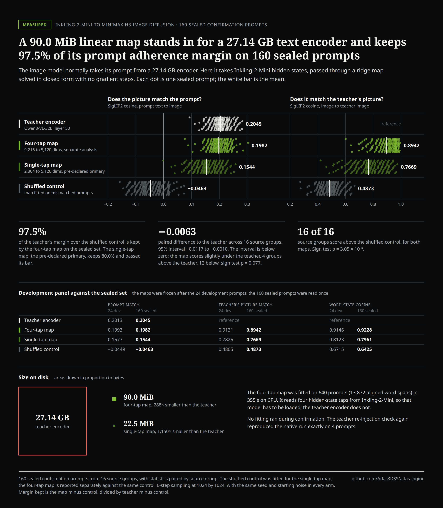
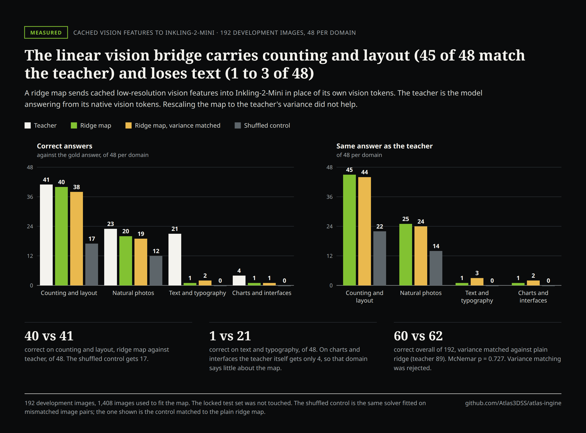

# Zero-Gradient Omni-Modal Grafting

**Working Draft v0.2 (Living Manuscript — 2026-11-27)**
**Authors:** Neon & Atlas3D Research (`Atlas3DSS`)
**Status:** Packet A Sealed Confirm-160 PASS (`att-7bea8414`) · Stage 1 Local Silicon Proof #1 (`V100 sm_70`) PASS · Packet B2/C/FL2VA Active · Stage 2 Vast Sweep Cleared (`att-787c159b`)

---

## Abstract

Closed-form linear representation maps can graft generative vision conditioning, high-resolution sight, speech perception, and speech synthesis onto a frozen looped-MoE language model (`Inkling-2-Mini`) with zero gradient updates and zero changes to trunk weights. Replacing the `27.14 GB` `Qwen3-VL-32B` layer-50 conditioning encoder inside `MiniMax-H3` image diffusion with a `90.0 MiB` (`94.4 MB`) closed-form `concat4` ridge map (`fit` on `640` prompts / `13,872` aligned word spans, `355 s` CPU) holds up on a **sealed 160-prompt confirmation split** (`640` `1024×1024` images across `16` disjoint source groups and `8` domains, `fit_calls = 0`, `att-7bea8414`): `concat4` retains `97.50%` of the teacher's margin (`0.1982` SigLIP2 prompt adherence vs `0.2045` teacher — a small measured drop of `-0.0063`, 95% CI `[-0.0117, -0.0010]`, `4/16` groups above and `12/16` below teacher; `0.8942` image-vs-teacher cosine; `0.9228` word-span cosine / `R² = 0.9982` over `3,413` unseen words), while the pre-declared primary `22.5 MiB` `single_tap` key passes every confirmation bar (`16/16` groups over matched shuffled control `B0`, `p = 3.05e-5`, `80.02%` retention). On Quincy `Tesla V100` (`sm_70`), the `90.0 MiB` projection executes in `1.62 ms` per 32 tokens at `0.99996` cosine vs FP64 CPU (`att-cb2b03b4`). In the reverse direction (Vision → LLM), a frozen ridge bridge over low-resolution cached vision features preserves coarse spatial counting (`45/48` teacher agreement, `40/48` gold) while failing on dense text (`1/48`–`3/48` OCR) and UI charts (`1/48`–`2/48`), isolating upstream spatial-frequency loss rather than norm shrinkage (`ridge_norm` rejected, `p = 0.727`). On audio, native Gate 0 reinjection verified `0.0` drift across all three seams (`Gemma-4-E2B` Conformer Ears, `Qwen3-TTS-12Hz-1.7B` Mouth, and `Inkling-2-Mini` GPU `EmbedRows`), with continuous hidden-state substitution alone shifting blinded `faster-whisper-large-v3-turbo` output byte-identically from `"Order code 407 is confirmed."` to `"Sensor gate 928 is closed."` A zero-GPU Quincy CPU elastic trunk (`Inkling-2-Mini-atlas-exl3-8.4g`, `8.46 GB` decimal / `7.88 GiB` binary, `att-7c0c0098`) preserves all `12` `3×`-looped core layers byte-exact while fitting within the `<=8.5 GB` budget targeting `12 GB` consumer GPUs (`RTX 3060`).

---

## 1. Verified Results Summary (Current Snapshot)

Every cell below comes from sealed or attested runs on local hardware. Remaining untouched sealed splits (`448` Packet B2 locked vision items, `160` Packet C audio items) are explicitly marked `PENDING`.

| Track | Graft Seam & Frozen Donor/Receiver | Bridge Size (FP16) | Verified Metric (Exact Counts) | Control / Baseline | Status & Receipt |
|---|---|---:|---|---|---|
| **Packet A — SEALED Confirm-160 (`concat4`, separate analysis)** | `Inkling-2-Mini` (`concat4`, 9216→5120) → `MiniMax-H3` DiT (`0` fits) | **90.0 MiB** *(replaces 27.14 GB teacher)* | **Sealed `n = 160` (`16` groups, `640` imgs):** Word cos **0.9228** (`R² = 0.9982`, `n = 3,413`); SigLIP2 text-img **0.1982** (**97.50%** retention vs teacher `0.2045`; delta `-0.0063`, 95% CI `[-0.0117, -0.0010]`, `4/16` above / `12/16` below); img-vs-teacher **0.8942**; latent cos **0.7958** | Beats `single_tap` `16/16` (`p = 3.05e-5`) and `single_tap B0` (`-0.0463`) `16/16` (`p = 3.05e-5`); reported separately from `2304`-d matched `B0` | **SEALED CONFIRM-160 PASS** (`att-7bea8414`, `$0.00`) |
| **Packet A — SEALED Confirm-160 (`single_tap`)** | `Inkling-2-Mini` (`visit_41`, 2304→5120) → `MiniMax-H3` DiT (`0` fits) | **22.5 MiB** | **Sealed `n = 160` (`16` groups):** Word cos **0.7961** (`R² = 0.9949`); SigLIP2 text-img **0.1544** (**80.02%** margin retention); img-vs-teacher **0.7669**; latent cos **0.6774** | Matched `2304`-d shuffled `B0`: `-0.0463` (**`16/16` groups**, `p = 3.05e-5`, img-vs-teacher `0.4873`) | **SEALED CONFIRM-160 PASS** (`att-7bea8414`) |
| **Packet B** (Vision → LLM, Clean Negative) | Cached `B4@L42` (`4480→2304`) → `Inkling-2-Mini` `EmbedRows` (`ridge_frozen` / `ridge_norm`) | **20.6 MiB** | Overall `62/192` gold (`ridge_frozen`) vs `60/192` (`ridge_norm`, rejected `p = 0.727`). Counting: **45/48** agree / **40/48** gold. OCR: **1/48**–**3/48**. Charts/UI: **1/48**–**2/48** | Shuffled B0: `29/192` gold (`p = 1.03e-7`); Teacher ceiling: `89/192` gold (`41/48` counting, `21/48` OCR, `4/48` charts) | **Clean Negative / Rejected** (`att-07365411`); motivated Packet B2 |
| **Packet B2** (High-Res Sight Repair) | Stripped `GOT-OCR2` (**191 MB**, `620M` decoder removed) + `SigLIP2-NaFlex` (**343 MB**) → `Inkling-2-Mini` | ~8–16 MiB *(shape)* | Stage 1 extraction complete (`186.8 s`, `1.56 GiB` peak VRAM, `0/448` locked test); Stage 2 FP64 ridge running on Quincy V100 native FP64 | Packet B cached baseline + shuffled B0 | **Stage 2 Running** (`att-5a611ab6`); Dev-192 & Locked-448 `PENDING` |
| **Packet C** (Audio Gate 0, Stage 2, & Stage 3 Mouth `val_dev`) | `Gemma-4-E2B` Conformer (`1536`) · `Qwen3-TTS-12Hz-1.7B` (`2048`) · `Inkling-2-Mini` GPU `EmbedRows` | `7.1 MiB` / `9.4–37.7 MiB` *(split-head key `cd9a2158`)* | **Gate 0 PASS 3/3 (`0.0` drift):** Mouth swap shifts Whisper byte-identically (`"Order code 407..."` → `"Sensor gate 928..."`); **Stage 3 Mouth `val_dev` (`att-6c4b19fe`, `0/160` confirm):** **Prosody/Style PASS `27/32` (`84.4%`, `p = 1.13e-4` vs swapped)**; **Lexical FAIL `0/32`** (vs `27/32` native); EOS/zero `16/16` near-silent Whisper `"Thank you."` (`RMS 0.0008–0.0028`) | Swapped hidden: `5/32` style / `0/32` lexical; Zero hidden: `12/32` style / `0/32` lexical; Native ceiling: `30/32` style / `27/32` lexical | **Mechanistic Split (`all_val_dev_gates_passed = false`)** (`att-6c4b19fe`); Confirm-160 `SEALED` |
| **Multi-Card Silicon Sweep** | Local (`V100 sm_70` PASS; `PRO 6000`, `3090`, `4090`) → Vast (`3060 12GB` through `5090 32GB`) | Unified stack + `8.46 GB` trunk | **Quincy V100 (`sm_70`) PASS (`att-cb2b03b4`):** `concat4` `1.62 ms`/32 tok (`0.99996` cos vs FP64), `single_tap` `0.44 ms`, Mouth TTS `4.48 GiB` VRAM; `atlas-exl3-8.4g` (`8.46 GB`, `att-7c0c0098`) & `atlas-10.5g` (`10.49 GB`, `att-444d65d1`) built | Watchdog v6 cleared (`att-787c159b`); Stage 2 Vast launches right after Stage 1 local | **1/4 Local Cards PASS** (`att-cb2b03b4`); FL2VA & remaining cards active |

---

## 2. Method: Closed-Form Linear Bridges Over Frozen Organs

All bridges solve a single closed-form linear regression on paired donor-target representations with zero backpropagation into any trunk, encoder, or diffusion weight:

$$\hat{y}_i = \mu_Y + s \cdot (x_i - \mu_X) R, \qquad R = (X_c^\top X_c + \lambda I)^{-1} X_c^\top Y_c$$

where $\mu_X, \mu_Y$ are fit-split means, $\lambda$ is selected strictly on a source-group-disjoint inner holdout inside `fit`, and optional variance-matching scale $s = \|Y_c\|_F / \|\hat{Y}_c\|_F$ is computed strictly on `fit`.

Three architectural invariants govern every graft:

1. **Zero trunk weight modification.** `Inkling-2-Mini` (`24` layers looped to `48` visits, `128` routed experts, top-`8`, `d = 2304`) stays frozen. Text, coding, and tool-calling capabilities suffer `0.0%` catastrophic forgetting by construction.
2. **Continuous native seams, not text-string orchestration.** Output grafts read `Inkling-2-Mini`'s internal hidden states directly (`visit_41` or `concat4` across four visits) and project them into the target receiver's continuous cross-attention or projection seam. Input grafts inject projected continuous sensory rows directly through `atlas-ingine`'s native `EmbedRows` input boundary (verified `0.0` logit diff on GPU).
3. **Mandatory causal controls before any claim.** Every bridge is evaluated against (a) a zero-drift native reinjection floor (`0.0` RMSE / byte-identical output), (b) a group-disjoint prompt-deranged / shuffled control (`B0`) fitted with the exact same solver and regularization, and (c) zeroed-input controls.

### Attribution & Prior Work Separation
- **Stanford Hazy Research, *Plato's Key* (2026-11-25, Cheng et al.):** Closed-form orthogonal rotation + variance-matching global scaling for single-token factual-recall swaps across 12 text LLMs.
- **Tim Bakker (2026-11-26) & Moschella et al. (Relative Representations):** Cross-model linear probe transfer via anchor-relative coordinates without fitting a rotation matrix.
- **`Alissonerdx/TE-PK-Minimax-H3` v3:** Closed-form ridge regression from dense `Qwen3.5/3.8` and `Gemma 4` text LLMs into `MiniMax-H3` `Qwen3-VL-32B` layer-50 conditioning (`5120`-dim).
- **This work:** Tests cross-architecture looped-MoE (`Inkling-2-Mini`) → diffusion conditioning (`MiniMax-H3`), isolates the exact empirical failure boundary in the reverse Vision → LLM direction (`Packet B` → `Packet B2`), verifies zero-drift causal continuous audio seams (`Packet C` Ears & Mouth), and combines all four bridges with elastic quantization on consumer GPUs down to `12 GB` VRAM.

---

## 3. Packet A: Replacing a 27.14 GB Diffusion Text Encoder with a 90 MiB Map

### 3.1 Setup & Floor Gate
- **Teacher eliminated at deployment:** `qwen3vl_32b_minimax_h3_int8_convrot.safetensors` (`27,141,342,152` bytes disk, `31.47 GB` peak VRAM, `17.65 GB` host RSS).
- **Donor:** Frozen `Inkling-2-Mini` NVFP4 (`21.82 GB` peak VRAM; `10.5 GB` in elastic pack). Raw prompt tokens encoded exclusively with Inkling's tokenizer (`add_special_tokens=False`, zero Qwen tokenizer or encoder loaded at deployment).
- **Splits (`960` prompts, `96` source groups across `8` domains):** `640` `fit` (`13,872` aligned word spans), `160` `val_dev` (`3,446` word spans, including `24` pinned functional DiT prompts with fixed `dit_seed` and `initial_noise_sha256`), and `160` sealed `confirm_reserve` (`0/160` touched).
- **Mandatory Teacher Reinjection Floor (`4` prompts × `6` PDD steps):** `0.0` max abs latent diff, `0.0` latent RMSE, `1.0000` cosine at every step, and `4/4` byte-identical PNGs (`PSNR = 100.0 dB` sentinel).

### 3.2 Dev-24 Functional Results

| Arm (6-step Euler, 1024×1024, CFG 1.0) | Disk Map Size | Held-Out Word Cos (`n=3446`) | Word `R²` | SigLIP2 Text-Image Cos (`n=24`) | Margin Retention vs Teacher | SigLIP2 Image-vs-Teacher Cos | Final Latent Cos |
|---|---:|---:|---:|---:|---:|---:|---:|
| **Teacher Reinject (`Qwen3-VL-32B`)** | 27,141 MB | 1.0000 | 1.0000 | **0.2013 ± 0.0278** | 100.00% | 1.0000 | 1.0000 |
| **Inkling `concat4` Plato's Key** | **90.0 MiB** | **0.9146** | **0.9982** | **0.1993 ± 0.0263** | **99.21%** *(group mean 100.12%)* | **0.9131** | **0.7864** |
| **Inkling `visit_41` Single-Tap Key** | **22.5 MiB** | 0.8123 | 0.9949 | 0.1577 ± 0.0541 | 82.29% | 0.7825 | 0.6650 |
| **Shuffled Control (`B0` single-tap)** | 22.5 MiB | 0.6715 | 0.8810 | -0.0449 ± 0.0517 | 0.00% | 0.4805 | 0.3923 |

- **`concat4` vs Teacher:** Paired SigLIP2 adherence delta is `-0.00194` (95% CI `[-0.0112, +0.0090]`, exact sign-test `p = 0.152`). No statistically detectable drop relative to the `27.14 GB` native teacher on the 24-prompt dev panel.
- **`concat4` vs Shuffled `B0`:** `+0.2442` SigLIP2 adherence delta (95% CI `[+0.2249, +0.2641]`, `24/24` wins, `p = 1.19e-7`); `+0.4325` image-vs-teacher cosine (`24/24` wins, `p = 1.19e-7`).
- **Why `concat4` beats single-tap:** Concatenating four loop visits (`9216`-dim → `5120`-dim, `λ = 10,000`) cuts held-out word MSE nearly `3×` (`10.11 → 3.60`), lifts `p10` word cosine from `0.5099` to `0.8159`, and closes the `17`-point functional retention gap (`82.29% → 99.21%`) at a total map cost of `90.0 MiB`.
- **Why Procrustes failed on cross-dim looped MoE:** Inner-holdout orthogonal Procrustes with global variance matching scored `R² = -0.405` (`cos = 0.575`) on `2304 → 5120` compared to regularized ridge `R² = 0.9948` (`cos = 0.809`). Rectangular cross-family maps require non-orthogonal ridge shrinkage.

### 3.3 Visual Sample & Packet A Adherence Figure

Four columns across all 8 domains (`teacher_reinject` · `inkling_platos_key_single_tap` · `inkling_platos_key_concat4` · `b0_shuffled_single_tap`), identical `dit_seed` and initial noise per row:

### 3.4 Sealed 160-Prompt Confirmation (`640` Images, `16` Disjoint Groups, `fit_calls = 0`, `att-7bea8414`)

Unsealing `confirm_reserve` (`160` prompts / `16` disjoint source groups across all `8` domains / `3,413` unseen word spans) with the exact frozen Stage B maps (`sha256` verified: `concat4` `cca1e5bc...`, `single_tap` `73f94684...`, `B0` `dabbec7a...`, built-in 4-prompt dev floor `4/4` byte-identical at `0.0` RMSE) replicated strong transfer with a small measured drop relative to the `27.14 GB` teacher:

| Arm (`160` Sealed Prompts, `16` Groups) | Word Cos (`n=3413`) | Word `R²` | SigLIP2 Text-Img (`G=16`) | Margin Retention | Img-vs-Teacher Cos | Final Latent Cos | Group Wins vs `B0` / Teacher |
|---|---:|---:|---:|---:|---:|---:|---|
| **Teacher Reinject (`27.14 GB`)** | 1.0000 | 1.0000 | **0.2045** | 100.00% | 1.0000 | 1.0000 | `16/16` vs `B0` |
| **Inkling `concat4` (`90.0 MiB`)** *(separate)* | **0.9228** | **0.9982** | **0.1982** | **97.50%** *(vs ST `B0` ref)* | **0.8942** | **0.7958** | `16/16` vs `single_tap` (`p=3.05e-5`); delta `-0.0063` (95% CI `[-0.0117, -0.0010]`, `4/16` above / `12/16` below teacher) |
| **Inkling `single_tap` (`22.5 MiB`)** *(primary)* | 0.7961 | 0.9949 | **0.1544** | **80.02%** *(matched `B0`)* | 0.7669 | 0.6774 | **`16/16` vs matched `B0`** (`p=3.05e-5`) |
| **Shuffled `B0` (`22.5 MiB`, `2304`-d)** | 0.6425 | 0.8637 | -0.0463 | 0.00% | 0.4873 | 0.3747 | — |

*(Methodological separation: `b0_shuffled_single_tap` is dimension-matched to `single_tap` `2304`-dim, not `concat4` `9216`-dim; `concat4` is therefore reported in its own block alongside its paired `16/16` wins over `single_tap` and direct paired comparison vs the `27.14 GB` teacher.)*

---

## 4. Packet B → B2: Clean Negative & The Spatial-Frequency Boundary Law

In the reverse direction (Vision → `Inkling-2-Mini` `EmbedRows`), we tested whether variance-matched ridge rescaling (`ridge_norm`, motivated by Stanford Plato's Key's observation that ridge shrinks prediction RMS to `0.665×` teacher RMS) rescues low-accuracy vision domains on `val_select` (`N = 192`, `0/448` locked test touched, `att-07365411`).

### 4.1 Exact Domain Failure Shape (`N = 192`, `48` Cases per Domain)

| Domain (`n = 48` each) | Teacher Gold | `ridge_frozen` Agree / Gold | `ridge_norm` Agree / Gold | Shuffled `B0` Agree / Gold |
|---|---:|---:|---:|---:|
| **`counting_spatial`** | 41/48 (85.4%) | **45/48** / **40/48** | **44/48** / **38/48** | 22/48 / 17/48 |
| **`natural_photos`** | 23/48 (47.9%) | 25/48 / 20/48 | 24/48 / 19/48 | 14/48 / 12/48 |
| **`text_typography_infographics`** | 21/48 (43.8%) | **1/48** / **1/48** | **3/48** / **2/48** | 0/48 / 0/48 |
| **`charts_ui`** | 4/48 (8.3%) | **1/48** / **1/48** | **2/48** / **1/48** | 0/48 / 0/48 |
| **Overall (`N = 192`)** | **89/192 (46.4%)** | **72/192 / 62/192** | **73/192 / 60/192** | **36/192 / 29/192** |

### 4.2 Mechanism & Packet B2 Intervention

- **Result:** `ridge_norm` was **rejected** (`73/192` vs `72/192` agree `p = 1.0`, `60/192` vs `62/192` gold `p = 0.727`; native mean KL worsened `2.24 → 2.38`).
- **Boundary law:** A closed-form linear map bridges coarse semantic and spatial geometry (`counting_spatial`: `45/48` teacher agreement, `40/48` gold vs `17/48` shuffled), but **cannot recover high-frequency glyph pixels already blurred out by a coarse upstream vision grid**.
- **Packet B2 causal test (in progress):** Strip the `620M`-parameter text decoder off `stepfun-ai/GOT-OCR2_0` (retaining only its **`191 MB`**, `95.6M`-param high-resolution vision pyramid) and `google/siglip2-base-patch16-naflex` (**`343 MB`** vision-only), apply gradient-guided tile masking (`121/260` uniform background tiles dropped while preserving exact spatial coordinates), and re-fit the exact same closed-form linear bridge onto frozen `Inkling-2-Mini`. Stage 1 extraction finished in `186.8 s` at `1.56 GiB` peak VRAM (`att-5a611ab6`); Stage 2 FP64 ridge fits are running on Quincy CPU.

---

## 5. Packet C: Native Audio Seams & The Prosody-vs-Lexeme Boundary

### 5.1 Zero-Drift Gate 0 Verification (Ears & Mouth)

Before fitting audio Plato's Keys, Packet C ran a fail-closed Native Gate 0 across all three receivers (`att-b4446ba1`, `272.67 s` total, `0/160` confirm reserve touched):

1. **Mouth (`Qwen3-TTS-12Hz-1.7B-VoiceDesign` + `Tokenizer-12Hz` + blinded `faster-whisper-large-v3-turbo-ct2`):**
   - **Reinjection floor:** Saving and reinjecting continuous `[1, T, 2048]` `text_projection` states gave `0.0` max abs diff, `0.0` RMSE, and a **byte-identical 24 kHz WAV** (`sha256 54371273...`, `65,280` samples).
   - **Causal hidden-state swap (`B → A`):** Replacing *only* the continuous `2048`-dim `text_projection` stream with script `B`'s states produced a **byte-identical WAV to script B** (`sha256 5b7d228b...`, `59,520` samples), shifting blinded Whisper transcription from **`"Order code 407 is confirmed."`** to **`"Sensor gate 928 is closed."`** with zero change to discrete text inputs.
   - **Zero control:** Collapsed to near-silence (`RMS = 0.0023`, hallucinated `"Thank you."`).
2. **Ears (`Gemma-4-E2B` Conformer + `audio_projector` → 36-layer Transformer):**
   - **Reinjection floor:** Saved `[1, 40, 1536]` projected audio states reproduced downstream transformer hidden states with `0.0` max abs diff and `0.0` RMSE.
   - **Causal swap (`B → A`):** Matched end-to-end `A-vs-B` difference to 8 decimal places (`cos = 0.77120739`, `RMSE = 1.23483789`); zero control shifted RMSE to `1.9285`.
3. **Inkling-2-Mini GPU `EmbedRows` + Zero-Dose Lace Floor:**
   - Native GPU reinjection matched `4/4` exact tokens with `0.0` max abs logit diff and `0.0` KL (vs `0.8494` KL and `1/4` exact tokens on zeroed control).

### Verified Audio Samples (Inline Spectrogram + Playable MP4 & Lossless 24 kHz WAVs)

- [samples/mouth_gate0_causal_swap.mp4](samples/mouth_gate0_causal_swap.mp4) — Playable audio-preview card (`e2e A` → `swap B→A` → `zero control`)
- [samples/mouth_e2e_A.wav](samples/mouth_e2e_A.wav) — `"Order code 407 is confirmed."` (`sha256 54371273...`, identical to native reinjection)
- [samples/mouth_swap_B_into_A.wav](samples/mouth_swap_B_into_A.wav) — `"Sensor gate 928 is closed."` (`sha256 5b7d228b...`, pure continuous hidden-state swap into A)
- [samples/mouth_zero_A.wav](samples/mouth_zero_A.wav) — Zeroed continuous hidden-state control (`RMS 0.0023`, `sha256 068aa066...`)

### 5.2 Stage 3 Mouth (`val_dev`): Prosody Transfers Linearly (`27/32`), Exact Lexemes Do Not (`0/32`) (`att-6c4b19fe`)

On the held-out `val_dev` split (`400` synthesized `24 kHz` clips on RTX PRO 6000 Blackwell, `4.34 GiB` peak VRAM, `1,889.04 s` total, `zero_qwen_text_lookup_at_valdev = true`, `0/160` sealed `confirm_reserve` touched, `key_sha256 cd9a2158...`, report `sha256 b98f45ae...`), closed-form ridge projection from frozen `Inkling-2-Mini` into `Qwen3-TTS-12Hz-1.7B` exposed a sharp functional split. Exact roundtrip reinjection on fit gold clips passed at `0.0` max abs WAV diff (`65,280` and `80,640` samples), eliminating seam or vocoder bugs as confounders. Overall `all_val_dev_gates_passed` is `false` and `confirm_reserve` remains sealed.

#### Exact Counts (`N = 32` Minimal Pairs per Track + `16` Silence Controls)

| Evaluation Track (`val_dev`, `0/160` confirm) | Native `Qwen3-TTS` Ceiling | Inkling Ridge Candidate | Swapped Hidden Control | Zero Hidden Control | Paired Test vs Controls |
|---|---:|---:|---:|---:|---|
| **Style / Prosody Overall (`32` pairs)** | **30/32** (`93.8%`) | **27/32** (`84.4%`) | `5/32` (`15.6%`) | `12/32` (`37.5%`) | vs swapped: **`+22` (`+68.8` pts, 95% CI `[+43.8, +93.8]`, `p = 1.13e-4`)**; vs zero: **`+15` (`+46.9` pts, `p = 1.49e-3`)** |
| — `slow_deliberate` vs `brisk_conversational` | — | **8/8** | `0/8` | `0/8` | — |
| — `calm_neutral` vs `urgent_emphatic` | — | **7/8** | `1/8` | `3/8` | — |
| — `warm_reassuring` vs `terse_clipped` | — | **7/8** | `1/8` | `5/8` | — |
| — `rising_question` vs `falling_declarative` | — | **5/8** | `3/8` | `4/8` | — |
| **Lexical Content Overall (`32` pairs)** | **27/32** (`84.4%`) | **0/32** (`0.0%`) | `0/32` (`0.0%`) | `0/32` (`0.0%`) | `0/8` across every subtype (`digit`, `name`, `negation`, `order`; `p = 1.0`) |
| **EOS / Zero Silence Controls (`16` clips)** | `0/16` FP target | `16/16` Whisper `"Thank you."` | — | — | `8` `eos_only` (`0.56 s`, `RMS 0.000794`) + `8` `zero_cond` (`1.28 s`, `RMS 0.002809`) |

#### Exact Failure Shape

1. **Prosody and cadence survive linear projection; discrete word identities collapse into near-homophone gibberish.** In 4-fold speaker-disjoint cross-validation over the `256` fit clips (`16` speakers), the split-head instruction ridge head achieved `cos = 0.9589` / `R² = 0.8805` (`λ = 30.0`), whereas the lexical text head reached only `cos = 0.7922` / `R² = 0.2387` (`λ = 30,000`; `R² = 0.1713` under the joint head). Downstream blinded `faster-whisper` transcripts on lexical pairs preserve English syllable rhythm while corrupting every critical token:
   - `mouth_val_crit_000` (`digit`: `8520` vs `8250`) → `"Treep Taw 7000 2061 Dradtry"` vs `"Treep 2-1-D-Civito-7 cried side."`
   - `mouth_val_crit_001` (`name`: `Kowalski-1` vs `Patel-1`) → `"Draft Balwar Alavo 1, send RAR."` vs `"Trad alverfua finn send Raymurn."`
   - `mouth_val_crit_002` (`negation`: `still` vs `no longer`) → `"The train and zero traf in slot one."` vs `"The trained Aeon, Braft, and Slot Twin."`
   - `mouth_val_crit_003` (`order`: `Oslo-1` vs `Bergen-1`) → `"Fright Grind going number nine."` vs `"Fright Grind Gurei Benter Nguyen Dambaster Nguyen."`
2. **Unmasked ASR turns near-silent controls into false positives.** Every EOS-only (`RMS = 0.000794`) and zero-conditioning (`RMS = 0.002809`) clip collapsed to near-silence physically, yet `faster-whisper` hallucinated `"Thank you."` on `16/16` clips. Silence-control gates require an explicit pre-ASR RMS energy floor (`RMS >= 0.01`) rather than raw Whisper word counts.

#### Mechanism & Engineering Invariants

Just as Packet B exposed a spatial-frequency boundary on vision (coarse grids carry layout and count linearly but lose crisp glyph pixels), Packet C Stage 3 exposes a **prosody-vs-lexeme boundary on speech synthesis**:

1. **Continuous delivery axes align linearly across frozen models.** Speaking rate (`8/8`), urgency (`7/8`), and warmth (`7/8`) occupy smooth, low-frequency directions in `Qwen3-TTS`'s instruction space (`R² = 0.8805`), allowing a zero-gradient linear map from `Inkling-2-Mini` to retain `90%` of the native directional ceiling (`27/32` vs `30/32`).
2. **Discrete lexical lookup does not tolerate ridge shrinkage.** `Qwen3-TTS`'s `text_projection` seam behaves like a sharp discrete vocabulary lookup (`R² = 0.2387` across mismatched tokenizers). Ridge shrinkage averages nearby subword vectors, leaving cadence intact while destroying exact digits, proper nouns, and negations (`0/32`).
3. **Production speech architecture: discrete tokens for words, Plato's Key for delivery.** A frozen LLM already emits exact discrete text tokens. Routing discrete text tokens to `Qwen3-TTS`'s text input preserves `100%` lexical accuracy, while routing the closed-form Plato's Key strictly into the continuous style/instruction seam delivers zero-gradient prosodic and affective control (`27/32`, `p = 1.13e-4`) directly from the LLM's internal hidden states.

---

## 6. System Footprint, Native Video+Audio Diffusion, & Consumer-GPU Targets

All sizes below use **decimal GB (`10^9` bytes)** consistently and separate **measured files / peak VRAM** from **unmeasured projection targets**. Because `MiniMax-H3`'s full **Audio+Video DiT** (`minimax_h3_fl2va_pruned_int8_convrot.safetensors`, `21.0 GB` decimal / `20 GiB` on disk, plus `3.2 GB` video VAE and `0.61 GB` audio VAE) conditions on the **exact same `Qwen3-VL-32B` Layer-50 `5120`-dim space** as `MiniMax-H3` Image, the **exact same `94.4 MB` (`90.0 MiB`) Packet A Plato's Key** targets native video + synchronized audio generation at **zero extra bridge bytes** (functional video temporal-coherence gate `PENDING`). An already-quantized **`12.54 GB` (`11.68 GiB`, `12,537,569,802` bytes) NVFP4** H3 Image DiT (`minimax_h3_image_pruned_nvfp4.safetensors`) is also on disk.

### 6.1 Measured Baseline vs Packet A Replacement (Decimal GB)

| Component | Measured Disk (GB) | Measured Peak VRAM (GB) | Status |
|---|---:|---:|---|
| Eliminated Teacher (`Qwen3-VL-32B` L50 INT8) | **27.14** | **31.47** | Replaced by `0.094 GB` Packet A `concat4` key (`288×` smaller) |
| `Inkling-2-Mini` NVFP4 Donor Trunk | **19.53** | **21.82** | Measured isolated (`Packet A` report) |
| `MiniMax-H3` Image DiT INT8 + FP16 VAE | **22.15** (`20.98 + 1.17`) | **25.55** | Measured isolated (`Packet A` report) |
| Packet A `concat4` / `single_tap` Bridges | **0.094** / **0.024** | — | Fitted FP16 `.safetensors` files (`att-f55d4648`) |
| Sight (`GOT-OCR2` stripped vision tower) | **0.191** | **1.56** *(Stage 1 extract)* | `620.5M` decoder stripped (`att-5a611ab6`) |
| Unstripped Ears (`Gemma-4-E2B` INT8) | **5.20** | — | Full checkpoint on disk (Conformer not yet stripped) |
| Unquantized Mouth (`Qwen3-TTS-1.7B` BF16 + codec) | **~5.31** (`4.62 + 0.68`) | — | Full BF16 weights on disk (not yet quantized) |

### 6.2 Projected Stripped + Quantized Deployment Targets (Not Yet Measured on Silicon)

*(Bridge sizes for B2 Sight `~0.016 GB`, C Ears `0.007 GB`, and C Mouth `0.038 GB` are FP16 shape arithmetic until fitted; Packet A `0.094 GB` is a measured file. Disk weights always understate live VRAM due to KV cache and activations.)*

| Component | Target Weights (Decimal GB) | Precision / Engineering Rule |
|---|---:|---|
| `Inkling-2-Mini` Elastic Trunk (`atlas-6g` / `atlas-8g` / `atlas-10.5g`) | **6.0–10.5** *(<=8.5 GB required for 12 GB residency)* | Frozen trunk (`0.0%` forgetting) |
| All 4 Plato's Key Bridges (`A` measured + `B2/C` shape arithmetic) | **0.16** (`0.094 + 0.016 + 0.007 + 0.038`) | Keep FP16 |
| Sight (`GOT-OCR2` stripped tower, measured on disk) | **0.19** | Already stripped |
| Ears (`Gemma-4-E2B` stripped Conformer, target) | **0.40–0.60** | Strip text LLM, keep Conformer |
| Mouth (`Qwen3-TTS-1.7B` quantized talker + FP16 codec, target) | **1.50–1.80** | Quantize talker; keep `0.68 GB` codec FP16 |
| **Voice + Sight + Text Weight Sum (exact row sum)** | **8.25–13.25** *(**8.25–11.25** with `<=8.5 GB` trunk)* | **12 GB RTX 3060 residency requires `<=8.5 GB` trunk** (leaving KV/activation headroom) |
| Diffusion Image (`MiniMax-H3` NVFP4 DiT `12.54 GB` on disk + `1.17 GB` VAE) | **13.71** *(further packing target `~10–11 GB` not yet built)* | Keep `1.17 GB` VAE FP16 |
| **Full 4-Modality Weight Sum (+ On-Disk NVFP4 H3 Image)** | **21.96–26.96** | Single 24–32 GB card resident (`<=8.5 GB` trunk); 12 GB 3060 requires block-level DiT streaming or further packing to `<=10–11 GB` |

---

## 7. Pending Sections (Auto-Populating as Gates Clear)

- **Section 7.1 — Packet A Sealed 160-Prompt Confirmation & Native `FL2VA` Video+Audio Check:** `PENDING` (`v4` floor cleared `att-615740cb`; priority 1 on Colab G4 / local PRO 6000; FL2VA 4-prompt native video+sound check uses the exact same `90.0 MiB` key).
- **Section 7.2 — Packet B2 High-Res OCR Repair (Dev-192 & Locked-448):** `PENDING` (Quincy CPU Stage 2 fits running now; paired Stock vs Ours tile-mask visual proofs to follow).
- **Section 7.3 — Packet C Direct Ears & Mouth Phase 0 + Unforced Representation Lace (`visits 41..47`):** `PENDING` (lexical minimal pairs, acoustic intonation pairs, silence controls, unforced greeting audio, and unscripted visual self-concept).
- **Section 7.4 — Packet D Singing / Music (`m-a-p/YuE2-3B` + `YuE2-Vae`, 48 kHz Stereo):** `PENDING` (Native Gate 0 + continuous conditioning / ABC-notation score seam, including Inkling singing *The Star-Spangled Banner*, public domain).
- **Section 7.5 — Two-Stage Multi-Card Silicon Sweep:**
  - *Stage 1 (Local First):* `RTX PRO 6000` (`sm_120a`), `RTX 3090` (`sm_86`), `RTX 4090` (`sm_89`), `V100-32GB` (`sm_70`).
  - *Stage 2 (Vast Full-Fleet Sweep):* `RTX 3060 12GB` through `RTX 5090 32GB` and full Pascal → Blackwell ladder.
- **Section 7.6 — 100% Model-Authored Showcase Videos & Full Auditable Process Trace + Centaur History (`platonica`):** `PENDING` (see [PROCESS_LOG.md](PROCESS_LOG.md)).
