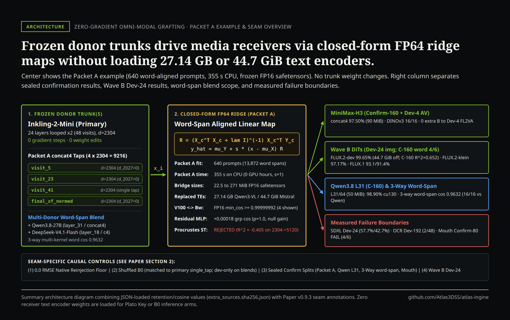

# Zero-Gradient Omni-Modal Grafting

Closed-form FP64 ridge bridges that graft image diffusion, native video+audio diffusion, visual perception, and speech control onto frozen language models with zero gradient updates and without loading `27.14 GB` (`Qwen3-VL-32B`) or `44.7 GiB` (`Mistral-Small-3.1-24B`) text encoders at runtime.

## Start Here
- **[TUTORIAL.md](TUTORIAL.md)** — **Shot-by-shot technical walkthrough** with system-authored images, contact sheets, audio spectrograms, failure boundaries, and local reproduction commands.
- **[PAPER.md](PAPER.md)** / **[PAPER.pdf](PAPER.pdf)** ([`PAPER.tex`](PAPER.tex)) — **Full research manuscript (`v0.9.3`)** with sealed Confirm-160 statistics, orthogonal `DINOv3-ViT-L/16` audit, matched-data MLP baseline, clean negative boundaries, multi-donor comparisons, Wave B 6/6 Confirm-160 word bars, FP64 SVD + live V100 MoE pruning, 5-family expressive TTS shoot-out, and `16`-GPU (`17`-run) real AV / `30`-GPU parity benchmarks.
- **[WORLD_MODEL_TURNAROUND.md](world_model_turnaround/WORLD_MODEL_TURNAROUND.md)** — **Standalone 360° World-Model Turnaround ("This Is Not a Video")** with `LEDGER-OFF` vs `LEDGER-ON` OCR/identity/continuity audits and complete Blender + Ref2VA reproduction scripts.
- **[HOST_ENFORCED_ALIGNMENT.md](HOST_ENFORCED_ALIGNMENT.md)** — **Live Pliny adversarial red-teaming (`22/40` vs `0/40` committed violations, `10/10` benign)**, Neuron Lens telemetry, and proposed `LoopRes` closed-loop alignment pilot.
- **[COMPARISONS.md](COMPARISONS.md)** — **23 SHA-256-pinned side-by-side contact sheets** across H3, Wave A, Wave B, Anthem v5, and the 360° World-Model Turnaround.
- **[PROCESS_LOG.md](PROCESS_LOG.md)** — Append-only chronological ledger of every verified gate, clean negative, receipt, and SHA-256 pin.

## Verified Visual & Audio Artifacts (`samples/` & `figures/`)
- **Figures (`figures/`):** [fig0_architecture_pipeline.png](figures/fig0_architecture_pipeline.png) · [fig1_packetA_adherence_and_size.png](figures/fig1_packetA_adherence_and_size.png) · [fig2_packetB_ocr_boundary.png](figures/fig2_packetB_ocr_boundary.png) · [fig3_omni_footprint_ladder.png](figures/fig3_omni_footprint_ladder.png) · [fig4_multidonor_and_universal.png](figures/fig4_multidonor_and_universal.png) · [fig5_lowrank_svd_and_prosody.png](figures/fig5_lowrank_svd_and_prosody.png) · [fig6_closed_loop_alignment_architecture.png](figures/fig6_closed_loop_alignment_architecture.png) · [fig7_silicon_16gpu_av.png](figures/fig7_silicon_16gpu_av.png) · [omni912_wave3_real_image_and_5s_av_benchmark.png](figures/omni912_wave3_real_image_and_5s_av_benchmark.png)
- **System-Authored Contact Sheets (`samples/`):**
  - [h3_confirm160_contact_sheet_8domains.png](samples/h3_confirm160_contact_sheet_8domains.png) — Sealed Confirm-160 `Inkling-2-Mini` (`90 MiB`) replacing `27.14 GB` `Qwen3-VL-32B` (`97.50%` margin retention)
  - [qwen38_h3_confirm160_contact_sheet_8domains.png](samples/qwen38_h3_confirm160_contact_sheet_8domains.png) — Controlled `cu130` Confirm-160 `Qwen3.8` half-depth `layer_31` (`50 MiB`, `98.90%` retention)
  - [flux2_dev_singleton_contact_sheet.png](samples/flux2_dev_singleton_contact_sheet.png) — Dev-24 `FLUX.2-dev` (`271 MiB`) replacing `44.7 GiB` `Mistral-Small-3.1-24B` (`99.65%` retention)
  - [sdxl_base_turbo_base_contact_sheet.png](samples/sdxl_base_turbo_base_contact_sheet.png) — Honest Dev-24 `SDXL` unmasked `CLIP-L` failure boundary (`57.69%` FAIL)
- **Audio Proofs (`samples/`):** [mouth_gate0_causal_swap.mp4](samples/mouth_gate0_causal_swap.mp4) · [mouth_gate0_causal_swap_spectrogram.png](samples/mouth_gate0_causal_swap_spectrogram.png) · [mouth_e2e_A.wav](samples/mouth_e2e_A.wav) · [mouth_swap_B_into_A.wav](samples/mouth_swap_B_into_A.wav) · [mouth_zero_A.wav](samples/mouth_zero_A.wav)

## Release & Branch Discipline
- Living updates filter onto branch `feat/zero-gradient-omni-modal-grafting` as each stage clears verification.
- Merges to `main` occur only after independent verification (`astartes-maxima`) and owner merge sign-off.
