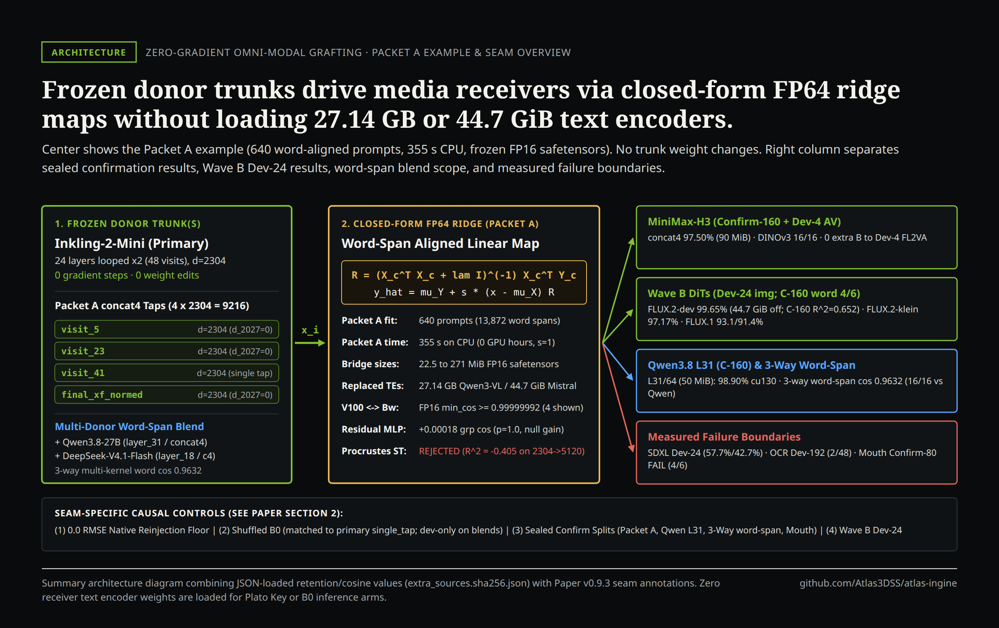
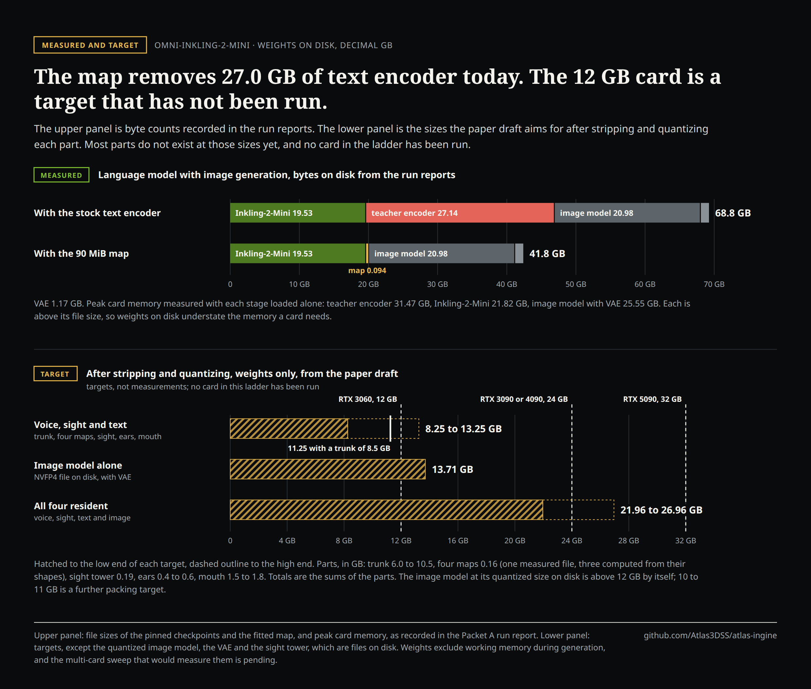
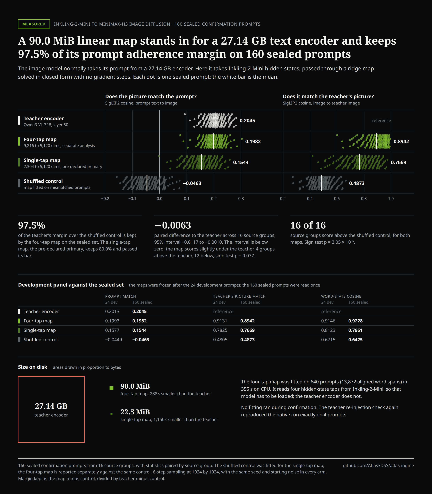
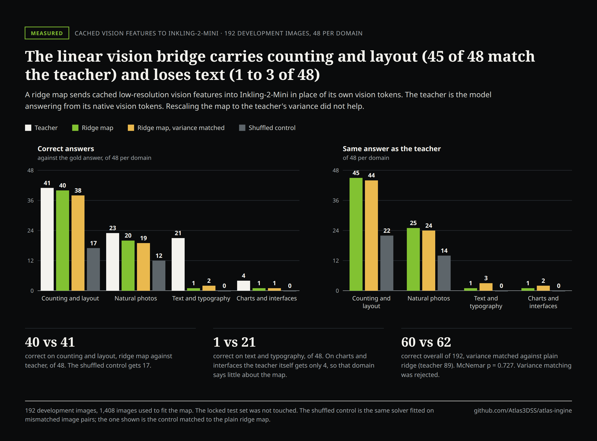
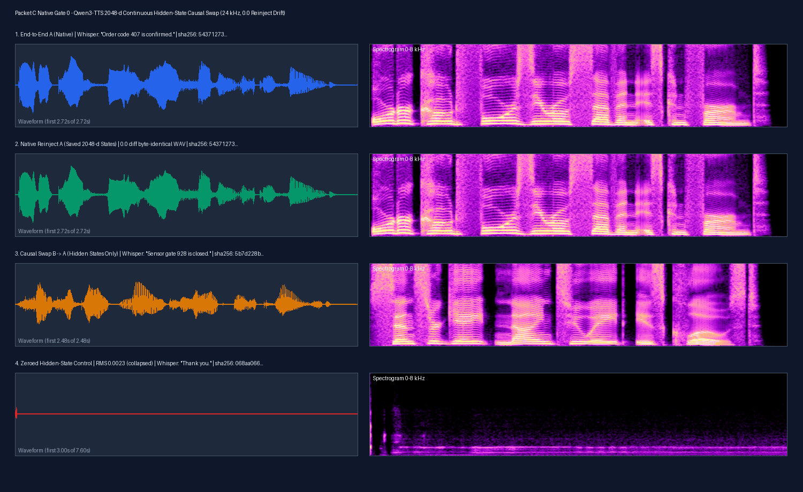
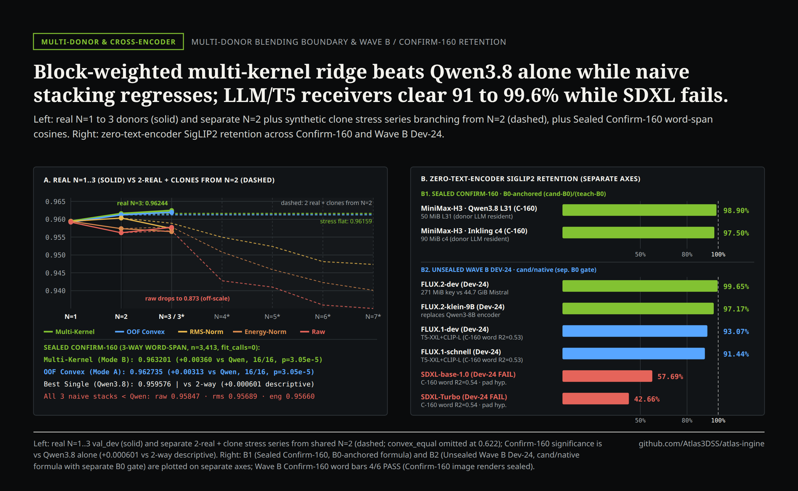
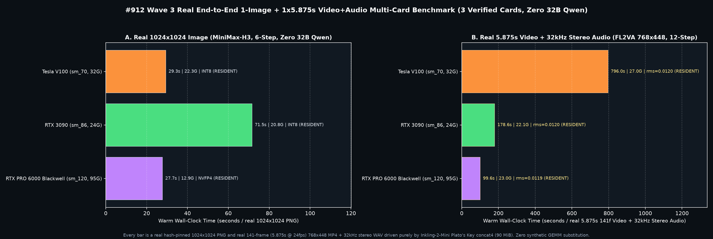

# Shot-by-Shot Technical Walkthrough: Zero-Gradient Omni-Modal Grafting

A step-by-step engineering guide to how one frozen language model (`Inkling-2-Mini`) drives image diffusion, native video+audio diffusion, prosodic speech control, and multi-donor representation blends without loading a `27.14 GB` `Qwen3-VL-32B` or `44.7 GiB` `Mistral-Small-3.1-24B` text encoder and without running gradient updates on the trunk.

Every contact sheet, spectrogram, and chart below was produced by the system or generated from pinned run reports (see Shot 6 for local regeneration requirements). Every claim cites its confirmation scope or clean negative boundary. For all 18 full-resolution side-by-side image comparisons (Wave A, Wave B, multi-donor Confirm-160, SDXL negative controls, and 360° turnaround), see **[COMPARISONS.md](COMPARISONS.md)**; for our live Pliny-style adversarial red-team & Neuron Lens proof, see **[HOST_ENFORCED_ALIGNMENT.md](HOST_ENFORCED_ALIGNMENT.md)**; for downloadable `.safetensors` Plato's Keys, see **[Omni by Atlas on Hugging Face](https://huggingface.co/collections/Atlas3D/omni-by-atlas-6b09daccd0f65e23233163b3)**.

---

## Shot 0: What Runs in Memory (and Why Prompt-Wrapper Harnesses Cannot Do This)

A prompt-wrapper harness sends text strings over HTTP from an LLM to a separate media server that still loads a `27.14 GB` to `44.7 GiB` text encoder (`Qwen3-VL-32B`, `Mistral-Small-3.1-24B`, or `T5-XXL`). That design runs two separate language models on every prompt and leaves the media engine blind to the donor model's internal hidden states.

Zero-gradient omni-modal grafting removes the receiver text encoder and replaces it with one closed-form FP64 ridge matrix (`22.5 MiB` to `271 MiB` stored in FP16 safetensors). At inference time, `zero_qwen_loaded = true` (Packet A) and `transformers_imported = false` (Wave B loaders) on the diffusion worker: only the projected conditioning tensor and the diffusion/VAE decoder run during generation.



Exact measured footprint from Packet A run reports (Figure 3) and Appendix A.1:
- **Packet A `int8_convrot` disk footprint (Figure 3):** Stock stack (`Inkling-2-Mini` NVFP4 + `27.14 GB` `Qwen3-VL-32B` + `MiniMax-H3` `int8_convrot` DiT + VAE) = **`68.8 GB`** on disk (`31.47 GB` peak VRAM for the teacher encoder alone). Grafted stack (`Inkling-2-Mini` NVFP4 + `90.0 MiB` `concat4` ridge map + `MiniMax-H3` `int8_convrot` DiT + VAE) = **`41.8 GB`** on disk (**`27.0 GB`** eliminated, `0` trunk weight edits). Separately, the quantized `MiniMax-H3` **NVFP4** image DiT + FP16 VAE measures `13.71 GB` on disk (`12.54 GB` DiT + `1.17 GB` VAE, Appendix A.5).
- **Consumer 16 GB execution (Wave 3 verified, Appendix A.1):** Using saved conditioning tensors with **`int8_convrot` + `comfy_lowvram_block_offload`**, real `1024×1024` image + `5.875 s` native `FL2VA` video+audio warm DiT+VAE generation runs inside `11.74–11.96 GiB` PyTorch peak CUDA allocated (`12.51–12.73 GiB` peak CUDA reserved) on `RTX 5070 Ti`, `RTX 4070 Ti SUPER`, and `RTX 4080` (separate from donor trunk residency; `nvfp4` image DiT `12.54 GB` was timed on `RTX PRO 6000`).



---

## Shot 1: How One Closed-Form FP64 Solve Replaces Fine-Tuning (Packet A Example)

### Step 1.1 — Extract Paired Word-Span Activations (`640` Prompts)
Packet A uses a frozen dataset of `640` fit prompts (`13,872` whitespace-delimited word spans across `8` visual domains: architecture, art styles, lighting, landscapes, objects/materials, portraits, spatial counting, and typography), `160` `val_dev` prompts, and `160` sealed `confirm_reserve` prompts across `16` disjoint source groups (`fit_calls = 0`).

1. Run the **frozen donor** (`Inkling-2-Mini`, `24` layers looped twice to `48` visits, `d = 2304`) over each prompt and record four internal layer taps (`visit_5`, `visit_23`, `visit_41`, `final_xf_normed` → `9216`-dim `concat4`, zero-masking the sink coordinate `d_2027`).
2. Run the **receiver's native teacher encoder** (`Qwen3-VL-32B` layer 50, `d = 5120`) once offline on those same `640` prompts to collect target conditioning matrices $Y$.
3. Because the donor and teacher use different tokenizers, align subword pieces over exact character offsets for each whitespace word and mean-pool overlapping tokens in FP64.

### Step 1.2 — Solve One Deterministic Linear System on CPU (`355 s`, `0` GPU Hours)
Center $X_c = X - \mu_X$ and $Y_c = Y - \mu_Y$ using fit-split means only, select regularization $\lambda$ strictly on a group-disjoint inner holdout inside `fit`, and solve once in FP64:

$$R = (X_c^\top X_c + \lambda I)^{-1} X_c^\top Y_c, \qquad \hat{y}_i = \mu_Y + s \cdot (x_i - \mu_X) R$$

where fit-only variance-matching scale $s = \|Y_c\|_F / \|\hat{Y}_c\|_F$ is disabled ($s = 1$, `norm_variance = False`) for Packet A `concat4` because inner validation rejected rescaling. When $d_{\text{donor}} > N$, switch to the exact Dual Woodbury identity $R = X_c^\top (X_c X_c^\top + \lambda I)^{-1} Y_c$. Freeze `(R, mu_X, mu_Y, s)` into an FP16 safetensors file pinned by SHA-256.

### Step 1.3 — Why Not Orthogonal Procrustes or a Nonlinear MLP?
Both alternatives were tested directly on the exact same `640` Packet A fit prompts (`13,872` word spans) and inner fold:
- **Single-tap Orthogonal Procrustes rejected (`2304 → 5120`):** On the `single_tap` (`visit_41`) `2304 → 5120` problem, Orthogonal Procrustes with variance matching scored **`R² = -0.405`** (`cos = 0.575`) vs regularized single-tap ridge **`R² = 0.9948`** (`cos = 0.809`). Rectangular cross-architecture transfer requires non-orthogonal shrinkage (multi-tap `concat4` `9216 → 5120` then pushes word `R²` to `0.9982`).
- **Matched 2-layer GELU MLP yields no statistically detectable grouped cosine gain:** Adding a `29.4M`-parameter nonlinear residual MLP on top of closed-form `concat4` ridge (`76.56M` total params, `1.62×` size) shifted equal-group (`G = 16`) `confirm_reserve` word cosine by **`+0.00018`** (`8/16` groups higher, `p = 1.0`). A scratch 2-layer MLP trained for 40 epochs aligned direction (`cos = 0.926`) but left `49.5%` of target variance unexplained (`R² = 0.505`, `MSE = 983.3` vs `3.54` for ridge) because anisotropic LLM hidden states (`RMS ≈ 47`) resist first-order amplitude convergence.
- **Cross-silicon numerical stability (Wave B 24/24 verified):** Evaluating frozen FP16 keys on `Volta V100 (sm_70)` vs `Blackwell RTX PRO 6000 (sm_120)` matches to **`FP16 min_cos >= 0.99999992`** (lowest observed `0.9999999259` on `FLUX.2-dev`) across all four Wave B targets shown (`FLUX.2-dev`, `FLUX.2-klein-9B`, `FLUX.1-dev/schnell`, `SDXL`).

---

## Shot 2: Same Seed, Zero Text Encoder — Sealed Confirm-160 & Wave B Visual Proofs

Every image experiment enforces seam-specific causal controls before any score is accepted:
1. **Zero-drift native reinjection floor:** Export the native teacher tensor, save to disk, reload, and run the DiT. All `24/24` diffusion steps must hit `0.0` RMSE and `4/4` byte-identical PNGs.
2. **Shuffled control (`B0`):** Fit the same ridge solver on prompt-deranged pairs (dimension-matched to the primary `single_tap` arm in Packet A and `Qwen3.8`; development-only on multi-donor blends).
3. **Identical seed and initial noise:** Every row across columns shares the exact same `dit_seed` and `initial_noise_sha256`.

### 2.1 — `Inkling-2-Mini` (`90.0 MiB`) Replacing `Qwen3-VL-32B` (`27.14 GB`) on `MiniMax-H3` (Sealed Confirm-160)
On the sealed `160`-prompt confirmation split (`640` `1024×1024` images, `16` disjoint groups, `fit_calls = 0`):
- **Teacher (`27.14 GB`):** SigLIP2 `0.2045`
- **`Inkling concat4` (`90.0 MiB`, separate analysis):** SigLIP2 **`0.1982`** (**`97.50%`** margin retention vs ST `B0` ref; delta `-0.0063`, 95% CI `[-0.0117, -0.0010]`; image-vs-teacher cosine **`0.8942`**; `3,413`-word cosine **`0.9228`**, `R² = 0.9982`)
- **`Inkling single_tap` (`22.5 MiB`, primary):** SigLIP2 **`0.1544`** (`80.02%` matched margin retention, **`16/16`** groups vs matched `B0`, `p = 3.05e-5`)
- **Matched Shuffled `B0` (`22.5 MiB`):** SigLIP2 `-0.0463` (semantic collapse)

Columns left to right: **`teacher_reinject` (27.14 GB)** · **`single_tap` (22.5 MiB)** · **`concat4` (90.0 MiB)** · **`B0` shuffled control (22.5 MiB)**.


### 2.2 — Orthogonal Audit (`DINOv3-ViT-L/16`)
To verify the image-to-teacher similarity ordering is not an artifact of evaluating only with `SigLIP2`, all `640` sealed PNGs were scored with self-supervised **`DINOv3-ViT-L/16`** (trained without text pairs). Across all `16/16` groups (`p = 3.05e-5`), `concat4` beat both `single_tap` and `B0`:
- **Global CLS cosine vs teacher:** `concat4` **`0.7599`** vs `single_tap` `0.4871` vs `B0` `0.0309`
- **Mean-patch cosine vs teacher:** `concat4` **`0.8697`** vs `single_tap` `0.7026` vs `B0` `0.1936`
- **Positional spatial-patch cosine vs teacher:** `concat4` **`0.6910`** vs `single_tap` `0.5285` vs `B0` `0.1729`



### 2.3 — Middle-Layer Conditioning Sufficiency (`Qwen3.8-27B` `layer_31 / 64`, `50.02 MiB`, Sealed Confirm-160)
In a controlled `PRO 6000` `cu130` Confirm-160 replay (`160/160` teacher tensors matching Packet A identically at `0.204513`, `0` refits), activations through **`layer_31 / 64`** alone (`50.02 MiB`) sufficed to pass **`16/16`** groups vs matched `B0` (`p = 3.05e-5`) and retain **`98.90%`** of the teacher-minus-`B0` margin (`0.201639` vs `0.204513` teacher, `0.91783` image-vs-teacher cosine; end-to-end early-exit prefill speedup was not timed).


### 2.4 — Replacing `44.7 GiB` `Mistral-Small-3.1-24B` (`FLUX.2-dev`, Wave B Dev-24)
Across other diffusion families on **Wave B Dev-24** (`16` groups, zero receiver text encoder loaded; Wave B `confirm160` remains `0/160` sealed; retention defined as `candidate_group_margin / native_group_margin` with a separate `B0` sign-test gate, distinct from `MiniMax-H3`'s `(candidate - B0)/(teacher - B0)`), a `271.0 MiB` Inkling Plato's Key on `black-forest-labs/FLUX.2-dev` reached **`99.65%` native SigLIP2 retention** (`0.271135 / 0.272101`, vs `-0.0028` `B0`, `16/16` groups, `p = 3.05e-5`), alongside `FLUX.2-klein-9B` (`97.17%`), `FLUX.1-dev` (`93.07%`), and `FLUX.1-schnell` (`91.44%`).


---

## Shot 3: Why This Is Real Engineering — Four Honest Failure Boundaries

Every failure mode discovered in this project was preserved unmodified in the log and separated clearly from passing tracks.

### Boundary 1 — `SDXL` Failure on Wave B Dev-24 (`57.69%` / `42.66%` FAIL)
While LLM/T5-conditioned DiTs (`FLUX.2-dev`, `MiniMax-H3`, `FLUX.2-klein-9B`, `FLUX.1`) cleared `91.4%–99.65%` retention, **`SDXL-base-1.0` (`57.69%`)** and **`SDXL-Turbo` (`42.66%`)** failed Dev-24 parity cleanly. Contact sheets show scene/mood transfer with subject loss.
- **Working hypothesis (no isolated ablation yet):** `PlatosKeyConditioning` zero-pads `fixed_77` positions beyond the prompt length whereas SDXL's unmasked UNet cross-attention receives non-zero causal `CLIP-L <|endoftext|>` pad vectors in native runs, alongside contrastive dual-CLIP vs autoregressive LLM geometry.


### Boundary 2 — Vision → LLM Spatial Frequency Loss (`OCR 2/48` vs `Counting 45/48`)
Grafting coarse visual embeddings into `Inkling-2-Mini`'s `EmbedRows` input boundary preserved spatial counting (`45/48` teacher agree, `40/48` gold) while collapsing on dense OCR (`1–3/48`) and UI charts (`1–2/48`). Variance rescaling (`ridge_norm`) was rejected (`p = 0.727`). Upgrading to stripped high-resolution vision towers (`GOT-OCR2` `191 MB` + `SigLIP2-NaFlex` `343 MB`, `arm3a`) raised overall Dev-192 agreement (`64 → 81/192`, `p = 7.63e-5`), `natural_photos` (`24 → 33/48`), and `charts_ui` (`1 → 8/48`), yet cleared only `2/5` dev bars and left dense OCR near zero (`2/48` agree, `0/48` gold; `448`-item test remains sealed).



### Boundary 3 — Speech Synthesis: Prosody Transfers Linearly, Exact Lexemes Do Not
Inside `Qwen3-TTS-12Hz-1.7B`, replacing the continuous `text_projection` tensor directly proves the causal seam (`0.0` RMSE reinjection; swapping `B → A` shifts Whisper verbatim from `"Order code 407 is confirmed."` to `"Sensor gate 928 is closed."`):



*Playable 24 kHz audio proof card:* [samples/mouth_gate0_causal_swap.mp4](samples/mouth_gate0_causal_swap.mp4) (`mouth_e2e_A.wav` · `mouth_swap_B_into_A.wav` · `mouth_zero_A.wav`).

Fitting a direct linear ridge map from donor hidden states to `text_projection` exposed a clean split:
- **Direct hidden-only Mouth (`val_dev`):** Speaking style transferred (`27/32` Inkling, `25/32` Qwen3.8), while contrastive lexical identity collapsed (`0/32` Inkling, `2/32` Qwen3.8).
- **Factorized Hybrid Mouth (`M_explicit_lexical_plus_hidden`):** Supplying discrete LLM words directly to the TTS receiver while projecting style linearly cleared `6/6` amended `val_dev` gates (`28/32` style, `32/32` blind human audibility), then **failed one-shot Sealed Confirm-80 (`4/6` amended gates, zero retuning)**: lexical preservation (`29/32`), exact roundtrip (`2/2`), silence gating (`0/16` gated FP), urgency (`8/8`), and pace (`8/8`) passed, while rising-vs-falling intonation reversed (`0/8` under the frozen acoustic scorer), pulling overall style to `21/32` vs `11/32` swapped (`p = 0.1102`).

### Boundary 4 — Cross-Host Tensor Divergence Caught by Forensic Audit
An earlier Vast `cu128` run of `Qwen3.8 layer_31` yielded within-Vast `101.55%` margin retention (`0.20234` vs `0.19838` Vast teacher). Auditing all `160` saved teacher conditioning tensors against our local `PRO 6000` `cu130` replay (`0.204513`, matching Packet A `160/160`) localized a pre-render divergence: first nonzero BF16 differences occur at token `0` (`153` prompts) or `1` (`7` prompts), `12` short prompts stay within `max_abs <= 0.03125`, and zero-based token index `24` is the first token with `max_abs > 0.125` across all `148/148` long prompts (smallest index-24 maximum **`12.46875`**; backend attribution remains unresolved). We retracted the cross-host superiority claim, preserved the historical within-Vast `101.55%` separately, and established controlled `cu130` retention at **`98.90%`** (`6/16` groups above teacher, `p = 0.4545`).

---

## Shot 4: Multi-Donor Blending (`N = 1 → 2 → 3`) and Why Unweighted Stacking Regresses

Combining hidden states from multiple distinct LLM families (`Qwen3.8-27B` + `Inkling-2-Mini` + `DeepSeek-V4.1-Flash`) on `val_dev` and Sealed Confirm-160 word-span alignment (`n = 3,413`, `fit_calls = 0`, `B0` dev-only) shows that **unweighted and RMS/energy-normalized concatenation ridge regress as donors are added**:

- **Collapsing unweighted/normed controls (`val_dev` real `N = 1..3` & separate `2`-real + clone stress series branching from `N = 2`):** `convex_equal` drops to `0.622`, `stacked_raw` drops to `0.873`, `stacked_energy_norm` drops to `0.940`, and `stacked_rms_norm` peaks at `N = 2` (`0.96033`) then regresses at real `N = 3` (`0.95739`).
- **Block-weighted multi-kernel & OOF convex solvers:**
  - **Mode B `stacked_multikernel_concat4`:** climbs `0.95944 → 0.96159 → 0.96244` on real `val_dev` `N = 1..3` (and holds flat at `0.96159` under the separate `N = 2` clone stress series), hitting **`0.963201`** on **Sealed Confirm-160** (`R² = 0.999293`, **`+0.003602`** vs `Qwen3.8` alone, **`16/16` groups & `8/8` domains**, `p = 3.052e-5`; `typography_signage +0.00794`; `+0.000601` vs prior 2-way `0.962601` is descriptive only, not paired to 2-way).
  - **Mode A `convex_mse_opt` (5-fold OOF convex weights):** hits **`0.962735`** on **Sealed Confirm-160** (`+0.003126` vs `Qwen3.8` alone, **`16/16` & `8/8`**, `p = 3.052e-5`).
  - **Mode C Cross-LLM Hubs (Confirm-160 word-span):** Routing `Qwen3.8 → DeepSeek-V4.1(layer_18) → H3` reaches **`0.93357`** (`+0.1117` above DeepSeek's direct `0.82190`), and `Qwen3.8 → Inkling → H3` reaches **`0.93407`** (`+0.01125` above Inkling direct).



---

## Shot 5: Zero-Extra-Byte Video+Audio Across Nine Verified GPUs (`Volta → Blackwell`)

Because `MiniMax-H3`'s native video+audio diffusion model (`FL2VA`, `24 fps` video + `32 kHz` stereo audio) reads the exact same `5120`-dim conditioning space as its image DiT, the frozen `90.0 MiB` `concat4` key transfers at **zero extra bytes and zero refits** (Dev-4 functional check; expanded Dev-24 `FL2VA` in flight).

Real measured warm DiT+VAE wall-clock timings from saved conditioning across **9 verified GPUs spanning 4 NVIDIA generations** (`Volta sm_70`, `Ampere sm_86`, `Ada sm_89`, `Blackwell sm_120`, Appendix A.1):
- **Workstation / Datacenter:** `RTX PRO 6000` (`27.7 s` NVFP4 img / `99.6 s` 5.875s AV), `L40S` (`9.7 s` / `145.7 s`), `RTX PRO 4500` (`12.9 s` / `168.6 s`), `RTX PRO 4000` (`12.6 s` / `239.3 s`), `V100` (`29.3 s` / `796.0 s`).
- **Consumer 16–24 GB Cards (`int8_convrot` + `lowvram` on 16 GB cards):** `RTX 3090` (`71.5 s` / `178.6 s`), `RTX 5070 Ti` (`15.47 GiB`, `11.8 s` / `191.9 s`, `11.74 GiB` peak CUDA alloc), `RTX 4070 Ti SUPER` (`15.57 GiB`, `19.8 s` / `234.3 s`, `11.85 GiB` alloc), `RTX 4080` (`15.57 GiB`, `13.4 s` / `239.5 s`, `11.96 GiB` alloc).



---

## Shot 6: Reproducing and Auditing Figures Locally

Regenerating the SVG/PNG figures requires the pinned local run JSON reports (verified against `figures/sources.sha256.json` and `figures/extra_sources.sha256.json`), local Noto fonts (`NotoSans` / `NotoSerif`), and headless Chromium (`chrome-headless-shell`; omit PNG rasterization with `--no-png`):

```bash
# 1. Regenerate core publication figures (fig1, fig2, fig3) from pinned Packet A/B/strip JSONs
python3 modules/zero_gradient_omni_modal_grafting/figures/build_figures.py

# 2. Regenerate architecture + multi-donor/cross-encoder figures (fig0, fig4) from 7 pinned JSONs
python3 modules/zero_gradient_omni_modal_grafting/figures/build_extra_figures.py

# 3. Inspect full append-only provenance ledger & cryptographic pins
cat modules/zero_gradient_omni_modal_grafting/PROCESS_LOG.md
```

For full statistical tables, confidence intervals, related work, and exact artifact SHA-256 pins, see **[PAPER.md](PAPER.md)** and **[PROCESS_LOG.md](PROCESS_LOG.md)**.
