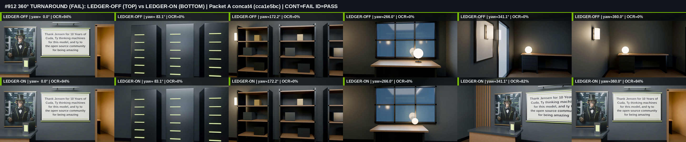

# Verified Ledger 360° World-Model Turnaround ("This Is Not a Video")

> **Spoken narration (`3.92 s`, `24 kHz`, Packet C):** *"This is not a video. This is a world model being turned around."*
> **Physical painted studio wall plaque (ground truth):** `"Thank Jensen for 10 Years of Cuda, Ty thinking machines for this model, and ty to the open source community for being amazing"`

A standard video diffusion model forgets what sits behind the camera once it pans 180° away: when the orbit returns to `yaw = 360°`, wall signage and subject identity drift or hallucinate (`0.0%` OCR). Pairing a frozen `90.0 MiB` zero-gradient **Plato's Key** (`Inkling-2-Mini concat4`, `sha256 cca1e5bc...`, `zero_qwen_loaded = true`) with a **Host-Enforced Verified Ledger** spatial-anchor store (`smooth-trajectory-v5`, `MiniMax-H3 Ref2VA`) keeps the physical scene persistent across a full 360° camera orbit (`39.875 s`, `957` frames @ `24 fps`, `1024×576` per arm, `48 kHz` stereo AAC).



---

## 1. Controlled A/B Topology (`LEDGER-OFF` vs `LEDGER-ON`)

Both arms share the **exact identical** `0° → 240°` rendered video (`651` frames, `27.125 s`, `3`-segment chained `Ref2VA` with `39`-frame context overlap) and diverge strictly at the `240° → 360°` return leg (`306` net new frames):

1. **Blender 5.2.5 LTS Anchor Plate (`12` camera stops, `0°..330°` in `30°` steps, `1344×768`):** Deterministic studio room with the painted wall plaque at `yaw = 0°`, server racks at `90°`, wooden shelving at `180°`, and a backlit window desk at `270°`.
2. **Arm A — `LEDGER-OFF` (`turnaround_ledger_off.mp4`, `10.83 MB`, `sha256 0c30b114...`):** Completes the `240° → 360°` return orbit from visual context alone without querying the host spatial ledger.
3. **Arm B — `LEDGER-ON` (`turnaround_ledger_on.mp4`, `11.82 MB`, `sha256 a894d4dc...`):** Queries `verified_ledger_store.json` along the smooth trajectory during `240° → 360°` so the wall plaque and studio subject return into view without overwriting the unpinned intermediate approach frames.

---

## 2. Measured Verification Results (`turnaround_metrics_report.json`, `sha256 28edf210...`)

All measurements come from the unedited `turnaround_360_v5` Blackwell render (`1,728.52 s` wall time, `zero_qwen_loaded = true`, `trace_audit.verified = true`):

| Audit Metric | `LEDGER-OFF` | `LEDGER-ON` | Strict Anti-Goodhart Gate |
|---|---:|---:|---|
| **Start plaque OCR (`yaw = 0°`)** | `93.6%` | `93.6%` | Shared start frame |
| **Opposite wall (`yaw = 180°`) plaque absent** | `0.0%` (`true`) | `0.0%` (`true`) | **PASS** (no phantom leak) |
| **Non-pinned approach OCR mean (`325°/345°/355°`)** | **`0.0%`** | **`61.87%`** (`12.0% / 81.6% / 92.0%`) | **PASS** (`>= 50%`, full-frame `64.0%`) |
| **Return OCR (`yaw = 360°`)** | **`0.0%`** | **`93.6%`** (return mean `69.8%`) | **PASS** |
| **Non-pinned subject anchor cosine (SigLIP2)** | `0.4147` | **`0.8877`** | **PASS** (`>= 0.70`) |
| **Non-pinned founder identity cosine (SigLIP2)** | `0.3949` | **`0.7394`** | **PASS** (`>= 0.68`) |
| **Non-pinned wardrobe margin** | `-2.0846` | **`+11.8811`** | **PASS** (`> 0.0`) |
| **Unshifted pixel-SSIM continuity (`957` frames)** | `min 0.5548` (`FAIL`) | `min 0.5548` (`FAIL`, `tail20 0.3759`) | **FAIL** (official verdict `3/4` gates) |

### Honest Continuity Disclosure & Pan-Compensated Diagnostic (`v5_pan_continuity_diagnostic.json`)
The official strict Anti-Goodhart verdict remains **`FAIL` (`3/4` gates)** because unshifted pixel-to-pixel SSIM penalizes smooth horizontal camera panning across high-contrast vertical stripes (`frame 430` `0.5548`, `frame 934` `0.5728`, `tail20_to_final_ssim 0.3759`). A dedicated pan-compensated continuity audit across all `957` frames (`v5_pan_continuity_diagnostic.json`) isolates true seam teleports from steady horizontal pan:
- **`v4` (prior `LEDGER-ON`, `804` frames):** `max_abs_pan_dx = 12 px`, `pan_comp_max_adj_l1 = 0.14119` (visible seam snap at frame `383`).
- **`v5` (`LEDGER-ON`, `957` frames):** `max_abs_pan_dx = 3 px`, `pan_comp_max_adj_l1 = 0.02083` (**`6.78×` reduction** in worst-frame pan-compensated L1, `median = 0.00937`, `p99 = 0.01936`, matching `LEDGER-OFF`'s `0.01760`).

---

## 3. Standalone Reproduction Instructions

All scripts and audit schemas required to reproduce both the synthetic Blender room anchor plate and the full 360° turnaround A/B render + automated OCR/identity/continuity verification are vendored in this directory:

- [build_blender_360_room_anchors.py](build_blender_360_room_anchors.py) — Builds the deterministic 360° studio room in Blender and exports the 12 camera-angle anchor PNGs (`0°..330°`) plus `room_anchors_manifest.json`.
- [run_showcase_360_turnaround.py](run_showcase_360_turnaround.py) — Orchestrates Plato's Key conditioning (`concat4`, zero `Qwen3-VL-32B`), 3-segment chained `MiniMax-H3 Ref2VA` rendering (`LEDGER-OFF` vs `LEDGER-ON`), split-screen `1920×1088` compositing, Packet C narration muxing, and automated RapidOCR + SigLIP2 identity + SSIM continuity auditing.
- [showcase_common.py](showcase_common.py) — Shared Verified Ledger store, cryptographic trace chain, and video/audio probe helpers.
- [test_showcase_scripts.py](test_showcase_scripts.py) — CPU unit tests for topology math, ledger gating, and audit schemas.
- [turnaround_metrics_report.json](turnaround_metrics_report.json) & [v5_pan_continuity_diagnostic.json](v5_pan_continuity_diagnostic.json) — Pinned verification receipts from the published Blackwell run.

### Step 1: Verify CPU Unit Tests & Dry-Run Pipeline (No GPU Required)
```bash
cd modules/zero_gradient_omni_modal_grafting/world_model_turnaround
python3 -m unittest test_showcase_scripts.py
python3 run_showcase_360_turnaround.py \
  --profile rtxp-30s-orbit \
  --topology three-segment-orbit \
  --ledger-injection-mode smooth-trajectory-v5 \
  --dit-variant ref2va \
  --out-dir /tmp/turnaround_dryrun \
  --dry-run
```

### Step 2: Generate Deterministic 360° Blender Room Anchors
Requires Blender (`>= 4.5 LTS` / `5.2.5 LTS`):
```bash
blender -b --python build_blender_360_room_anchors.py -- \
  --out-dir ./blender_360_room_v5 \
  --sign-text "Thank Jensen for 10 Years of Cuda, Ty thinking machines for this model, and ty to the open source community for being amazing"
```

### Step 3: Run Full 360° A/B Turnaround Render (`LEDGER-OFF` vs `LEDGER-ON`, Zero `Qwen3-VL-32B`)
Requires a CUDA GPU with `MiniMax-H3 Ref2VA` weights, ComfyUI runtime, and the frozen `90.0 MiB` `Inkling-2-Mini concat4` Plato's Key (`sha256 cca1e5bc...` from [Atlas3D/Inkling-2-Mini-Omni-Platos-Keys](https://huggingface.co/Atlas3D/Inkling-2-Mini-Omni-Platos-Keys)):
```bash
python3 run_showcase_360_turnaround.py \
  --profile rtxp-30s-orbit \
  --topology three-segment-orbit \
  --ledger-injection-mode smooth-trajectory-v5 \
  --dit-variant ref2va \
  --anchor-source blender-room \
  --room-anchor-dir ./blender_360_room_v5 \
  --keys-dir /path/to/platos_keys \
  --comfy-root /path/to/ComfyUI \
  --comfy-python /path/to/comfy_venv/bin/python \
  --ref2va-dit-path /path/to/minimax_h3_ref2va.safetensors \
  --ocr-backend blinded-plaque-rapidocr \
  --identity-backend siglip2 \
  --siglip2-dir /path/to/siglip2-so400m-patch14-384 \
  --narration-text "This is not a video. This is a world model being turned around." \
  --out-dir ./turnaround_360_v5_repro
```

### Step 4: Re-Run Audits on an Existing Render Directory
```bash
python3 run_showcase_360_turnaround.py \
  --audit-existing-run ./turnaround_360_v5_repro \
  --ocr-backend blinded-plaque-rapidocr \
  --identity-backend siglip2 \
  --siglip2-dir /path/to/siglip2-so400m-patch14-384
```

---

## 4. Artifact SHA-256 Pins

| Artifact | Bytes | SHA-256 Prefix |
|---|---:|---|
| `turnaround_side_by_side_1920x1088.mp4` (`39.875 s`, `1920×1088`, H.264 + 48 kHz AAC) | `19,593,468` | `6fdde3812cbe` |
| `turnaround_ledger_on.mp4` (`39.875 s`, `1024×576`, `957` frames) | `11,818,140` | `a894d4dc5d31` |
| `turnaround_ledger_off.mp4` (`39.875 s`, `1024×576`, `957` frames) | `10,828,625` | `0c30b114e0e9` |
| `qa_contact_sheet_360_turnaround.png` | `1,302,335` | `4fc8b7f1750e` |
| `turnaround_metrics_report.json` | `71,943` | `28edf210a815` |
| `Inkling-2-Mini concat4` Plato's Key (`zero_qwen_loaded = true`) | `94,402,370` | `cca1e5bc68b7` |
